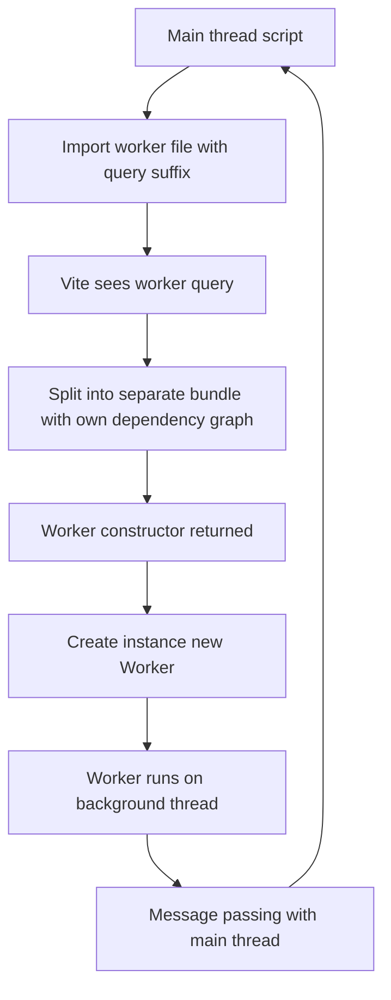

# Worker Imports and Web Workers: Offloading Work Without Blocking the UI

## English

JavaScript runs on a single thread per browsing context, so a long computation freezes the page: clicks do nothing, animations stutter, the tab feels dead. Web Workers solve this by running script in a separate background thread that communicates with the main thread through message passing. Vite supports workers directly, and the syntax is refreshingly simple: import MyWorker from './worker.js?worker' gives you a constructor, and you create an instance with new MyWorker(). The query suffix tells Vite to treat the file as a worker entry rather than a normal module, so it gets bundled separately with its own dependency graph.

Why the special syntax? A worker is a separate execution context. It cannot share variables with the main thread, and it needs its own bundle containing everything it imports. If Vite treated the file as an ordinary module, the bundler would merge it into the main chunk and the worker would never actually be a worker. The ?worker query is Vite's signal to split it out. There is also ?worker&inline, which embeds the worker as a base64 blob inside the main bundle, useful for tiny workers where an extra network request costs more than the bytes saved.

A related feature is ?sharedworker, which produces a SharedWorker instead. Unlike a regular worker, a shared worker can be connected to by multiple tabs or iframes from the same origin, making it a natural place for state that should survive navigation, such as a websocket connection or a cache. The same bundling logic applies: the file becomes its own entry so it can run in the shared worker context. Note that shared workers have their own port-based messaging model, so the code on both sides differs from a dedicated worker.

In development, Vite serves workers as native ES modules, which means you get hot module replacement inside the worker file too, a feature many bundlers lack. In production, the worker is emitted as a separate chunk with a hashed name, and the import resolves to a small wrapper that constructs the worker from the correct URL. This works whether the worker is classic or module type, though module workers require a modern browser, so check your browser targets if you support older clients.

Practical advice: workers are ideal for parsing large files, running compression, doing heavy math, or any CPU-bound loop that would otherwise jank the interface. They are not a free lunch: data crossing the boundary is copied unless you use transferable objects such as ArrayBuffer, and workers cannot touch the DOM. A good pattern is to keep the worker's message protocol small and typed, pass big buffers as transferables, and let the main thread stay responsive. Vite's import syntax makes the bundling part painless; the design work of deciding what belongs off the main thread is still yours.

## 中文

JavaScript 在每個瀏覽情境中只跑單一執行緒，所以一段長時間的運算會凍結頁面：點擊沒反應、動畫卡頓、分頁像死了一樣。Web Worker 透過在獨立背景執行緒中執行程式碼來解決這個問題，並以訊息傳遞與主執行緒溝通。Vite 直接支援 worker，語法簡單得令人耳目一新：import MyWorker from './worker.js?worker' 會給你一個建構子，你用 new MyWorker() 建立實例。查詢後綴告訴 Vite 把該檔案當作 worker 入口，而不是普通模組，因此它會以自己的依賴圖單獨打包。

為什麼需要特殊語法？worker 是獨立的執行環境。它不能與主執行緒共用變數，而且需要自己的 bundle，包含它匯入的一切。如果 Vite 把該檔案當成普通模組，打包器就會把它併進主 chunk，worker 就根本不會是 worker。?worker 查詢就是 Vite 把它切分出來的訊號。另外還有 ?worker&inline，會把 worker 以 base64 blob 內嵌進主 bundle，適合極小的 worker，因為額外一次網路請求比省下的位元組更貴。

相關功能是 ?sharedworker，會產生 SharedWorker。與一般 worker 不同，shared worker 可以讓同源的多個分頁或 iframe 連線，因此很適合放需要跨頁面存活的狀態，例如 websocket 連線或快取。打包邏輯相同：該檔案成為自己的入口，以便在 shared worker 環境中執行。注意 shared worker 有自己的 port 式訊息模型，所以兩邊的程式碼與專用 worker 不同。

在開發期間，Vite 把 worker 當作原生 ES 模組提供，這意味著你在 worker 檔案裡也能享受熱模組替換，這是許多打包器沒有的功能。在生產環境，worker 會以帶雜湊名稱的獨立 chunk 輸出，而匯入會解析成一個小包裝，從正確的 URL 建構 worker。無論 worker 是傳統型還是模組型都能運作，不過模組型 worker 需要較新的瀏覽器，若你支援較舊的客戶端，請檢查瀏覽器目標。

實用建議：worker 很適合解析大檔案、執行壓縮、做繁重數學運算，或任何會讓介面卡頓的 CPU 密集迴圈。它不是免費的午餐：跨越邊界的資料會被複製，除非你使用 ArrayBuffer 這類可轉移物件，而且 worker 不能碰 DOM。好的模式是讓 worker 的訊息協定保持小而具型別、把大緩衝區當作可轉移物件傳遞，並讓主執行緒保持靈敏。Vite 的匯入語法讓打包部分毫不費力；決定什麼該放到主執行緒之外，仍是你的設計工作。

## Key Takeaway

Vite's ?worker and ?sharedworker import suffixes bundle a file as a separate background thread so heavy work never blocks the UI.

## Related Concepts
- Web Workers API
- Transferable objects

## Diagram

