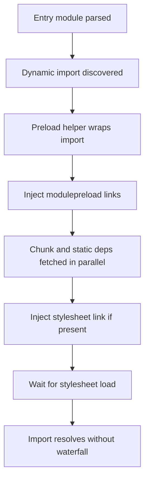

# The Preload Helper and Module Preloading: How Vite Avoids Network Waterfalls

## English

When you split a bundle into chunks, you create a new problem: the browser must discover each chunk before it can request it. Consider a page whose entry module does `import('./chart.js')`. The browser fetches the entry, parses it, sees the dynamic import, and only then starts a second round trip for `chart.js`. Each level of nesting adds a full network latency — a 'waterfall' that can make a chunked app feel slower than one big file, even though less total bytes are transferred. This is the classic argument for bundling, and Vite's answer is not to give up on chunks but to tell the browser about them in advance.

Vite's build emits a small runtime module commonly called the preload helper (historically `vite/preload-helper`, and in newer versions part of the generated runtime). Its job is to wrap dynamic imports so that before the actual `import()` resolves, it injects `<link rel="modulepreload">` tags into the document head for the chunk being loaded and for that chunk's own static dependencies. `modulepreload` is a standard hint: it tells the browser 'fetch and parse this module now, in parallel, at the right priority' rather than waiting to discover it through the import graph. The result is that a chain of dependencies is fetched concurrently instead of sequentially.

For static imports that end up in separate chunks, Vite's HTML output also includes `<link rel="modulepreload">` tags for the entry's direct dependencies, so the browser starts fetching them while it parses the entry. This is why viewing the page source of a Vite-built site often shows several preload links you never wrote. The helper also handles CSS: if a dynamically imported chunk has an associated stylesheet, Vite injects a `<link rel="stylesheet">` and waits for it to load before resolving the import, so your component never renders unstyled for a frame.

The helper is deliberately tiny and dependency-free, and it de-duplicates requests — if two dynamic imports need the same chunk, only one preload link is created. It also tracks which URLs have already been preloaded so repeated calls are cheap. You can disable or tune this behaviour with build options such as `build.modulePreload` (for example, setting `polyfill: false` when you know your targets support modulepreload natively, or adjusting `resolveDependencies` to control which dependencies get preloaded).

The practical lesson: chunk splitting is only a win if the browser can fetch chunks in parallel. If you ever hand-write a `import()` in a context where the preload helper is bypassed — say, inside a string evaluated at runtime, or in a script Vite does not transform — you reintroduce the waterfall. The takeaway is that Vite's performance story in production is not just 'the bundler made small files'; it is 'the bundler made small files and Vite taught the browser to fetch them all at once' (in Vite 8 the production bundler is Rolldown, the Rust successor to Rollup).

## 中文

當你將 bundle 拆成多個 chunk，就會產生一個新問題：瀏覽器必須先「發現」每個 chunk，才能發出請求。設想某個頁面的入口模組寫了 `import('./chart.js')`。瀏覽器先下載入口、解析它、看到動態 import，然後才展開第二趟來回去拿 `chart.js`。每多一層巢狀，就多一整個網路延遲——這種「瀑布式」載入，會令一個已分 chunk 的應用感覺比單一大檔案更慢，即使總位元組其實更少。這正是傳統支援打包的論據，而 Vite 的答案並非放棄 chunk，而是預先告知瀏覽器有哪些 chunk。

Vite 的建置會輸出一個細小的 runtime 模組，一般稱為 preload helper（歷史上叫 `vite/preload-helper`，較新版本則併入生成的 runtime）。它的工作是把動態 import 包起來：在真正的 `import()` 解析之前，先向 document head 注入 `<link rel="modulepreload">` 標籤，指向正在載入的 chunk 以及該 chunk 自身的靜態依賴。`modulepreload` 是一個標準提示：它叫瀏覽器「立即以合適的優先順序下載並解析這個模組」，而不是等到透過 import graph 才發現它。結果是一條依賴鏈可以並行下載，而非順序下載。

對於被分到獨立 chunk 的靜態 import，Vite 的 HTML 輸出亦會為入口的直接依賴加上 `<link rel="modulepreload">` 標籤，讓瀏覽器在解析入口的同時就開始下載它們。這就是為何檢視一個 Vite 建置網站的原始碼，經常會見到幾個你從未寫過的 preload link。這個 helper 亦處理 CSS：如果某個動態 import 的 chunk 有對應的樣式表，Vite 會注入 `<link rel="stylesheet">`，並等待它載入完成才解析該 import，這樣你的元件就永遠不會有一幀無樣式地渲染。

這個 helper 刻意保持細小、零依賴，並且會去重請求——如果兩個動態 import 需要同一個 chunk，就只會建立一條 preload link。它亦會記錄哪些 URL 已經 preload 過，所以重複呼叫成本很低。你可以用建置選項調整或停用這個行為，例如 `build.modulePreload`（例如當你確定目標瀏覽器原生支援 modulepreload 時設定 `polyfill: false`，或調整 `resolveDependencies` 去控制哪些依賴要 preload）。

實用的教訓是：chunk 拆分只有在瀏覽器能並行下載 chunk 時才是贏。如果你在某個 preload helper 被繞過的場景手寫 `import()`——例如在 runtime 才評估的字串內，或在 Vite 不會轉換的 script 中——你就會重新引入瀑布。重點是：Vite 在生產環境的效能故事不只是「打包器造了細檔案」，而是「打包器造了細檔案，而 Vite 教會了瀏覽器一次過把它們全部拿回來」（在 Vite 8，生產打包器已經是 Rolldown，一個以 Rust 寫成的 Rollup 後繼者）。

## Key Takeaway

Vite's preload helper injects modulepreload links so split chunks are fetched in parallel rather than discovered one network round trip at a time.

## Related Concepts
- modulepreload
- Dynamic import waterfall

## Diagram

