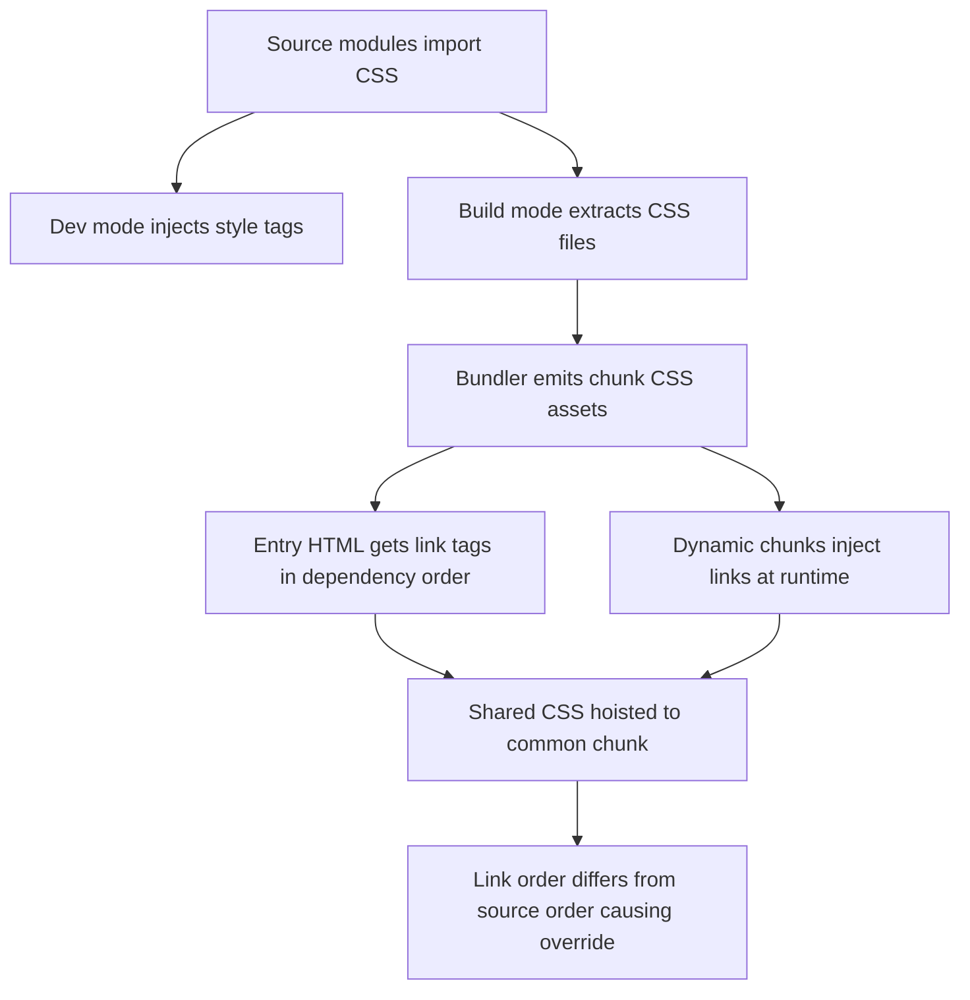

# CSS Code Splitting and the Ordering Trap: How Styles Follow Your Chunks

## English

In development, Vite serves CSS by injecting `<style>` tags through JavaScript, so a component's styles appear the moment its module executes. In production, that model changes: CSS is extracted into real `.css` files, and each chunk gets its own stylesheet. This is CSS code splitting, and it is on by default. The benefit is obvious — a user visiting the home page does not download the styles for the admin dashboard — but the mechanism has subtle consequences you should understand before debugging a mysterious style bug.

When Vite (via Rolldown in Vite 8) emits chunks, it tracks which CSS files each chunk's modules imported and emits a matching `.css` asset. The HTML for an entry point gets `<link rel="stylesheet">` tags for that entry's CSS, in dependency order. For dynamically imported chunks, the preload helper injects the stylesheet link at runtime and waits for it before resolving the import, as described in the preload story. So far, so clean. The trap appears when two chunks both import the same CSS module: the bundler may hoist the shared CSS into a common chunk, and the order in which stylesheets are inserted into the document can differ from the order they were imported in source.

CSS is order-dependent: if `.button { color: blue }` appears after `.button { color: red }`, blue wins, regardless of specificity ties. In a bundled app, the 'order' is the order of `<link>` tags in the head plus the order of runtime-injected links. If chunk A's stylesheet loads before chunk B's, but in your source B was imported first, a rule in A can unexpectedly override B. This is the classic symptom: 'it looks right in dev but wrong in prod', or 'the styles are fine until I navigate to a certain route'. It is not a Vite bug; it is the honest consequence of splitting order-dependent resources.

The usual fixes are structural rather than magical. Keep global, order-sensitive styles (resets, design tokens, utility frameworks) in a single entry-level import so they always load first and in one file. Scope component styles with CSS Modules or scoped selectors so cross-chunk ordering stops mattering. Avoid relying on source order between separately imported files for cascade decisions; if two rules genuinely compete, make the winner explicit with specificity or layers (`@layer` is well supported and gives you deterministic cascade control). You can also disable CSS code splitting entirely with `build.cssCodeSplit: false`, which emits one stylesheet for the whole app — simpler ordering, larger initial download.

A related detail: `build.cssMinify` controls CSS minification independently of JS, and `css.devSourcemap` (dev) versus `build.sourcemap` (prod) determine whether you can trace a rule back to its source file. When a style bug only appears in production, the first move is to open devtools, find the offending rule, and check which stylesheet file it came from — the filename will tell you which chunk owns it, which usually explains the ordering. Understanding that CSS follows chunks, not your import statements, turns a baffling bug into a predictable design constraint.

## 中文

在開發環境，Vite 透過 JavaScript 注入 `<style>` 標籤來提供 CSS，所以元件的樣式會在它的模組執行的一刻出現。在生產環境，這個模型會改變：CSS 被抽取成真正的 `.css` 檔案，每個 chunk 有自己的樣式表。這就是 CSS code splitting，而且是預設開啟的。好處顯而易見——訪客首頁不會下載管理後臺的樣式——但這個機制有微妙的後果，你應該在 debug 一個莫名其妙的樣式 bug 之前先理解它。

當 Vite（在 Vite 8 係透過 Rolldown）輸出 chunk 時，它會追蹤每個 chunk 的模組 import 了哪些 CSS 檔，並輸出對應的 `.css` 資產。入口的 HTML 會按依賴順序加上該入口 CSS 的 `<link rel="stylesheet">` 標籤。對於動態 import 的 chunk，preload helper 會在 runtime 注入樣式表 link，並等待它完成才解析該 import，正如 preload 那篇所述。到這裡一切乾淨。陷阱出現在兩個 chunk 都 import 同一個 CSS 模組的時候：打包器可能把共用的 CSS 提升到一個共同 chunk，而樣式表插入檔案的順序，可能與它們在原始碼中被 import 的順序不同。

CSS 是順序相關的：如果 `.button { color: blue }` 出現在 `.button { color: red }` 之後，藍色勝出，不管 specificity 是否打和。在一個打包的應用中，「順序」就是 head 裡 `<link>` 標籤的順序，加上 runtime 注入 link 的順序。如果 chunk A 的樣式表比 chunk B 先載入，但在你的原始碼中 B 是先被 import 的，A 的規則就可能意外覆蓋 B。這就是經典症狀：「開發時正常，生產時錯」或者「樣式一直正常，直到我導航到某條路由」。這不是 Vite 的 bug；這是拆分順序相關資源的誠實後果。

慣常的修法屬於結構性而非魔法。把全域性、對順序敏感的樣式（reset、design token、utility framework）放在單一的入口層 import，令它們永遠最先載入且在同一個檔案。用 CSS Modules 或 scoped selector 把元件樣式隔離，令跨 chunk 的順序不再重要。避免依賴分別 import 的檔案之間的原始碼順序去做 cascade 決定；如果兩條規則真的競爭，用 specificity 或 layer 明確指定贏家（`@layer` 支援良好，給你確定性的 cascade 控制）。你也可以用 `build.cssCodeSplit: false` 完全停用 CSS code splitting，整份應用只輸出一個樣式表——順序更簡單，但初次下載更大。

一個相關細節：`build.cssMinify` 獨立於 JS 控制 CSS 壓縮，而 `css.devSourcemap`（開發）對比 `build.sourcemap`（生產）決定你能否把一條規則追溯回它的原始檔案。當一個樣式 bug 只在生產出現，第一步是開啟 devtools，找到出問題的規則，看看它來自哪個樣式表檔案——檔名會告訴你它屬於哪個 chunk，通常就解釋了順序。理解 CSS 跟隨的是 chunk 而非你的 import 語句，就能把一個令人困惑的 bug 變成可預測的設計約束。

## Key Takeaway

Production CSS is extracted per chunk, so stylesheet load order follows chunk order rather than your import statements — keep order-sensitive styles in one entry-level file.

## Related Concepts
- CSS code splitting
- Cascade layers

## Diagram

