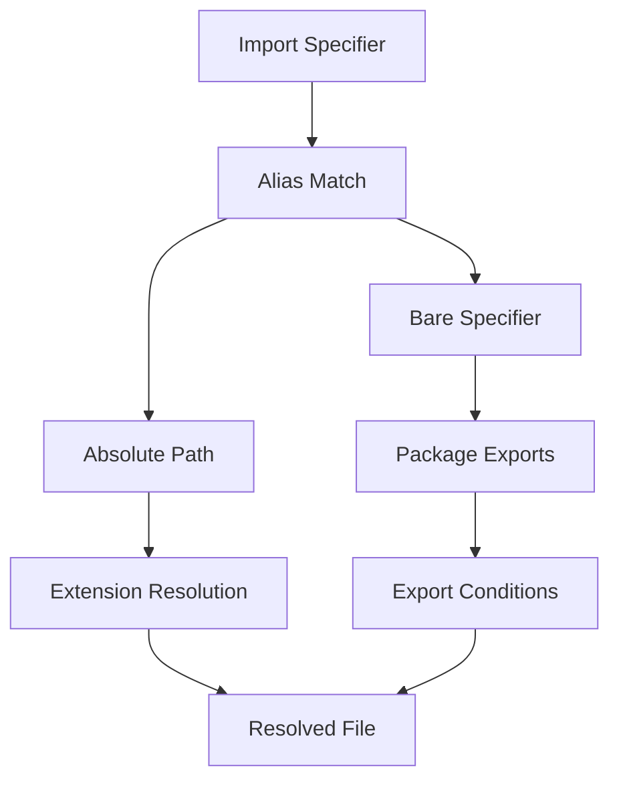

# Aliases, Resolve Extensions, and the Conditions That Decide Which File Wins

## English

Every `import './utils'` triggers a resolution algorithm: given a specifier and an importer, which actual file on disk should be loaded? Vite implements this with a resolver that is close to, but not identical to, Node's. Understanding its rules explains a whole class of 'works in dev, fails in build' and 'works in Node, fails in Vite' problems, because the two environments can legitimately pick different files for the same specifier.

The first rule is extension resolution. Vite, like most bundlers, will try a list of extensions when the specifier has none — by default something like `.mjs`, `.js`, `.mts`, `.ts`, `.jsx`, `.tsx`, `.json`. So `import './utils'` can resolve to `utils.ts`. TypeScript's own compiler historically required explicit extensions in ESM output, so this is a bundler convenience, not a language guarantee. If you set `resolve.extensions`, you replace that list, and forgetting `.tsx` or `.vue` is a common cause of 'cannot resolve' errors that appear only after a config change.

The second rule is alias. `resolve.alias` maps a prefix to a directory or file, most commonly `@` to `src`. Aliases are applied before other resolution, and they are plain string or regex replacement, not a module system feature — so `@/components/Button` becomes an absolute path and then resolves normally. Two cautions: aliases must be kept in sync with your editor and TypeScript (`tsconfig.json` `paths`), otherwise the editor underlines imports that the bundler happily resolves; and aliases can silently shadow real packages if you alias a bare name like `react`, which is occasionally useful (deduplication) and frequently disastrous (two copies of React).

The third and least understood rule is export conditions. When resolving a package's `exports` field in `package.json`, the resolver chooses among condition names such as `import`, `require`, `browser`, `node`, `development`, and `production`. Vite sets conditions appropriate for a browser bundler and adds `development` or `production` depending on mode. This is why a library can ship different code to Vite dev, Vite build, and Node — and why a bug can appear only in one. `resolve.conditions` lets you add or change these, which is sometimes necessary for libraries that use custom conditions, but changing them casually can select code paths the library never tested in a browser.

A fourth rule is `resolve.dedupe`, which forces a package to resolve to a single copy. In a monorepo or with linked packages, the same dependency can exist at multiple paths; without dedupe you get two instances, two React contexts, and hooks that throw. Finally, `resolve.mainFields` controls which field of `package.json` is consulted for packages without `exports` (e.g. `module` before `main`). The practical habit: when an import resolves to the wrong file, do not guess — the resolution is deterministic. Check the specifier, the alias table, the extensions list, the conditions, and the package's `exports` map in that order, and you will find the rule that chose the file.

## 中文

每一個 `import './utils'` 都會觸發一套解析演算法：給定一個 specifier 和一個 importer，究竟應該載入磁碟上哪個實際檔案？Vite 用一個接近、但不完全等同於 Node 的 resolver 來實現。理解它的規則，就能解釋一整類「開發時正常、建置時失敗」和「Node 正常、Vite 失敗」的問題，因為兩個環境可以合理地為同一個 specifier 揀不同的檔案。

第一條規則是副檔名解析。Vite 像大多數 bundler 一樣，當 specifier 沒有副檔名時會嘗試一串副檔名——預設大概是 `.mjs`、`.js`、`.mts`、`.ts`、`.jsx`、`.tsx`、`.json`。所以 `import './utils'` 可以解析到 `utils.ts`。TypeScript 自己的編譯器在歷史上要求 ESM 輸出要有明確副檔名，所以這是 bundler 的便利，不是語言的保證。如果你設定 `resolve.extensions`，你就會取代那個清單，忘記 `.tsx` 或 `.vue` 是常見的「無法解析」錯誤成因，而且只在改完 config 之後才出現。

第二條規則是 alias。`resolve.alias` 把一個前綴映射到一個目錄或檔案，最常見是 `@` 映射到 `src`。Alias 在其他解析之前套用，而且它們是純字串或 regex 替換，不是模組系統的功能——所以 `@/components/Button` 會變成絕對路徑，然後正常解析。兩個警告：alias 必須與編輯器和 TypeScript（`tsconfig.json` 的 `paths`）保持同步，否則編輯器會對 bundler 樂意解析的 import 畫紅線；而 alias 若映射一個裸名如 `react`，可以靜靜地遮蔽真正的套件，偶爾有用（去重），但經常是災難（兩份 React）。

第三條、最少人理解的規則是 export condition。解析 `package.json` 的 `exports` 欄位時，resolver 會在 `import`、`require`、`browser`、`node`、`development`、`production` 等條件名之間選擇。Vite 設定適合瀏覽器 bundler 的條件，並按 mode 加上 `development` 或 `production`。這就是為何一個函式庫可以向 Vite 開發、Vite 建置和 Node 輸出不同的程式碼——也是為何一個 bug 可以只在其中一個環境出現。`resolve.conditions` 讓你增加或更改這些條件，對使用自訂條件的函式庫有時是必要的，但隨意更改可能會選中函式庫從未在瀏覽器測試過的程式碼路徑。

第四條規則是 `resolve.dedupe`，強制一個套件解析到單一副本。在 monorepo 或使用連結套件時，同一個依賴可以存在於多個路徑；沒有 dedupe 你就會有兩個實例、兩個 React context，以及會拋錯的 hook。最後，`resolve.mainFields` 控制對於沒有 `exports` 的套件要查 `package.json` 哪個欄位（例如 `module` 先於 `main`）。實用習慣：當一個 import 解析到錯的檔案，不要猜——解析是確定性的。按順序檢查 specifier、alias 表、副檔名清單、條件，以及套件的 `exports` 映射，你就會找到選中該檔案的那條規則。

## Key Takeaway

Vite's resolver is deterministic: extensions, aliases, export conditions, dedupe, and mainFields are applied in a known order, so a wrong resolution can always be traced to a specific rule.

## Related Concepts
- Package exports conditions
- resolve.alias

## Diagram

