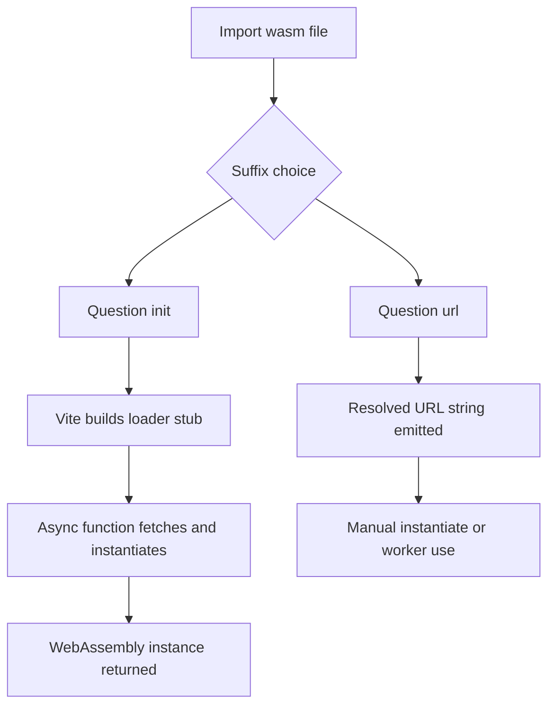

# WebAssembly and Vite: Loading .wasm Modules as First-Class Assets

## English

WebAssembly (Wasm) is a compact binary instruction format that browsers can execute at near-native speed. Vite treats .wasm files as assets you can import directly, but the details matter. When you write `import init from './math.wasm?init'`, Vite gives you an async function that fetches the binary and instantiates it for you, returning the WebAssembly instance. This is the low-level path: you get the raw exports and must wire up memory and imports yourself. For libraries that ship a JavaScript glue file (the pattern Emscripten or wasm-bindgen produces), you normally import that JS file instead, and Vite just serves it like any other module. The `?init` suffix is the key that tells Vite's asset pipeline to treat the file specially rather than emitting it as a plain URL.

There is a subtlety around the `?url` suffix versus `?init`. With `?url`, Vite hands you the resolved URL string to the emitted binary, which is useful when you want to pass it to `WebAssembly.instantiateStreaming(fetch(url))` yourself, or hand it to a worker. With `?init`, Vite wraps the fetch and instantiation and returns a promise that resolves to the instance. The difference matters in production: the `?url` form lets the bundler hash and emit the file into `assets/`, while `?init` does the same but also generates the loader stub. Either way, the .wasm file is content-hashed and cacheable, just like images.

Because Wasm binaries can be large, you should usually load them lazily. A top-level `import init from './heavy.wasm?init'` will cause the loader stub to be pulled into your main chunk, and if you call it eagerly in module scope, the fetch begins immediately, competing with your critical JS for bandwidth. The idiomatic pattern is a dynamic import: `const { default: init } = await import('./heavy.wasm?init')`, then call `init()` inside a function that runs only when the feature is used. Vite will emit the Wasm as a separate chunk and only fetch it on demand.

MIME types are a classic footgun. `WebAssembly.instantiateStreaming` requires the server to respond with `application/wasm`; if your dev server or CDN serves the file as `application/octet-stream`, streaming compilation fails and you must fall back to `WebAssembly.instantiate(await response.arrayBuffer())`. Vite's dev server sets the right MIME type for .wasm, but your production host might not — check your CDN configuration. When in doubt, the non-streaming path always works; it just skips the streaming optimization.

Finally, remember that Wasm modules cannot directly touch the DOM or call JavaScript APIs. They receive an imports object (functions, memory, globals) and export their own functions. Vite's job ends at delivering the bytes and instantiating; the boundary between JS and Wasm — copying data into linear memory, calling exported functions, reading results back — is your responsibility. Treat Wasm as a compute accelerator for hot loops (parsing, codecs, physics) rather than a replacement for your UI layer, and Vite's asset handling will stay out of your way.

## 中文

WebAssembly（Wasm）是一種緊湊的二進位指令格式，瀏覽器能以接近原生速度執行。Vite 把 .wasm 檔案當作可直接 import 的資源，但細節很重要。當你寫 `import init from './math.wasm?init'`，Vite 會給你一個非同步函式，幫你抓取二進位檔並實例化，回傳 WebAssembly instance。這是最低階的路徑：你拿到原始匯出，記憶體與 imports 都要自己接。對於附帶 JavaScript 膠水檔的函式庫（Emscripten 或 wasm-bindgen 產生的模式），你通常改為 import 那個 JS 檔，Vite 就當普通模組處理。`?init` 後綴是關鍵，它告訴 Vite 的資源管線要特別處理這個檔案，而不是單純輸出成 URL。

`?url` 與 `?init` 之間有個微妙差別。用 `?url`，Vite 交給你的是輸出二進位檔的解析後 URL 字串，適合你自己傳給 `WebAssembly.instantiateStreaming(fetch(url))`，或交給 worker。用 `?init`，Vite 包裝了 fetch 與實例化，回傳解析為 instance 的 promise。這在生產環境有差：`?url` 形式讓打包器雜湊並輸出檔案到 `assets/`，`?init` 也一樣，但額外產生載入器 stub。無論哪種，.wasm 檔都會內容雜湊、可快取，就像圖片一樣。

由於 Wasm 二進位檔可能很大，通常應該延遲載入。頂層的 `import init from './heavy.wasm?init'` 會把載入器 stub 拉進主 chunk，若你在模組作用域立刻呼叫，fetch 會馬上開始，與關鍵 JS 搶頻寬。慣用模式是動態 import：`const { default: init } = await import('./heavy.wasm?init')`，然後只在功能被使用時才在函式內呼叫 `init()`。Vite 會把 Wasm 輸出成獨立 chunk，只在需要時抓取。

MIME 類型是經典陷阱。`WebAssembly.instantiateStreaming` 要求伺服器回應 `application/wasm`；若你的開發伺服器或 CDN 把它當 `application/octet-stream` 供應，串流編譯會失敗，你得退回 `WebAssembly.instantiate(await response.arrayBuffer())`。Vite 的開發伺服器對 .wasm 設了正確 MIME，但你的生產主機未必——檢查 CDN 設定。不確定時，非串流路徑永遠可行，只是少了串流最佳化。

最後，記住 Wasm 模組不能直接碰 DOM 或呼叫 JavaScript API。它們接收 imports 物件（函式、記憶體、全域變數）並匯出自己的函式。Vite 的職責到交付位元組與實例化為止；JS 與 Wasm 之間的邊界——把資料複製進線性記憶體、呼叫匯出函式、讀回結果——是你的責任。把 Wasm 當成熱迴圈（解析、編解碼、物理）的運算加速器，而非 UI 層的替代品，Vite 的資源處理就不會礙你事。

## Key Takeaway

Vite serves .wasm as a hashed asset with ?url or an instantiation helper with ?init, but lazy dynamic imports and correct application/wasm MIME types are what keep large binaries from hurting startup.

## Related Concepts
- Static Asset Handling and the public Directory
- Dynamic Imports and Code Splitting

## Diagram

