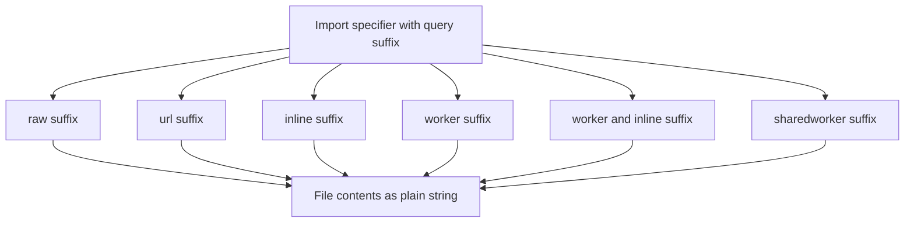

# Query Suffixes and Raw Imports: Telling Vite How to Interpret a File

## English

Vite extends the import specifier with query suffixes — little `?something` tags appended to the path — that change how a file is processed. You have already seen `?init` for Wasm; the same mechanism covers several other cases. `import text from './shader.glsl?raw'` gives you the file's contents as a plain string, bypassing all transforms. This is perfect for embedding shaders, small templates, or test fixtures where you want the exact bytes. Without `?raw`, importing a .glsl file would fail unless a plugin handled the extension, because Vite would not know how to turn it into a module.

The `?url` suffix returns the resolved URL of the asset rather than its contents. For a CSS file, `import cssUrl from './theme.css?url'` gives you a string pointing at the emitted stylesheet, which you might pass to a `<link>` tag created at runtime. For an image, `?url` is essentially what a bare `import img from './pic.png'` already returns in Vite, but writing it explicitly documents intent. There is also `?inline` for CSS, which forces the stylesheet to be injected as a string rather than emitted as a separate file — handy for web components that need to attach styles in a shadow root.

The `?worker` suffix turns a module into a Web Worker constructor. `import MyWorker from './worker.js?worker'` gives you a class; `new MyWorker()` spawns the worker. Vite handles the bundling of the worker's own dependency graph separately from the main thread, and in production it emits a dedicated chunk. There is a sibling, `?worker&inline`, which base64-encodes the worker source into the main bundle — useful when you cannot serve a separate file (for example, in some single-file distribution scenarios) at the cost of a larger main chunk. You will also encounter `?sharedworker` for SharedWorker, following the same pattern.

Suffixes compose and can be combined with each other or with plugins. A plugin can register its own suffix handling through the `load` hook by inspecting the `id` argument, which includes the query string. This is how frameworks add things like `?macro` or custom virtual module schemes. The rule of thumb: the query is part of the module ID, so `./foo.js` and `./foo.js?raw` are two distinct modules from Vite's perspective, each with its own entry in the module graph and its own HMR invalidation. Changing one does not automatically invalidate the other unless the file on disk changes.

One practical warning: suffixes are Vite-specific, not standard ESM. If you ship a library that uses `?raw` or `?worker` in its source, consumers must build it with Vite (or a compatible bundler plugin). For published packages, prefer pre-transforming at build time so the emitted JavaScript has no Vite-only syntax. Inside an application, though, suffixes are a clean, declarative way to say "treat this file differently" without writing a custom plugin for every one-off case.

## 中文

Vite 用查詢後綴（query suffix）擴充 import 說明符——附加在路徑後的小小 `?something` 標籤——改變檔案的處理方式。你已見過 Wasm 的 `?init`；同一機制還涵蓋其他幾種情況。`import text from './shader.glsl?raw'` 把檔案內容當純字串給你，跳過所有轉換。這非常適合內嵌 shader、小型模板或測試資料，你需要精確位元組。沒有 `?raw`，import 一個 .glsl 檔會失敗，除非有外掛處理該副檔名，因為 Vite 不知道怎麼把它變成模組。

`?url` 後綴回傳資源的解析後 URL 而非內容。對 CSS 檔，`import cssUrl from './theme.css?url'` 給你指向輸出樣式表的字串，可傳給執行時建立的 `<link>` 標籤。對圖片，`?url` 基本上就是 Vite 中裸 `import img from './pic.png'` 已回傳的東西，但明寫能表達意圖。CSS 還有 `?inline`，強制樣式表以字串注入而非輸出成獨立檔案——對需要在 shadow root 附加樣式的 web component 很方便。

`?worker` 後綴把模組變成 Web Worker 建構子。`import MyWorker from './worker.js?worker'` 給你一個類別；`new MyWorker()` 啟動 worker。Vite 把 worker 自身的依賴圖與主執行緒分開打包，生產時輸出專屬 chunk。還有兄弟 `?worker&inline`，把 worker 原始碼 base64 編碼進主 bundle——當你無法供應獨立檔案時有用（例如某些單檔發佈情境），代價是主 chunk 變大。你也會遇到 `?sharedworker`，模式相同。

後綴可組合，也能與彼此或外掛搭配。外掛可在 `load` 鉤子檢查 `id` 參數（含查詢字串）來註冊自己的後綴處理。框架就是這樣加上 `?macro` 或自訂虛擬模組方案。經驗法則：查詢是模組 ID 的一部分，所以 `./foo.js` 與 `./foo.js?raw` 在 Vite 眼中是兩個不同模組，各自在模組圖有條目、各自的 HMR 失效。改一個不會自動讓另一個失效，除非磁碟上的檔案變了。

實務警告：後綴是 Vite 專屬，不是標準 ESM。若你發佈的函式庫原始碼用了 `?raw` 或 `?worker`，消費者必須用 Vite（或相容打包外掛）建置。發佈套件時，最好在建置時預先轉換，讓輸出的 JavaScript 不含 Vite 專屬語法。不過在應用程式內，後綴是乾淨、宣告式的方式，說「用不同方式處理這個檔案」，不必為每個一次性情況寫外掛。

## Key Takeaway

Query suffixes like ?raw, ?url, ?inline, and ?worker are part of the module ID and let you declare per-import processing without writing a plugin.

## Related Concepts
- Static Asset Handling and the public Directory
- Worker Imports and Web Workers

## Diagram

