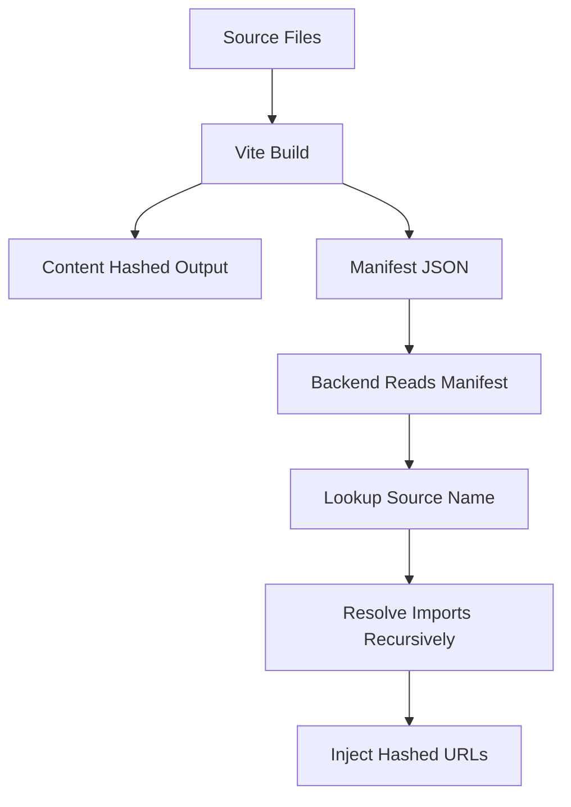

# The Manifest File: Mapping Source Names to Hashed Output for Backend Integration

## English

When Vite builds for production, it renames files with content hashes so browsers can cache them forever. That is great for the browser but terrible for a backend template that needs to know the final filename. If your HTML says `<script src="/assets/main.js">` but Vite emitted `main-a1b2c3d4.js`, the page breaks. The manifest solves this: setting `build.manifest` to `true` (or a path string) makes Vite emit a JSON file, by default `.vite/manifest.json` inside the output directory, that maps each source entry to its hashed output file and its list of imported chunks and CSS.

The manifest is a flat object keyed by source-relative paths. Each value contains `file` (the emitted filename), `src` (the original source), `isEntry` (whether it was an entry point), `imports` (an array of keys for chunks it depends on), `css` (an array of emitted stylesheet files), and `assets` (other emitted files like images). A server-side template can read this JSON once at startup, look up `src/main.js`, and inject the correct hashed URL into the HTML it renders. This is the standard integration path for frameworks that render HTML on the server — Laravel, Rails, Django, or a custom Node server — because it decouples Vite's build from the backend's templating.

A crucial detail: the `imports` array gives you chunk keys, not URLs. To render preload tags for the modules a page needs, you must resolve each key through the manifest recursively, collecting every `file` and `css` entry along the way. This is exactly what the preload helper does at runtime, but in a server-rendered context you are doing it at request time in your backend language. Without it, the browser discovers the dependency chain only after downloading the entry chunk, producing a network waterfall that the manifest was designed to prevent.

The manifest is also essential for asset URLs referenced from CSS or JS. Suppose your stylesheet references `background: url('./hero.png')`. Vite hashes the image and rewrites the CSS to point at the new name, but if your backend needs to reference that same image in a meta tag, it has to look it up in the manifest too. The keys include the source path, so `src/assets/hero.png` resolves to the emitted file. This keeps one source of truth for filenames across frontend and backend.

Two practical notes. First, the manifest is generated only for production builds; the dev server serves modules directly and has no manifest, so your backend integration must fall back to hardcoded dev URLs (or use Vite's dev server middleware) when running in development. Second, if you deploy static files behind a CDN with a base path, remember that manifest `file` values are relative to `base` — prepend the base URL when constructing final URLs. Get these two right and the manifest becomes a reliable contract between your build and your server.

## 中文

Vite 為生產建置時，會用內容雜湊重新命名檔案，讓瀏覽器能永久快取。這對瀏覽器很好，對需要知道最終檔名的後端模板卻很糟。若你的 HTML 寫 `<script src="/assets/main.js">`，但 Vite 輸出 `main-a1b2c3d4.js`，頁面就壞了。manifest 解決這問題：把 `build.manifest` 設為 `true`（或路徑字串），Vite 會輸出 JSON 檔，預設在輸出目錄內的 `.vite/manifest.json`，把每個來源入口對應到雜湊後的輸出檔，以及它 import 的 chunk 與 CSS 清單。

manifest 是以來源相對路徑為鍵的扁平物件。每個值含 `file`（輸出的檔名）、`src`（原始來源）、`isEntry`（是否為入口）、`imports`（依賴 chunk 的鍵陣列）、`css`（輸出的樣式表陣列）與 `assets`（其他輸出檔如圖片）。伺服器端模板可在啟動時讀一次這份 JSON，查 `src/main.js`，把正確的雜湊 URL 注入它渲染的 HTML。這是伺服器端渲染 HTML 的框架——Laravel、Rails、Django 或自訂 Node 伺服器——的標準整合路徑，因為它把 Vite 建置與後端模板解耦。

關鍵細節：`imports` 陣列給你的是 chunk 鍵，不是 URL。要為頁面需要的模組渲染 preload 標籤，你必須遞迴地透過 manifest 解析每個鍵，沿途收集每個 `file` 與 `css` 條目。這正是 preload 輔助函式在執行時做的事，但在伺服器渲染情境，你是在請求時用後端語言做。少了它，瀏覽器要下載入口 chunk 後才發現依賴鏈，產生 manifest 本來要防止的網路瀑布。

manifest 對 CSS 或 JS 引用的資源 URL 也很重要。假設樣式表引用 `background: url('./hero.png')`。Vite 會雜湊圖片並改寫 CSS 指向新名稱，但若後端要在 meta 標籤引用同一張圖，也得查 manifest。鍵包含來源路徑，所以 `src/assets/hero.png` 解析到輸出檔。這讓前後端對檔名有單一真相來源。

兩個實務提醒。第一，manifest 只在生產建置產生；開發伺服器直接供應模組，沒有 manifest，所以後端整合在開發時必須退回寫死的開發 URL（或使用 Vite 開發伺服器中間件）。第二，若你透過帶 base 路徑的 CDN 部署靜態檔，記得 manifest 的 `file` 值是相對於 `base`——建構最終 URL 時要前置 base URL。這兩點做對，manifest 就成為建置與伺服器之間可靠的契約。

## Key Takeaway

Setting build.manifest emits a JSON map from source entries to hashed outputs, letting any backend template inject correct URLs and preload the full chunk graph.

## Related Concepts
- Content Hashing and Long-Term Caching
- The Preload Helper and Module Preloading

## Diagram

