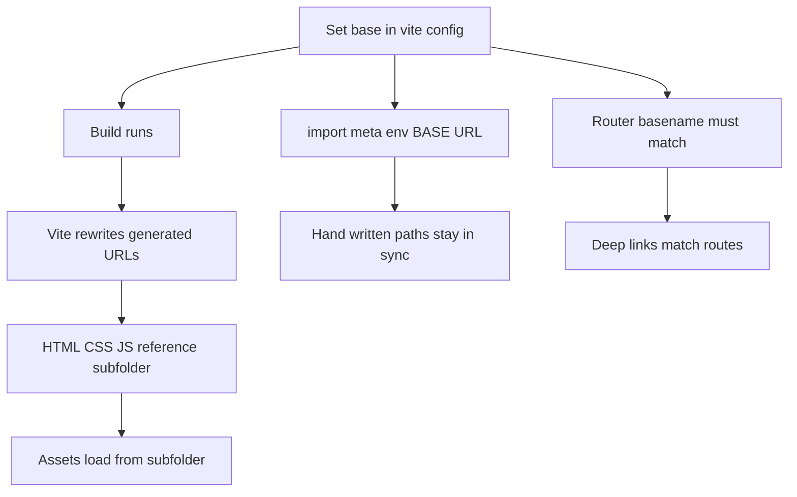

# Base Path and Deployment: Making Your App Survive Being Served From a Subfolder

## English

Every URL Vite writes into your HTML, CSS, and JavaScript is relative to a root that Vite calls the base path. By default base is '/', which is correct when your app sits at the domain root, but the moment you deploy to something like https://example.com/my-app/ or a CDN prefix, every hard-coded /assets/index-abc123.js becomes a 404. Setting base in vite.config.js (or with the --base CLI flag) rewrites asset URLs at build time so the emitted HTML references /my-app/assets/... instead. This is a build-time string substitution baked into the output, not a runtime lookup, so changing base after deployment requires a rebuild. For relative deployments where you do not know the final URL, base: './' produces relative asset references, which works for file:// previews and simple static hosts but breaks with client-side routing that uses absolute paths.

The subtle part is that base does not automatically fix paths you write yourself. A hard-coded fetch('/api/users') or an  in your template still points at the domain root, because Vite only rewrites the URLs it generated or that come through its asset pipeline (imports of files, CSS url() references, the injected script tags). To reference the base from your own code, Vite exposes import.meta.env.BASE_URL, which is a string like '/' or '/my-app/' at build time. Using `${import.meta.env.BASE_URL}logo.png` keeps your hand-written paths in sync with whatever base you configured.

A second trap is the router. Client-side routers often take a base or basename option, and that option is a separate concept from Vite's base even though they usually need the same value. If Vite's base is '/my-app/' but the router thinks it lives at '/', deep links like /my-app/settings will fail to match any route and render a blank page. The convention is to pass import.meta.env.BASE_URL into the router's configuration so both layers agree.

Finally, base interacts with the public directory. Files in public/ are copied to the output as-is, preserving their names, so a file at public/favicon.ico becomes /my-app/favicon.ico when base is set. That is convenient, but it also means public files are never hashed, so browsers and CDNs may cache them aggressively. For anything that changes between releases, prefer importing it from src/ so Vite can hash the filename and give you safe long-term caching.

When debugging a deployment that shows a blank page or a wall of 404s in the network tab, check the base first. Open the built index.html and look at the script src attribute: if it starts with '/' but the app is served from a subdirectory, base is the culprit. This one setting explains a large share of 'it works locally but not on the server' reports.

## 中文

Vite 寫進你 HTML、CSS 同 JavaScript 嘅每一條 URL，都係相對於一個根路徑，Vite 稱之為 base path。預設 base 係 '/'，當你嘅應用放喺網域根目錄時就啱，但一旦部署到好似 https://example.com/my-app/ 或者 CDN 前綴，所有寫死嘅 /assets/index-abc123.js 就會變成 404。喺 vite.config.js 設定 base（或者用 --base 命令列旗標）會喺建置時改寫資源 URL，令輸出嘅 HTML 引用 /my-app/assets/... 而唔係根目錄。呢個係建置期嘅字串替換，直接燒入輸出，唔係執行期查表，所以部署之後改 base 就要重新建置。對於唔知最終 URL 嘅相對部署，base: './' 會產生相對資源引用，適合 file:// 預覽同簡單靜態主機，但會同使用絕對路徑嘅客戶端路由衝突。

微妙嘅地方係，base 唔會自動修正你自己寫嘅路徑。寫死嘅 fetch('/api/users') 或者範本入面嘅  仍然指向網域根目錄，因為 Vite 只會改寫佢自己產生、或者經佢資源管線（檔案 import、CSS url() 引用、注入嘅 script 標籤）嘅 URL。想喺自己程式碼引用 base，Vite 提供 import.meta.env.BASE_URL，建置時係 '/' 或 '/my-app/' 咁嘅字串。用 `${import.meta.env.BASE_URL}logo.png` 就可以令手寫路徑同你設定嘅 base 保持同步。

第二個陷阱係路由器。客戶端路由器通常有 base 或者 basename 選項，呢個選項同 Vite 嘅 base 係兩個概念，雖然佢哋通常要同一個值。如果 Vite 嘅 base 係 '/my-app/' 但路由器以為自己喺 '/'，好似 /my-app/settings 嘅深層連結就會匹配唔到任何路由，畫面一片空白。慣例係將 import.meta.env.BASE_URL 傳入路由器設定，令兩層一致。

最後，base 同 public 目錄有互動。public/ 入面嘅檔案會原封不動複製到輸出，保留原本檔名，所以 public/favicon.ico 喺 base 設定之後會變成 /my-app/favicon.ico。咁樣好方便，但亦代表 public 檔案永遠唔會被 hash，瀏覽器同 CDN 可能快取得好進取。任何會隨版本改變嘅嘢，最好由 src/ import，等 Vite 可以 hash 檔名，俾你安全嘅長期快取。

當部署後出現白畫面或者網絡面板一堆 404，第一時間檢查 base。打開建置後嘅 index.html，睇 script 嘅 src 屬性：如果佢以 '/' 開頭但應用其實喺子目錄提供，base 就係元兇。呢個設定解釋咗好多「本地得、上到伺服器唔得」嘅報告。

## Key Takeaway

The base setting rewrites only the URLs Vite generates, so hand-written paths and router configuration must be kept in sync with import.meta.env.BASE_URL.

## Related Concepts
- Static asset handling and the public directory
- Client-side routing configuration

## Diagram

