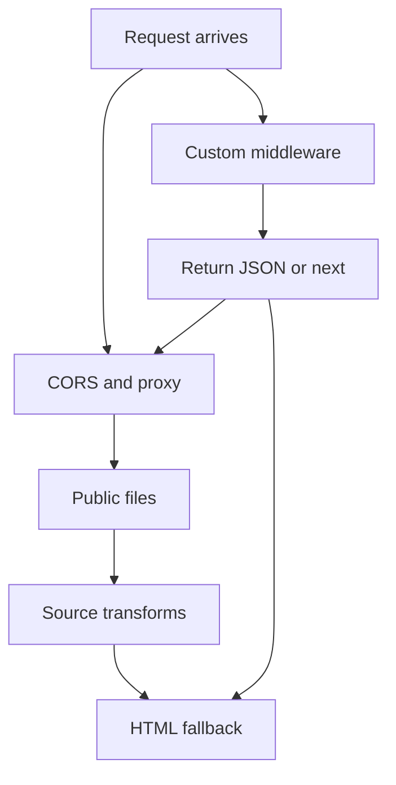

# The Dev Server Middleware Stack: Where Your Own Express-Style Handlers Fit

## English

Vite's dev server is not a black box; it is built on Connect, a minimal Node.js middleware framework, and it exposes that stack through server.middlewares. A middleware is simply a function that receives (req, res, next) and either answers the request or calls next() to pass it along. Vite registers its own middlewares in a deliberate order: CORS handling, the proxy rules, serving files from the public directory, transforming and serving source modules, and finally the HTML fallback that returns index.html. Because it is an ordered chain, the position where you insert your own middleware decides whether you run before or after Vite's transforms.

This matters when you need a tiny API during development. Suppose your frontend calls /api/todos but the real backend is not ready. In a plugin's configureServer hook you can do server.middlewares.use('/api/todos', (req, res) => { ... }) and return JSON directly. Because the hook runs during server setup, you can also capture the returned post hook to install your own middleware at that point in the chain. Vite applies that post-hook middleware before its own HTML middleware, precisely so that user middleware can serve custom content instead of index.html. It therefore runs early in the stack, and it is not a last-resort fallback that only fires when nothing else matched. Getting this order wrong is the usual cause of 'my middleware never runs' or 'my middleware swallows Vite's own requests'.

A related use is rewriting or inspecting requests without a full backend. You can log every request, add custom headers, simulate latency with a setTimeout before responding, or inject authentication stubs. Because the dev server is ordinary Node, you have access to the full request and response objects, so streaming, cookies, and status codes all behave as you would expect from Express-style code, even though the underlying framework is Connect rather than Express.

There is an important boundary: this middleware stack exists only in the dev server. It does not ship to production. If your app depends on /api/todos returning data, you still need a real backend or a mock service in production. The middleware approach is best understood as a development convenience, a way to unblock frontend work or to script edge cases, not as a deployment strategy. For anything more elaborate, tools like MSW (Mock Service Worker) intercept at the network layer in both dev and test, which avoids the dev-only limitation.

Finally, remember that Vite's own middlewares are also just functions, so you can read them as a reference implementation. When you are unsure why a request is being handled strangely, adding a logging middleware at the very top of the chain shows you exactly what arrives and in what form before Vite touches it. This turns the dev server from a mysterious process into a debuggable pipeline you can reason about.

## 中文

Vite 嘅開發伺服器唔係黑盒；佢建基於 Connect，一個極簡嘅 Node.js 中介軟件框架，並透過 server.middlewares 暴露成條鏈。中介軟件只係一個收到 (req, res, next) 嘅函數，佢要麼回應請求，要麼呼叫 next() 交俾下一個。Vite 按特定次序註冊自己嘅中介軟件：CORS 處理、代理規則、由 public 目錄提供檔案、轉換並提供原始模組，最後係回傳 index.html 嘅 HTML fallback。因為係一條有次序嘅鏈，你插入自己中介軟件嘅位置就決定咗你係喺 Vite 轉換之前定之後執行。

當你開發時需要一個小型 API，呢點就好重要。假設前端呼叫 /api/todos 但真正後端未準備好。喺插件嘅 configureServer hook 入面，你可以 server.middlewares.use('/api/todos', (req, res) => { ... }) 直接回傳 JSON。因為呢個 hook 喺伺服器設定階段執行，你亦可以捕捉佢回傳嘅 post hook，用嚟喺鏈嘅嗰個位置安裝自己嘅中介軟件。Vite 會喺自己嘅 HTML 中介軟件之前套用呢段 post hook 中介軟件，正正係為咗等使用者嘅中介軟件可以提供自訂內容而唔係 index.html。所以佢係喺鏈嘅早期執行，並唔係「冇其他嘢匹配時先觸發」嘅最後防線 fallback handler。次序搞錯就係「我嘅中介軟件永遠唔執行」或者「我嘅中介軟件食咗 Vite 自己嘅請求」嘅常見原因。

另一個相關用途係改寫或者檢查請求，而唔需要完整後端。你可以記錄每個請求、加自訂 header、用 setTimeout 模擬延遲先回應，或者注入認證 stub。因為開發伺服器就係普通 Node，你可以用到完整嘅 request 同 response 物件，所以串流、cookie、狀態碼嘅行為都同 Express 風格程式碼一樣，雖然底層框架係 Connect 而唔係 Express。

有個重要界線：呢個中介軟件鏈只存在於開發伺服器，唔會出貨到生產環境。如果你嘅應用依賴 /api/todos 回傳資料，生產環境仍然需要真正後端或者 mock 服務。中介軟件做法最好理解為開發便利，用嚟解除前端工作阻塞或者腳本化邊緣情況，唔係部署策略。要更複雜嘅嘢，好似 MSW（Mock Service Worker）喺網絡層攔截，開發同測試都用得，避開只限開發嘅限制。

最後，記住 Vite 自己嘅中介軟件都只係函數，你可以當佢哋係參考實作嚟讀。當你唔肯定為何某個請求處理得好奇怪，喺鏈嘅最頂加一個記錄中介軟件，就可以睇清楚請求喺 Vite 接觸之前究竟係咩樣、以咩形式到達。咁就將開發伺服器由神秘過程變成你可以推理嘅可除錯管線。

## Key Takeaway

Vite's dev server is a Connect middleware chain, so plugins can inject handlers at a chosen position, but those handlers exist only during development.

## Related Concepts
- Connect middleware
- configureServer plugin hook

## Diagram

