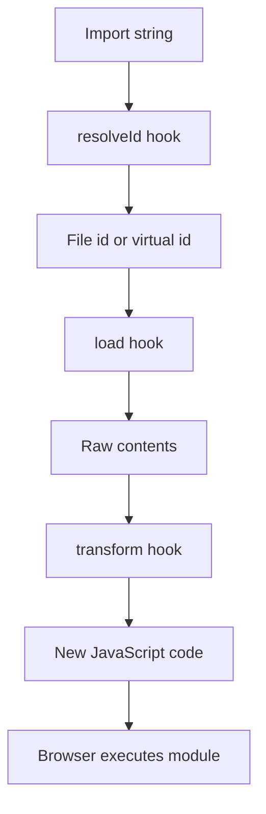

# Inspect and Transform: How Vite Hooks Rewrite Your Source Before It Reaches the Browser

## English

Between the file on disk and the module the browser executes, Vite runs a chain of hooks whose names follow a pattern: load, transform, resolveId. Understanding the difference between them explains why some plugins work on any file and others only on files they claim. The resolveId hook answers 'which file does this import string point to?' and returns an id or null to defer. The load hook answers 'what are the raw contents of that id?' and is where virtual modules are born, since a plugin can return code for an id that does not exist on disk. The transform hook receives the contents plus the id and returns new code, which is where most compilation happens.

A concrete example makes the ordering clear. When you write import './styles.css', Vite's internal CSS plugin claims the id in its load or transform phase and turns the CSS into a JavaScript module that injects a <style> tag during development. Your own plugin's transform runs as part of the same pipeline, and Vite applies user plugins in the order they appear in the plugins array, with enforce: 'pre' and enforce: 'post' letting you jump ahead of or behind Vite's core plugins. If you need to see the source before Vite's CSS handling, use enforce: 'pre'; if you need to post-process the generated JavaScript, use enforce: 'post'.

Transform hooks receive a context object with a this.parse helper and the module graph, and they can be async. A common pattern is a plugin that rewrites a custom syntax, for example turning a marker like __DEV_ONLY_BLOCK__ into a conditional that is stripped in production. Because the transform runs per module and per environment, the same plugin can behave differently in dev versus build if it checks the command or the mode passed in the config.

One subtlety is that transforms run again after HMR invalidates a module, so transform hooks should be pure functions of their input. If a transform keeps state across calls, for example a counter used to generate unique names, the names will drift between dev and production and between reloads. Deriving names deterministically from the id and content avoids this class of bug.

The practical payoff is that you rarely need to fork a tool. A short plugin with a resolveId for an alias, a load for a virtual module such as 'virtual:build-info', and a transform for a syntax tweak covers a surprising amount of ground. Reading the plugin's own source, or logging the id and code inside each hook, is the fastest way to learn what Vite is doing to your files. Once you can see the pipeline as resolve, load, transform, the behaviour of any plugin becomes predictable.

## 中文

由磁碟上嘅檔案到瀏覽器執行嘅模組之間，Vite 會跑一串 hook，名字有規律：load、transform、resolveId。理解佢哋嘅分別，就解釋咗為何有啲插件對任何檔案都有效，有啲就只對佢宣稱嘅檔案有效。resolveId hook 答「呢個 import 字串指向邊個檔案？」，回傳一個 id 或者 null 表示交俾下一個。load hook 答「嗰個 id 嘅原始內容係咩？」，虛擬模組就係喺呢度誕生，因為插件可以為一個磁碟上唔存在嘅 id 回傳程式碼。transform hook 收到內容同 id，回傳新程式碼，大部分編譯都喺呢度發生。

一個具體例子可以講清楚次序。當你寫 import './styles.css'，Vite 內部嘅 CSS 插件喺 load 或者 transform 階段認領呢個 id，將 CSS 變成一個喺開發時注入 <style> 標籤嘅 JavaScript 模組。你自己插件嘅 transform 喺同一條管線入面執行，而 Vite 按 plugins 陣列嘅次序套用使用者插件，enforce: 'pre' 同 enforce: 'post' 俾你跳去 Vite 核心插件之前或者之後。如果你想喺 Vite 嘅 CSS 處理之前睇到原始碼，用 enforce: 'pre'；如果你想後處理產生嘅 JavaScript，用 enforce: 'post'。

transform hook 收到一個 context 物件，有 this.parse 輔助函數同模組圖，而且可以係 async。常見模式係寫一個改寫自訂語法嘅插件，例如將 __DEV_ONLY_BLOCK__ 呢類標記變成喺生產環境剝走嘅條件式。因為 transform 逐個模組、逐個環境執行，同一個插件只要檢查 config 傳入嘅 command 或者 mode，就可以喺 dev 同 build 有唔同行為。

一個微妙位係，HMR 令模組失效之後 transform 會再跑，所以 transform hook 應該係輸入嘅純函數。如果 transform 跨呼叫保留狀態，例如用計數器產生唯一名字，名字就會喺 dev 同生產之間、同每次重載之間漂移。由 id 同內容確定性地推導名字，就避開呢類 bug。

實際好處係你很少需要 fork 一個工具。一個短插件，用 resolveId 處理別名、用 load 處理 'virtual:build-info' 呢類虛擬模組、用 transform 處理語法微調，已經覆蓋好多情況。讀插件自己嘅原始碼，或者喺每個 hook 入面記錄 id 同程式碼，係最快學到 Vite 對你檔案做咩嘅方法。一旦你將管線睇成 resolve、load、transform，任何插件嘅行為都變得可預測。

## Key Takeaway

Vite's resolveId, load, and transform hooks form an ordered pipeline, and enforce: 'pre' or 'post' lets a plugin choose exactly where it sits in that pipeline.

## Related Concepts
- Virtual modules
- Plugin hook ordering

## Diagram

