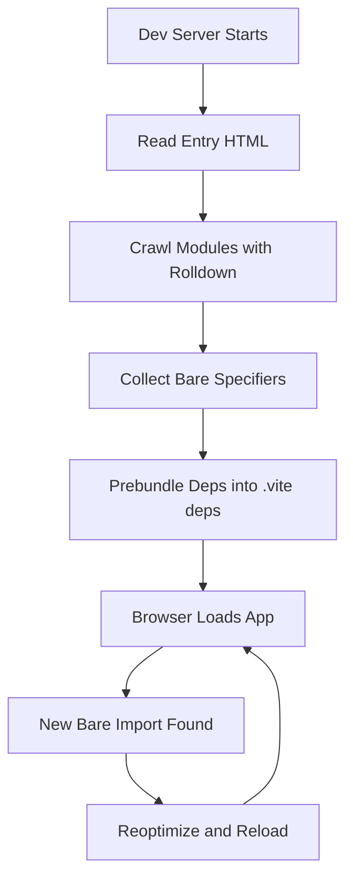

# The Optimize Deps Lifecycle: Discovery, Crawling, and the Mid-Session Re-Bundle

## English

Vite's dependency pre-bundling is not a single upfront step; it is a lifecycle with a discovery phase that can restart mid-session. When the dev server first starts, Vite has no idea which bare imports your code will eventually reach, because it only reads the entry HTML and follows imports lazily. So it uses Rolldown to crawl the entry modules, collect every bare specifier (a package name like `react` or `lodash-es` rather than a relative path), and bundle each dependency into a single file under `node_modules/.vite/deps`. This turns a package that ships hundreds of internal ES modules into one HTTP request, which matters because browsers handle a handful of parallel requests well but choke on hundreds of small ones.

The interesting part is what happens when the crawl misses something. Suppose you navigate to a lazy-loaded route that imports a package nobody touched at startup. Vite detects a bare import it has not pre-bundled, and instead of serving it unbundled, it triggers a re-optimization: it re-runs the dep bundler (Rolldown) over the newly discovered dependency, writes a new deps bundle, and then tells the browser to do a full page reload. That reload is deliberate. Because the new bundle may have different internal module IDs and URLs, any already-loaded module that references the old bundle would be pointing at stale paths, so Vite forces a clean slate.

You will see this in the terminal as a message like `new dependencies optimized: some-package` followed by `optimized dependencies changed. reloading`. It is not an error; it is the system self-correcting. The reason it feels disruptive is that it invalidates every module in the browser's ESM cache at once. In large apps with many lazy routes, this can happen repeatedly during early development, which is why Vite lets you pre-declare dependencies via the `optimizeDeps.include` config option. Listing packages there tells Vite to bundle them on the very first pass, so the mid-session reload never fires.

The opposite lever is `optimizeDeps.exclude`, useful when a dependency should be served to the browser as source rather than pre-bundled. One caveat from Vite's own docs: CommonJS dependencies generally should *not* be excluded, because the pre-bundling step is what converts them to ESM in the first place. There is also `optimizeDeps.force`, which re-runs the whole optimization on the next start regardless of cache state, handy after you upgrade a dependency and suspect the cached bundle is stale. These options exist because the crawler is heuristic: it reads static `import` statements and dynamic `import()` with literal strings, but it cannot see a specifier built from a variable at runtime.

A concrete example: if you write `const name = 'dayjs'; import(name)`, the crawler never sees `dayjs` and will discover it only when that code actually executes in the browser, triggering the reload. The mental model to keep is that pre-bundling is a cache with a discovery loop, not a one-shot compile. Understanding that loop explains three otherwise mysterious behaviours: why the first page load after adding a package is slow, why the browser sometimes reloads itself for no obvious reason, and why deleting `node_modules/.vite` so often fixes a broken dev session.

## 中文

Vite 的依賴預打包並不是一次性的前置步驟，而是一個帶有「探索階段」、甚至會在中途重啟的生命週期。開發伺服器初次啟動時，Vite 根本不知道你的程式碼最終會觸及哪些裸引入（bare import，即像 `react` 或 `lodash-es` 這種套件名，而非相對路徑）。因此它用 Rolldown 爬梳進入點模組，收集所有裸識別符（bare specifier），把每個依賴打包成 `node_modules/.vite/deps` 下的單一檔案。這能把一個內部含數百個 ES 模組的套件壓縮成一個 HTTP 請求——瀏覽器能輕鬆處理少量並行請求，卻會被數百個小請求拖垮。

真正有趣的是爬梳漏掉東西時會發生什麼。假設你導航到一條延遲載入的路由，它引入了一個啟動時沒人碰過的套件。Vite 偵測到一個尚未預打包的裸引入，它不會原樣提供，而是觸發重新優化：對新發現的依賴再跑一次 dep 打包器（Rolldown），寫出新的 deps 打包檔，然後叫瀏覽器整頁重新載入。這個重載是刻意的。因為新打包檔可能帶有不同嘅內部模組 ID 和 URL，任何已載入、仍引用舊打包檔的模組都會指向過期路徑，所以 Vite 強制清空重來。

你會在終端看到類似 `new dependencies optimized: some-package` 接著 `optimized dependencies changed. reloading` 的訊息。這不是錯誤，而是系統自我修正。它之所以令人煩躁，是因為它一次過令瀏覽器 ESM 快取中的所有模組失效。在擁有大量延遲路由的大型應用中，開發初期這可能反覆發生——這正是 Vite 讓你透過 `optimizeDeps.include` 設定選項預先宣告依賴的原因。把套件列在那裡，就等於告訴 Vite 在第一輪就打包它們，中途重載便不會觸發。

相反方向的槓桿是 `optimizeDeps.exclude`，當某個依賴應該以原始碼形式直接供瀏覽器載入、而不是預先打包時便派上用場。但 Vite 官方文件有一點提醒：CommonJS 依賴通常*不應該*被排除，因為把 CommonJS 轉成 ESM 正是預打包這一步的工作。還有 `optimizeDeps.force`，它會在下一次啟動時無視快取狀態重跑整個優化，在你升級依賴、懷疑快取打包檔過期時很方便。這些選項之所以存在，是因為爬梳器本質上是啟發式的：它讀取靜態 `import` 語句和帶字面字串的動態 `import()`，但看不見在執行時才由變數組出來的識別符。

具體例子：若你寫 `const name = 'dayjs'; import(name)`，爬梳器永遠看不到 `dayjs`，只會在該段程式碼真正在瀏覽器執行時才發現它，從而觸發重載。要記住的心智模型是：預打包是一個帶探索迴路的快取，而不是一次性編譯。明白這個迴路，就能解釋三個本來神秘的現象：為何新增套件後第一次載入頁面特別慢、為何瀏覽器有時會無緣無故自己重載、以及為何刪掉 `node_modules/.vite` 經常能修好壞掉的開發工作階段。

## Key Takeaway

Dependency pre-bundling is a discovery loop with a cache, so mid-session reloads are the system learning about imports it could not see at startup.

## Related Concepts
- Rolldown
- optimizeDeps.include

## Diagram

