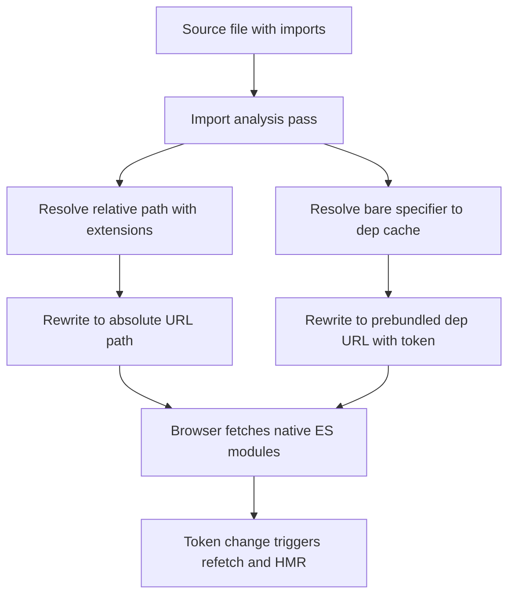

# Import Analysis in Depth: Why Relative Paths Become Absolute URLs

## English

Every time you save a file, Vite runs an import analysis pass over the module before sending it to the browser, and that pass quietly rewrites your source. Consider a file containing `import { helper } from './utils'` and `import React from 'react'`. The browser has no idea what `./utils` means relative to the server root, and it certainly cannot resolve a bare specifier like `react` without an import map. So Vite rewrites the first into something like `/src/utils.js` (an absolute URL path from the dev server root) and the second into `/node_modules/.vite/deps/react.js?v=abc123`. The browser then fetches those URLs directly as native ES modules.

This rewriting is why a few things that look broken in plain ESM work fine in Vite. Extensionless imports like `./utils` resolve because Vite applies its resolve extensions (`['.mjs', '.js', '.mts', '.ts', '.jsx', '.tsx', '.json']` by default) during analysis. Directory imports that resolve to an `index` file work for the same reason. And bare specifiers pointing into `node_modules` resolve because the pre-bundled dep cache already knows where they live. In a plain browser without a bundler, none of this would resolve, which is exactly why the analysis pass exists.

There are actually two different cache-busting query strings, and they mean different things. The `?v=abc123` token on a pre-bundled dependency URL is a *browser hash* computed from the optimizer's state — it changes when a different version of a dependency is installed (reflected in the lockfile), not when the file's own content changes. Source modules get a different token, `?t=<timestamp>`, which is what changes when you edit the file: the browser then treats it as a brand-new URL and re-fetches rather than serving the stale module from its ESM cache. This is a subtle but essential trick: native ES modules are cached aggressively by the browser and cannot be invalidated by headers alone in a reliable way, so Vite changes the URL instead. The `?t=` timestamp is also what underpins hot module replacement, because the HMR client needs to know which module URL corresponds to which file on disk.

Import analysis also handles the awkward cases. Dynamic `import()` with a relative path gets rewritten the same way, and `import.meta.url` is preserved so code that computes sibling paths still works. CSS imports like `import './styles.css'` are rewritten to a URL that Vite's dev server intercepts and serves as a JavaScript module that injects a `<style>` tag, which is how CSS HMR works without a bundler. And `new URL('./asset.png', import.meta.url)` is recognised and rewritten so the asset URL resolves correctly.

The practical consequence is that you cannot assume the source the browser sees is byte-for-byte what you wrote. If you debug by inspecting the Network tab and see URLs with query strings and absolute paths, that is the analysis output, not your source. If you write a plugin that transforms code, remember it runs before or after this pass depending on its `enforce` and hook ordering, which is why a plugin that emits bare imports can still work: analysis runs late enough to resolve them. The key insight is that Vite's dev server is a rewriter, not a bundler, and import analysis is the rewriter's core.

## 中文

每次你儲存檔案，Vite 都會在把模組送到瀏覽器之前，對它跑一趟引入分析（import analysis），而這一趟會靜靜地改寫你的原始碼。設想一個檔案含 `import { helper } from './utils'` 和 `import React from 'react'`。瀏覽器不知道 `./utils` 相對於伺服器根目錄是什麼意思，更不可能在沒有 import map 的情況下解析 `react` 這種裸識別符。於是 Vite 把前者改寫成類似 `/src/utils.js`（從開發伺服器根目錄起的絕對 URL 路徑），把後者改寫成 `/node_modules/.vite/deps/react.js?v=abc123`。瀏覽器接著直接以原生 ES 模組身份抓取這些 URL。

正是這個改寫，令一些在純 ESM 下看似行不通的東西在 Vite 中運作正常。像 `./utils` 這種無副檔名引入能解析，是因為 Vite 在分析時套用它的解析副檔名（預設為 `['.mjs', '.js', '.mts', '.ts', '.jsx', '.tsx', '.json']`）。解析到 `index` 檔案的目錄引入同理。而指向 `node_modules` 的裸識別符能解析，是因為預打包的依賴快取早已知道它們在哪裡。在沒有打包器的純瀏覽器中，這些全都解析不了——這正是分析這一步存在的理由。

改寫後 URL 中的查詢字串，其實有兩種、意思不同。預打包依賴 URL 上的 `?v=abc123` 是一個 *browser hash*，由最佳化器的狀態計算出來——當安裝了不同版本的依賴（反映在 lockfile 裡）時它才會改變，並不是因為檔案內容改變。原始碼模組則拿到另一種 token：`?t=<timestamp>`。當你編輯檔案，改變的是這個，令瀏覽器視之為全新 URL 而重新抓取，而不是從 ESM 快取供應過期模組。這是個微妙卻關鍵的技巧：原生 ES 模組會被瀏覽器積極快取，單靠標頭無法可靠地令其失效，所以 Vite 改為改變 URL。`?t=` 時間戳同時也是熱模組替換的基礎，因為 HMR 客戶端需要知道哪個模組 URL 對應磁碟上哪個檔案。

引入分析也處理棘手情況。帶相對路徑的動態 `import()` 會以同樣方式改寫，而 `import.meta.url` 會被保留，令計算同層路徑的程式碼仍然可行。像 `import './styles.css'` 的 CSS 引入會被改寫成一個 URL，由 Vite 開發伺服器攔截並以會注入 `<style>` 標籤的 JavaScript 模組形式供應——CSS 熱替換就是這樣在沒有打包器的情況下運作。而 `new URL('./asset.png', import.meta.url)` 會被識別並改寫，令資源 URL 正確解析。

實際後果是：你不能假設瀏覽器看到的原始碼與你寫的逐位元組相同。若你靠檢視 Network 面板除錯，看到帶查詢字串和絕對路徑的 URL，那是分析輸出，不是你的原始碼。若你寫一個轉換程式碼的外掛，記住它會依 `enforce` 和鉤子排序在這一趟之前或之後執行——這就是為何一個發出裸引入的外掛仍能運作：分析執行得夠晚，能解析它們。關鍵洞見是：Vite 開發伺服器是一個改寫器，不是打包器，而引入分析就是改寫器的核心。

## Key Takeaway

Vite's dev server never ships your source verbatim; import analysis rewrites relative and bare specifiers into absolute, cache-busted URLs the browser can fetch as native modules.

## Related Concepts
- bare specifier resolution
- Hot Module Replacement

## Diagram

