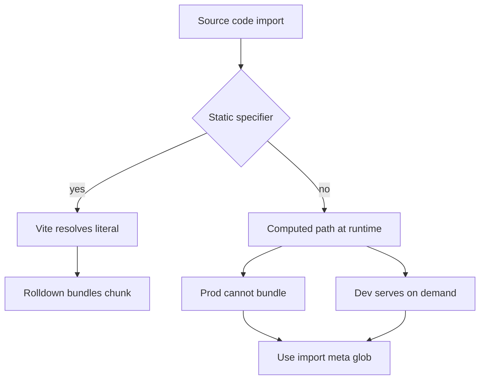

# Static Analysis Limits: What Vite Can and Cannot See in Your Imports

## English

Vite's speed comes from doing almost no work until a module is requested, but that laziness depends on static analysis: reading import statements without executing code. This works beautifully for literal specifiers like `import('./pages/Home.jsx')` and fails for anything computed at runtime. If you write `const path = './pages/' + name + '.jsx'; import(path)`, Vite sees a dynamic `import()` with a non-literal argument and cannot know which files to include in the production build. In dev it may still work, because the browser requests whatever URL the code produces and Vite serves it on demand—but in production, the bundler needs to know the full set of possible modules upfront to bundle them, and a computed path gives it nothing to bundle.

The fix is the `import.meta.glob` API, which is Vite-specific syntax that the compiler recognises statically. Writing `const modules = import.meta.glob('./pages/*.jsx')` tells Vite at build time to expand the glob into an object mapping each matching path to a dynamic import function. Because the pattern is a literal string, Vite can enumerate the files, generate the import map, and let the production bundler include them all as separate chunks. This is the sanctioned escape hatch for the 'convention-based routing' pattern where you want every file in a folder to become a route without hand-writing imports.

There is a similar limit with `require`. Vite does not implement CommonJS `require` in the browser, because native ESM has no such concept. Some tooling or older libraries assume `require` exists, and Vite handles this during pre-bundling by letting its dependency bundler (Rolldown as of Vite 8) convert CommonJS to ESM—but only for dependencies in `node_modules`, not for your own source. If you write `require('./thing')` in application code, it will fail at runtime in dev. The migration path is to use `import` or `import.meta.glob` instead.

Another limit is conditional imports inside dead branches. Vite's analysis does not do full dead-code elimination during dev; it rewrites every import it sees, including ones inside `if (false)` blocks, because it does not evaluate the condition. This is usually harmless—the browser simply fetches a module it never uses—but it can surprise you if a module has side effects on import. In production, the bundler's tree-shaking may remove the dead branch and the import with it, so dev and prod can diverge in whether a side-effecting import runs.

The unifying principle is that Vite's dev server is a lazy server optimised for literal, statically analysable imports, while its production build is a static bundler that needs the full graph upfront. Anything that hides a specifier from static analysis—string concatenation, variables, `eval`, or a module system Vite does not emulate—breaks the contract. When you hit one of these limits, the answer is almost always to make the specifier literal: use `import.meta.glob` for folder-wide imports, use explicit `import` statements for conditionals, and reserve computed `import()` for cases where you can guarantee the path resolves to a file the bundler already knows about.

## 中文

Vite 的速度來自於在模組被請求之前幾乎不做任何工作，但這種懶惰依賴靜態分析：讀取引入語句而不執行程式碼。對於像 `import('./pages/Home.jsx')` 這種字面識別符，效果極佳；對於任何在執行時才計算出來的東西，則會失效。若你寫 `const path = './pages/' + name + '.jsx'; import(path)`，Vite 看到的是一個參數非字面值的動態 `import()`，無法知道生產建置該包含哪些檔案。在開發模式下它或許仍能運作，因為瀏覽器請求程式碼產生的任何 URL，而 Vite 按需供應——但在生產環境，打包器需要事先知道所有可能模組的完整集合才能打包，而計算路徑讓它無從打包。

解法是 `import.meta.glob` API，這是 Vite 專屬語法，編譯器能靜態識別。寫 `const modules = import.meta.glob('./pages/*.jsx')` 就等於在建置時告訴 Vite 把 glob 展開成一個物件，把每個符合的路徑映射到一個動態引入函數。因為模式是字面字串，Vite 能列舉檔案、產生引入映射，並讓生產打包器把它們全部作為獨立分塊納入。這正是「約定式路由」模式的官方出口——你想讓資料夾內每個檔案都成為一條路由，而不必手寫引入。

`require` 也有類似限制。Vite 不在瀏覽器中實作 CommonJS 的 `require`，因為原生 ESM 根本沒有這個概念。有些工具或較舊的函式庫假設 `require` 存在，Vite 在預打包期間透過讓依賴打包器（Vite 8 起為 Rolldown）把 CommonJS 轉成 ESM 來處理——但僅限於 `node_modules` 中的依賴，不包括你自己的原始碼。若你在應用程式碼中寫 `require('./thing')`，開發時執行階段就會失敗。遷移路徑是改用 `import` 或 `import.meta.glob`。

另一個限制是死分支內的條件引入。Vite 在開發時不做完整的死碼消除；它會改寫看到的每一個引入，包括 `if (false)` 區塊內的，因為它不會評估條件。這通常無害——瀏覽器只是抓取一個永遠用不到的模組——但若某模組在引入時有副作用，就會令你意外。在生產環境，打包器的 tree-shaking 可能移除死分支連同其引入，於是開發與生產在「有副作用的引入是否執行」上可能出現分歧。

統一的原則是：Vite 的開發伺服器是為字面、可靜態分析的引入而優化的懶惰伺服器，而它的生產建置是需要完整圖譜的靜態打包器。任何把識別符藏起來、令靜態分析看不到的東西——字串串接、變數、`eval`，或 Vite 沒有模擬的模組系統——都會破壞這個契約。當你撞上這些限制，答案幾乎總是讓識別符變成字面值：用 `import.meta.glob` 處理整個資料夾的引入，用明確的 `import` 語句處理條件式，並把計算式 `import()` 留給你能保證路徑解析到打包器已知檔案的情況。

## Key Takeaway

Vite only sees imports it can read statically, so computed specifiers work in dev but silently vanish from production builds unless you use import.meta.glob or literal paths.

## Related Concepts
- import.meta.glob
- tree-shaking

## Diagram

