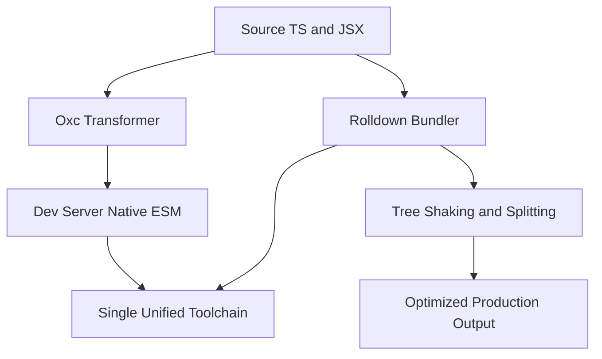

# How Vite 8 Unified on Rolldown and Oxc

## English

Vite's original design split its work across two separate tools. During development it used esbuild, a compiler written in Go, to transform TypeScript, JSX and other non-plain-JavaScript syntax — it had to be fast, because every keystroke can trigger a fresh transform. For production it switched to Rollup, a JavaScript bundler with mature scope hoisting, tree-shaking and chunk-splitting algorithms, where output size and predictability matter more than build speed. That split worked well for years, but it also created two separate transform pipelines, two plugin systems, and a growing pile of glue code keeping them in sync.

Vite 8, released in March 2026, replaced both. Production bundling now uses Rolldown, a Rust-based bundler built by the VoidZero team, and JavaScript transformation uses Oxc, a Rust-based transformer. Rolldown supports the same plugin API as Rollup and Vite, so most existing Vite plugins work unchanged. The official Vite 8 announcement reports benchmarks of roughly 10 to 30 times faster than Rollup for production builds, at performance levels matching esbuild. The unifying effect is the headline: instead of "esbuild in dev, Rollup in build", there is now one bundler and one transformer, so behaviour is much more consistent between the two phases.

The configuration surface changed to match. `build.rollupOptions` is now `build.rolldownOptions`, and the top-level `esbuild` option is now `oxc`. Rather than breaking every project at once, Vite ships a compatibility layer that converts the old option names automatically — for example `esbuild.jsxFactory` maps to `oxc.jsx.pragma`, `esbuild.jsxFragment` maps to `oxc.jsx.pragmaFrag`, and `esbuild.jsxImportSource` maps to `oxc.jsx.importSource`. The `esbuild` option is now deprecated and will be removed in the future, and the migration guide explicitly encourages moving to `oxc`. Dependency optimization also moved: Rolldown now pre-bundles dependencies instead of esbuild, with `optimizeDeps.esbuildOptions` deprecated in favour of `optimizeDeps.rolldownOptions`.

Some limitations come with the swap. esbuild is no longer used directly by Vite and is now only an optional dependency — plugins that call `transformWithEsbuild` must install esbuild themselves, and that function is deprecated in favour of `transformWithOxc`. The Oxc transformer does not yet lower native decorators, so Babel or SWC must be used for that. Rolldown also does not support a handful of Rollup features, including the `system` and `amd` output formats, the `resolveImportMeta` hook and the `shouldTransformCachedModule` hook. Rollup parallel hooks now run sequentially, which is a meaningful behavioural change for plugins that relied on parallelism.

A useful mental model: Vite 8 is not one compiler either, but it is now one *family* of tools. Rolldown handles the bundling in both phases and Oxc handles the transforms, so the dev server and the production build share the same underlying engine rather than talking to two different ones.

## 中文

Vite 最初的設計把工作分給兩個不同的工具。開發階段用 esbuild（一個以 Go 語言編寫的編譯器）來轉換 TypeScript、JSX 等非純 JavaScript 語言——因為每次按鍵都可能觸發新一輪轉換，它必須夠快。生產階段則改用 Rollup，一個以 JavaScript 寫成的打包器，擁有經多年打磨的 scope hoisting、tree-shaking 與 chunk 分割演算法；在那裡，輸出大小與可預測性比建置速度更重要。這個分工多年來運作良好，但也同時產生了兩條獨立的轉換管線、兩套外掛系統，以及愈來愈多的黏合程式碼去維持兩者同步。

2026 年 3 月推出的 Vite 8 把兩者都換掉了。生產打包現在使用由 VoidZero 團隊開發、以 Rust 寫成的 Rolldown，JavaScript 轉換則使用同樣以 Rust 寫成的 Oxc。Rolldown 支援與 Rollup 及 Vite 相同的外掛 API，所以現有的大多數 Vite 外掛無需修改即可運作。Vite 8 官方發布文章指出，生產建置的基準測試大約比 Rollup 快 10 至 30 倍，效能水平與 esbuild 相若。統一化正是重點：不再是「dev 用 esbuild、build 用 Rollup」，而是一個打包器加一個轉換器，因此兩個階段的行為一致得多。

設定介面也跟著改變。`build.rollupOptions` 現在是 `build.rolldownOptions`，頂層的 `esbuild` 選項則變成 `oxc`。為了不一次過破壞所有專案，Vite 提供了一層相容機制，會自動把舊選項名稱轉換過去——例如 `esbuild.jsxFactory` 對應 `oxc.jsx.pragma`、`esbuild.jsxFragment` 對應 `oxc.jsx.pragmaFrag`、`esbuild.jsxImportSource` 對應 `oxc.jsx.importSource`。`esbuild` 選項現已被標示為 deprecated，日後會移除，遷移指南亦明確建議改用 `oxc`。依賴最佳化同樣換掉了：現在由 Rolldown 負責預先打包，而 `optimizeDeps.esbuildOptions` 亦被棄用，改用 `optimizeDeps.rolldownOptions`。

這個替換也帶來一些限制。esbuild 不再被 Vite 直接使用，現在只是選用依賴——呼叫 `transformWithEsbuild` 的外掛必須自行安裝 esbuild，而該函數亦被棄用，建議改用 `transformWithOxc`。Oxc 轉換器目前還未能降級原生 decorators，因此這方面仍需用 Babel 或 SWC。Rolldown 亦不支援部分 Rollup 功能，包括 `system` 與 `amd` 輸出格式、`resolveImportMeta` hook 與 `shouldTransformCachedModule` hook。另外，Rollup 的平行 hook 現在會循序執行——對依賴平行處理的外掛而言，這是一個具意義的行為變化。

一個好用的心智模型：Vite 8 同樣不只一個編譯器，但現在是同一「家族」的工具。Rolldown 在兩個階段都負責打包，Oxc 負責轉換，所以開發伺服器與生產建置共用同一套底層引擎，而不是各自跟兩台不同的機器對話。

## Key Takeaway

Vite 8 replaced the esbuild-plus-Rollup split with a unified Rust stack of Rolldown for bundling and Oxc for transformation, changing `build.rollupOptions` to `build.rolldownOptions` and `esbuild` to `oxc`.

## Related Concepts
- Rolldown
- Oxc transformer
- Rollup plugin API compatibility

## Diagram

