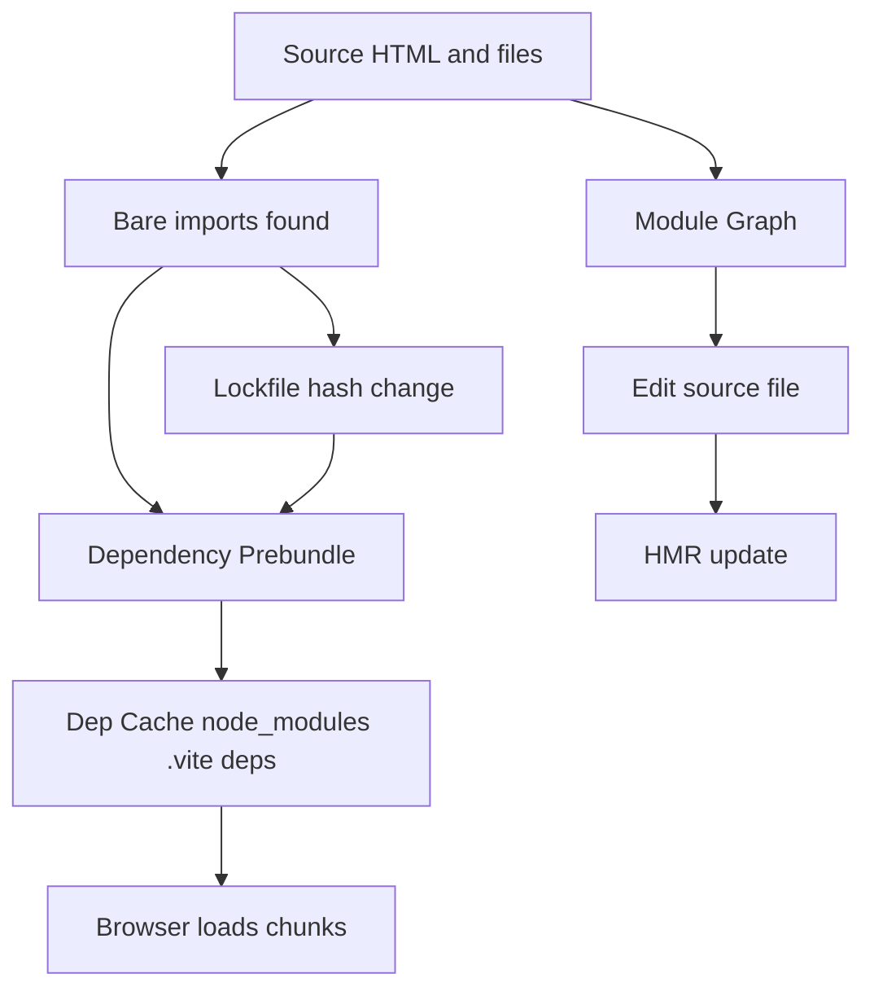

# The Dependency Graph vs the Module Graph: Two Different Pictures of Your Code

## English

Vite keeps two related but distinct graphs, and confusing them is a common source of misunderstanding about caching and invalidation. The module graph is the one most people mean when they say 'the graph': it is the record of every module the dev server has transformed, with edges representing import relationships. When a file changes, Vite walks backwards along those edges to find every importer that needs re-transforming, then pushes an HMR update to the browser. The module graph is built lazily — a module only enters the graph the first time the browser requests it, which is why Vite can start so fast even in a huge codebase.

The dependency graph (sometimes called the dep cache graph) is different: it describes the pre-bundled third-party packages produced at startup. Vite crawls your entry HTML and source files looking for bare imports like `import React from 'react'`, groups them into chunks, and writes the results to `node_modules/.vite/deps`. (In Vite 7 and earlier that pre-bundling was done by esbuild in its `--bundle` mode with `--splitting`; Vite 8 moved dependency optimization to Rolldown.) The browser then loads those pre-bundled chunks instead of hundreds of individual files from `node_modules`, avoiding the request waterfall that would otherwise crush performance. This graph is keyed by a hash of your lockfile, config, and the discovered dependencies, so it only rebuilds when something material changes.

The two graphs interact in a subtle way. When you edit a source file, only the module graph is invalidated — the dep cache is untouched, because your own code is not a dependency. When you install a new package or change `package.json`, Vite detects the lockfile hash change and re-runs the optimize step, rebuilding the dep cache and triggering a full page reload because the pre-bundled chunks are now different. This is why installing a package mid-session sometimes kicks you out of hot reload and back to a full refresh: the dep graph changed, not just a source file.

A practical implication: if HMR seems broken after adding a dependency, the fix is often not to touch your source but to let Vite re-optimize. Conversely, if the dev server is slow on first start in a monorepo, the culprit is usually dep discovery crawling files it should not see — which is why `optimizeDeps.include` and `optimizeDeps.exclude` exist as manual overrides. Understanding which graph you are poking at tells you whether to expect a fast HMR patch or a full reload.

## 中文

Vite 維護兩個相關但不同的圖，混淆它們是誤解快取與失效機制的常見來源。模組圖（module graph）是大多數人說「那個圖」時所指的東西：它記錄開發伺服器已轉換的每個模組，邊代表 import 關係。當檔案變更，Vite 沿邊反向走，找出所有需要重新轉換的 importer，然後向瀏覽器推送 HMR 更新。模組圖是惰性建立的——模組只在瀏覽器首次請求時才進入圖中，這正是 Vite 即使在巨大程式庫中也能極快啟動的原因。

依賴圖（dependency graph，有時叫 dep cache graph）不同：它描述啟動時產生的預先打包第三方套件。Vite 爬梳入口 HTML 與原始檔，尋找像 `import React from 'react'` 的裸 import，把它們分組成 chunk，並把結果寫到 `node_modules/.vite/deps`。（在 Vite 7 及更早版本，這個預先打包由 esbuild 以 `--bundle` 模式配合 `--splitting` 完成；Vite 8 已把依賴最佳化改為 Rolldown。）瀏覽器然後載入這些預先打包的 chunk，而不是 `node_modules` 裡數百個獨立檔案，避免原本會壓垮效能的請求瀑布。這個圖以 lockfile、設定與發現的依賴的雜湊為鍵，所以只有實質變動時才重建。

兩個圖以微妙方式互動。當你編輯原始檔，只有模組圖失效——dep cache 不動，因為你自己的程式碼不是依賴。當你安裝新套件或改 `package.json`，Vite 偵測到 lockfile 雜湊變化，重跑 optimize 步驟，重建 dep cache 並觸發整頁重載，因為預打包 chunk 已不同。這就是為何在 session 中途安裝套件有時會把你踢出熱替換、回到整頁刷新：變的是依賴圖，不只是原始檔。

實務含意：若加入依賴後 HMR 似壞，解法往往不是改原始碼，而是讓 Vite 重新 optimize。反之，若在 monorepo 中開發伺服器首次啟動很慢，元凶通常是 dep 探索爬到不該看的檔案——這正是 `optimizeDeps.include` 與 `optimizeDeps.exclude` 作為手動覆寫存在的原因。理解你在動哪個圖，就知道該預期快速 HMR 補丁還是整頁重載。

## Key Takeaway

Vite maintains a lazily-built module graph for your source and a hash-keyed dependency graph for pre-bundled packages; knowing which one changed tells you whether to expect HMR or a full reload.

## Related Concepts
- optimizeDeps
- HMR invalidation

## Diagram

