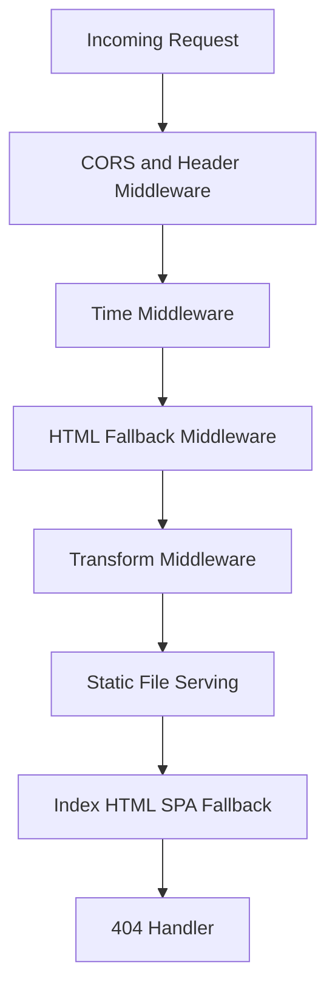

# Vite's Dev Server Is a Connect Middleware Stack, Not a Monolith

## English

Under the hood, Vite's dev server is built on Connect, a minimal Node.js middleware framework, and its behaviour is easier to reason about once you see the request as passing through an ordered chain of functions. Each middleware gets `(req, res, next)` and either handles the request or calls `next()` to pass it along. Vite registers them in a deliberate order: CORS and header handling first, then the time middleware, then the HTML fallback, then the transform middleware (which is where most of the magic happens), then static file serving, then the index.html SPA fallback, and finally a 404 handler. If you have ever wondered why a request for `/` returns your index.html but a request for `/src/main.ts` returns transformed JavaScript, the answer is which middleware claimed it first.

The transform middleware is the heavyweight. It receives any request that looks like a module path, checks whether the URL carries a query suffix like `?import` or `?raw`, looks up the file in the module graph, and if it is not cached, runs the plugin pipeline (`resolveId`, `load`, `transform`) before writing the result to the response. The plugin container is what makes Vite feel like a single system even though it is a stack of middleware — plugins can intercept requests at several points, and the container orchestrates them.

Two practical consequences follow. First, you can add your own middleware with `server.middlewares.use()` in a plugin's `configureServer` hook, and it will slot into the chain at the point Vite decides (usually before or after the transform middleware, depending on whether you return a post hook). This is how people add mock API endpoints, custom auth checks, or a dev-only proxy route without leaving Vite. Second, the order explains many confusing bugs: if your middleware calls `res.end()` but forgets to set the right content type, the browser may refuse to execute the script; if it calls `next()` after already writing headers, you can get `ERR_HTTP_HEADERS_SENT`.

Knowing the middleware order also helps when debugging why a request does not hit your plugin. If a static file exists at the requested path, the static middleware may serve it before your transform plugin ever sees it. If the request looks like an HTML navigation, the SPA fallback may rewrite it to index.html before your custom handler runs. Reading `vite/src/node/server/index.ts` in the source — or just enabling `DEBUG='vite:*'` — reveals the actual order in your version, which is more reliable than any blog post.

## 中文

在底層，Vite 的開發伺服器建構於 Connect 之上，這是一個極簡的 Node.js 中介軟體框架；一旦把請求看成穿過一串有序函式，它的行為就更容易推理。每個中介軟體收到 `(req, res, next)`，要麼處理請求，要麼呼叫 `next()` 傳下去。Vite 以刻意安排的順序註冊它們：先 CORS 與標頭處理，然後時間中介軟體，然後 HTML fallback，然後轉換中介軟體（大部分魔法在此發生），然後靜態檔案服務，然後 index.html SPA fallback，最後 404 處理器。如果你曾疑惑為何請求 `/` 回傳 index.html，而請求 `/src/main.ts` 回傳轉換後的 JavaScript，答案就是哪個中介軟體先認領了它。

轉換中介軟體是重量級角色。它接收任何看似模組路徑的請求，檢查 URL 是否帶 `?import` 或 `?raw` 之類的查詢後綴，在模組圖中查找檔案，若未快取就執行外掛管線（`resolveId`、`load`、`transform`），再把結果寫入回應。外掛容器正是讓 Vite 在是一疊中介軟體的情況下仍感覺像單一系統的原因——外掛可在多個點攔截請求，容器負責協調。

兩個實務後果隨之而來。第一，你可以在外掛的 `configureServer` 勾子中用 `server.middlewares.use()` 加入自己的中介軟體，它會依 Vite 決定的位置插入鏈中（通常在轉換中介軟體之前或之後，取決於你是否回傳 post 勾子）。這就是人們在不離開 Vite 的情況下加入 mock API 端點、自訂驗證檢查或僅開發用的代理路由的方式。第二，順序解釋了許多令人困惑的 bug：若你的中介軟體呼叫 `res.end()` 卻忘了設對 content type，瀏覽器可能拒絕執行腳本；若它已寫入標頭後才呼叫 `next()`，你可能收到 `ERR_HTTP_HEADERS_SENT`。

知道中介軟體順序也有助於除錯為何請求沒打到你的外掛。若請求路徑上存在靜態檔，靜態中介軟體可能在你的轉換外掛看到它之前就送出。若請求看似 HTML 導覽，SPA fallback 可能在你的自訂處理器執行前把它改寫成 index.html。閱讀原始碼中的 `vite/src/node/server/index.ts`——或直接啟用 `DEBUG='vite:*'`——可揭示你所用版本的真實順序，比任何部落格文章都可靠。

## Key Takeaway

Vite's dev server is an ordered Connect middleware chain, so understanding which middleware claims a request first explains most routing, transform, and custom-handler behaviour.

## Related Concepts
- Connect middleware
- configureServer hook

## Diagram

