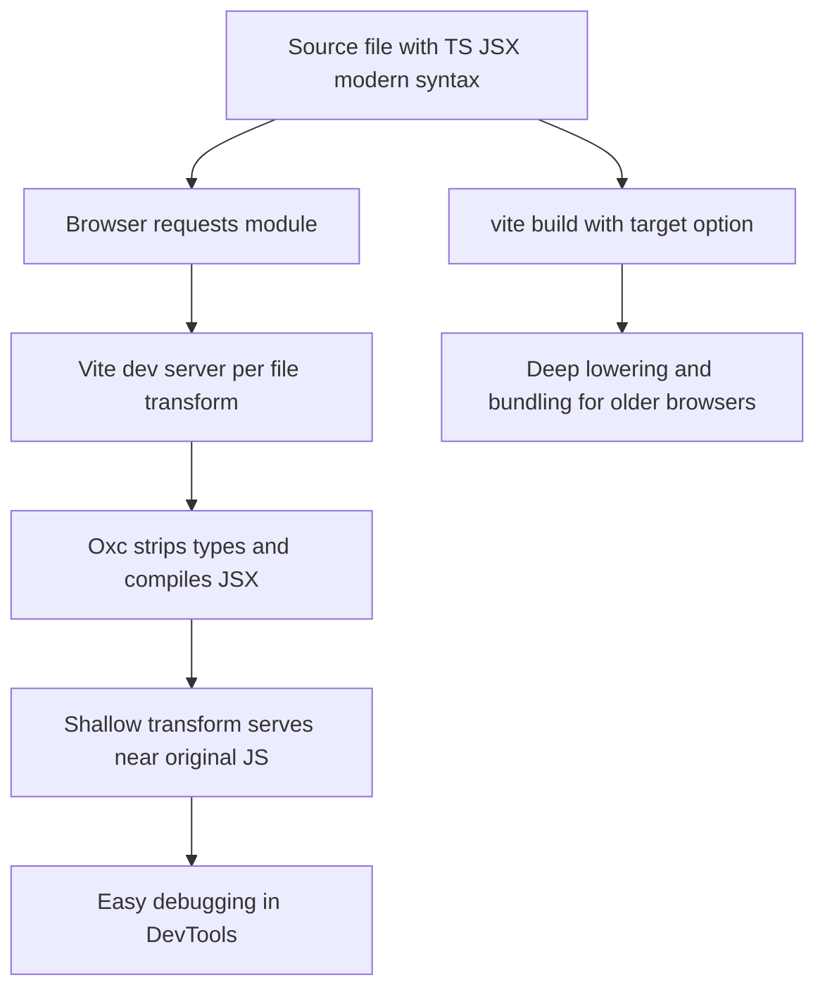

# Why Vite Needs a Browser-Targeted Transform: Syntax Lowering in Dev vs Build

## English

Vite's dev server does not bundle your modules, but it still transforms them. When you write TypeScript, JSX, or modern JavaScript syntax that the browser cannot execute natively, Vite hands each file to a transpiler before serving it over HTTP. As of Vite 8 that transpiler is Oxc, the Rust-based transformer that replaced esbuild; Vite 7 and earlier used esbuild. This is a per-file, on-demand transform: the moment the browser requests /src/App.tsx, Vite strips the type annotations, compiles the JSX, and returns plain JavaScript. The key insight is that this transform is deliberately shallow. It removes things that must disappear (types, JSX syntax) but it does not aggressively rewrite your syntax to support old browsers — Vite targets `esnext` during development, so there is no syntax lowering at all. That means the code you see in DevTools during development is close to what you wrote, which makes debugging far easier than the compiled, bundled output you would get from a traditional dev server.

The build step is where deeper transformation happens. During `vite build`, the target option in your config tells the bundler which browser versions must be supported. If you set target to something like 'es2015', the bundler will lower newer syntax such as optional chaining (`?.`), nullish coalescing (`??`), class fields, and async/await into equivalent older constructs. If you leave the default, Vite assumes a baseline of browsers that support native ES modules and dynamic import, which is why the default output is smaller and faster but will break in genuinely ancient browsers. This is the same reason the legacy plugin exists: it produces a second, fully transpiled bundle with polyfills for browsers that fail the modern baseline check.

A concrete example makes the difference clear. Imagine you write `const name = user?.profile?.name ?? 'anonymous';`. In dev, Vite serves that line almost verbatim (after stripping types if it was TypeScript), because every browser that can load the dev server's ESM output also understands optional chaining. In a production build targeting es2017, the bundler rewrites it into a nested series of ternary checks and null comparisons. The behaviour is identical, but the shipped bytes differ from what you tested. This is one of the subtle ways dev and prod can diverge, and why testing a production build before deploying is not optional.

The transform pipeline also explains why some syntax errors surface at different times. A TypeScript type error will not stop the dev server, because the transform strips types without type-checking them; it will only stop `tsc` or your editor. A genuine JavaScript syntax error, however, will surface the moment the file is requested, because the transform fails. Similarly, a feature that requires a polyfill (like `Array.prototype.at` on older engines) will not be caught by the transform at all, because polyfilling is a runtime concern, not a syntax concern. Vite does not inject polyfills automatically; that is a decision you make explicitly, usually via the legacy plugin or by importing a polyfill library at your entry point.

The practical takeaway is to think of Vite's transforms as two different jobs with two different goals. In dev, the goal is speed and fidelity: transform only what the browser cannot parse, keep everything else as close to source as possible, and rely on native ESM to avoid the cost of bundling. In build, the goal is compatibility and size: rewrite syntax to match your declared browser targets, tree-shake unused code, and produce chunks that load efficiently. Understanding which job is happening at which stage helps you diagnose the confusing cases, like a bug that only appears in production because a syntax rewrite changed evaluation order, or a feature that works in dev but fails on an older browser because no polyfill was included.

## 中文

Vite 的開發伺服器雖然不會打包你的模組，但它仍然會轉換它們。當你撰寫 TypeScript、JSX，或瀏覽器無法原生執行的現代 JavaScript 語法時，Vite 會先把每個檔案交給轉譯器，然後才透過 HTTP 提供。由 Vite 8 起，這個轉譯器就是 Oxc——用 Rust 寫、取代 esbuild 的轉換器；Vite 7 及更早版本用的是 esbuild。這是一種逐檔、按需的轉換：瀏覽器一請求 /src/App.tsx，Vite 就剝掉型別標註、編譯 JSX，回傳純 JavaScript。關鍵在於這個轉換刻意做得很淺。它只移除必須消失的東西（型別、JSX 語法），並不會積極改寫你的語法去支援舊瀏覽器——開發模式下 Vite 的轉換目標是 `esnext`，所以完全唔做語法降級。因此，開發時你在 DevTools 看到的程式碼，跟你寫的非常接近，這比傳統開發伺服器所提供的已編譯、已打包輸出更容易除錯。

建置階段才是更深層轉換發生的地方。在 `vite build` 期間，設定中的 target 選項會告訴打包器必須支援哪些瀏覽器版本。若你把 target 設成類似 'es2015'，打包器就會把較新的語法，例如可選串連（`?.`）、空值合併（`??`）、class 欄位、async/await，降級成等效的舊構造。若保留預設值，Vite 會假設瀏覽器基線支援原生 ES 模組與動態 import，這就是為什麼預設輸出更小更快，但在真正老舊的瀏覽器上會壞掉。這也是 legacy 外掛存在的原因：它會產生第二份完全轉譯、附帶 polyfill 的打包檔，給無法通過現代基線檢查的瀏覽器使用。

一個具體例子可以讓差異更清楚。假設你寫了 `const name = user?.profile?.name ?? 'anonymous';`。在開發時，Vite 幾乎原封不動地提供這一行（若是 TypeScript 則先剝掉型別），因為所有能載入開發伺服器 ESM 輸出的瀏覽器都懂可選串連。在目標為 es2017 的生產建置中，打包器會把它改寫成一連串巢狀三元判斷與 null 比較。行為一模一樣，但實際出貨的位元組跟你測試的不同。這是開發與生產之間微妙分歧的方式之一，也是為什麼部署前測試生產建置不是可選項。

轉換管線也解釋了為什麼某些語法錯誤會在不同時間出現。TypeScript 的型別錯誤不會讓開發伺服器停擺，因為轉換剝掉型別時並不做型別檢查；只有 `tsc` 或你的編輯器會擋下來。但真正的 JavaScript 語法錯誤，會在該檔案被請求的瞬間浮現，因為轉換失敗了。同樣地，需要 polyfill 的功能（例如舊引擎上的 `Array.prototype.at`）根本不會被轉換捕捉到，因為 polyfill 是執行期問題，不是語法問題。Vite 不會自動注入 polyfill；那是你必須明確做的決定，通常透過 legacy 外掛，或在進入點匯入 polyfill 函式庫。

實務上的結論是：把 Vite 的轉換想成兩份不同工作、兩個不同目標。開發時，目標是速度與保真度：只轉換瀏覽器無法解析的部分，其餘盡量貼近原始碼，並依賴原生 ESM 避免打包成本。建置時，目標是相容性與體積：依你宣告的瀏覽器目標改寫語法、樹搖掉未使用的程式碼，並產生載入效率高的 chunk。理解哪個階段在做哪份工作，能幫你診斷那些令人困惑的情況，例如某個 bug 只在生產環境出現，因為語法改寫改變了求值順序；或某個功能在開發時正常，卻在舊瀏覽器上失敗，因為沒有納入 polyfill。

## Key Takeaway

Vite's dev transform is shallow and per-file for speed and fidelity, while the production build rewrites syntax to match your declared browser targets, so dev and prod output can legitimately differ.

## Related Concepts
- Oxc transformer
- browser targets

## Diagram

