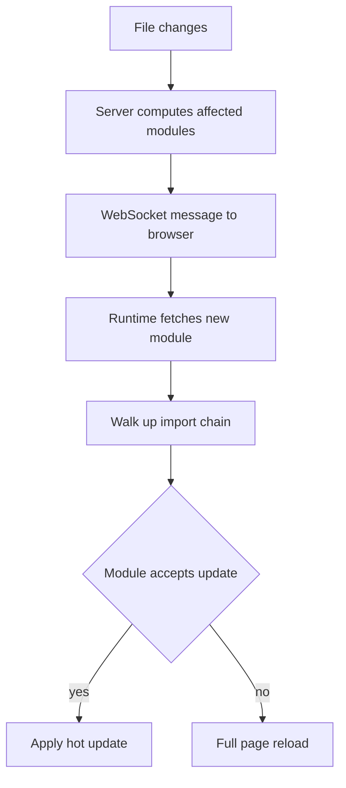

# HMR Boundaries and Accept Handlers: Who Actually Owns a Hot Update

## English

Hot Module Replacement (HMR) sounds like magic, but it is really a contract. When a file changes, Vite's dev server does not blindly swap the module in the browser. Instead, it walks up the import chain from the changed file and asks a simple question: which module is willing to accept this update? That willingness is expressed through `import.meta.hot.accept()`. A module that calls accept declares itself a boundary: it can handle a new version of itself (or of one of its dependencies) without a full page reload. If no module in the chain claims responsibility, Vite has no choice but to reload the page. This is why editing a plain utility function sometimes triggers a full refresh, while editing a component in a framework with HMR support updates instantly.

The mechanics are worth understanding because they explain a lot of confusing behaviour. When Vite detects a change, it computes the affected modules using the module graph, then sends a WebSocket message to the browser describing which modules need updating. The browser-side HMR runtime fetches the new module code and tries to propagate the update up the import chain. Each module in the chain gets a chance to accept. If a module calls `import.meta.hot.accept((newModule) => { ... })`, it receives the new module and can decide what to do: re-render a component, patch a store, or simply do nothing if the change is irrelevant. If a module calls `import.meta.hot.accept('./dep.js', (newDep) => { ... })`, it is specifically accepting updates to a dependency rather than itself.

Framework integrations hide most of this from you. React Fast Refresh, Vue's HMR, and Svelte's HMR all ship plugins that inject the right accept handlers into your components at transform time. That is why you rarely write `import.meta.hot.accept` yourself in a typical app. But the moment you write a custom module that sits outside the framework's awareness, like a plain JavaScript store, a WebSocket client, or a global event bus, you become responsible for declaring the boundary. If you do not, editing that file will reload the whole page, wiping your app state. Adding a small accept handler that re-initialises the module's state is often the difference between a smooth workflow and a frustrating one.

A classic pitfall is state loss across updates. When a module is replaced, its top-level code runs again, which means any module-level variables are re-created. If you had a counter at module scope, it resets. The `import.meta.hot.dispose()` hook lets you clean up before the old module is discarded, and `import.meta.hot.data` lets you pass state from the old module instance to the new one. This pattern is how framework HMR preserves component state across edits: the component instance is preserved, and only the render function is swapped. For your own modules, you can do the same by stashing state in `import.meta.hot.data` during dispose and reading it back during the new module's initialisation.

Another important detail is that HMR is disabled in production builds entirely. Calls to `import.meta.hot` are statically replaced with `undefined` (or the surrounding block is removed) during the build, so any code inside an `if (import.meta.hot)` guard is tree-shaken away. This means you can safely write development-only logic in your modules without shipping it. It also means you cannot rely on HMR behaviour at runtime in production, which is obvious but worth stating: HMR is a development-time convenience, not a runtime feature. Understanding the boundary contract turns HMR from a mysterious black box into a predictable tool you can extend to your own code.

## 中文

熱模組替換（HMR）聽起來像魔法，但它其實是一份契約。當檔案變更時，Vite 的開發伺服器不會盲目地在瀏覽器中替換模組。相反地，它會從變更的檔案沿著 import 鏈往上走，問一個簡單的問題：哪個模組願意接受這次更新？這份意願透過 `import.meta.hot.accept()` 表達。呼叫 accept 的模組宣告自己是一個邊界：它能處理自身（或其依賴之一）的新版本，而不需要整頁重新載入。如果鏈上沒有任何模組願意承擔責任，Vite 就只能重新載入頁面。這就是為什麼編輯一個普通工具函式有時會觸發整頁重新整理，而編輯一個有 HMR 支援的框架元件卻能即時更新。

背後的機制值得理解，因為它能解釋許多令人困惑的行為。當 Vite 偵測到變更，它會用模組圖計算受影響的模組，然後透過 WebSocket 訊息告訴瀏覽器哪些模組需要更新。瀏覽器端的 HMR 執行期會抓取新的模組程式碼，並嘗試沿 import 鏈往上傳播更新。鏈上每個模組都有機會接受。若某模組呼叫 `import.meta.hot.accept((newModule) => { ... })`，它會收到新模組，並可自行決定要做什麼：重新渲染元件、修補 store，或若變更無關就什麼都不做。若某模組呼叫 `import.meta.hot.accept('./dep.js', (newDep) => { ... })`，它便是明確接受某個依賴的更新，而非自身。

框架整合把大部分細節藏起來了。React Fast Refresh、Vue 的 HMR、Svelte 的 HMR 都附帶外掛，在轉換時把正確的 accept 處理器注入你的元件。這就是為什麼在典型應用中，你很少自己寫 `import.meta.hot.accept`。但一旦你寫了框架不知道的自訂模組，例如純 JavaScript store、WebSocket 客戶端或全域事件匯流排，你就得負責宣告邊界。若不宣告，編輯那個檔案就會重新載入整頁，清空應用狀態。加一個小小的 accept 處理器來重新初始化模組狀態，往往就是順暢工作流與令人沮喪的差別。

一個經典陷阱是更新間的狀態遺失。模組被替換時，它的頂層程式碼會再跑一次，這意味著任何模組層級變數都會被重新建立。若你在模組作用域放了計數器，它就會歸零。`import.meta.hot.dispose()` 鉤子讓你在舊模組被丟棄前清理，而 `import.meta.hot.data` 讓你從舊模組例項傳遞狀態給新例項。框架 HMR 就是靠這個模式保留元件狀態：元件例項被保留，只替換 render 函式。對你自己的模組，你也可以在 dispose 時把狀態塞進 `import.meta.hot.data`，並在新模組初始化時讀回來。

另一個重要細節是 HMR 在生產建置中完全停用。對 `import.meta.hot` 的呼叫在建置時會被靜態替換成 `undefined`（或整個區塊被移除），因此任何寫在 `if (import.meta.hot)` 防護內的程式碼都會被樹搖掉。這表示你可以安心在模組裡寫僅限開發的邏輯，而不會出貨。這也意味著你不能在生產執行期依賴 HMR 行為，這點很明顯但值得說明：HMR 是開發時的便利，不是執行期功能。理解邊界契約，能讓 HMR 從神秘黑箱變成你能延伸到自己程式碼的可預測工具。

## Key Takeaway

HMR works through an explicit accept contract where modules declare themselves as update boundaries, and framework plugins just inject those handlers for you.

## Related Concepts
- import.meta.hot
- module graph

## Diagram

