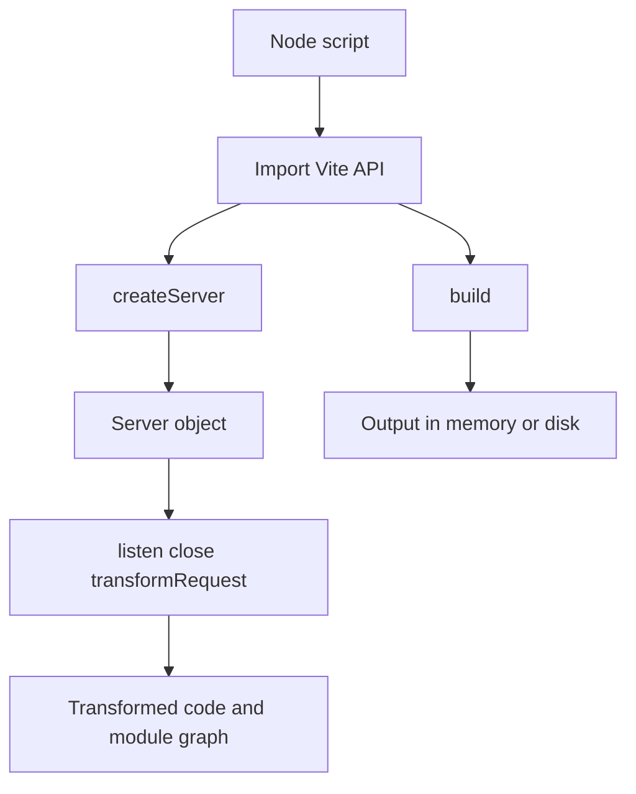

# Vite's Node.js API: Embedding the Dev Server and Build in Your Own Scripts

## English

Most people interact with Vite through the command line: `vite` for development, `vite build` for production. But under the hood, those commands are thin wrappers around a JavaScript API that you can call directly from Node.js. The two main entry points are `createServer` (from `vite`) and `build` (also from `vite`). Calling `createServer({ ... })` returns a server object with methods like `listen()`, `close()`, and `transformRequest()`. This is how tools like Vitest, Storybook, and various meta-frameworks integrate Vite: they do not shell out to the CLI, they import the API and drive it programmatically. Knowing this API unlocks a lot of custom workflows.

A common use case is testing. Vitest, for example, uses Vite's transform pipeline to run your test files through the same plugins and aliases your app uses, so a test sees the same module resolution as production code. If you are writing a custom test runner or a script that needs to compile a single file on the fly, you can call `server.transformRequest('/src/foo.ts')` and get back the transformed code plus metadata like the source map and the list of imported modules. This is also how you would build a custom linter that needs to understand your project's actual module graph rather than guessing from file paths.

Another use case is programmatic builds. If you are writing a build script that needs to produce multiple outputs, or that needs to run Vite after some custom preprocessing step, you can call `build({ ... })` directly instead of spawning a child process. The function accepts the same options as the config file, plus a few extras like `write: false` (return the output in memory instead of writing to disk) and `build.watch` (rebuild on file changes). Returning output in memory is especially useful for server-side rendering setups where you want to evaluate the built code without touching the filesystem, or for testing plugins by inspecting their output.

A third use case is embedding the dev server inside a larger process. Imagine a desktop app built with Electron, or a CLI tool that needs to serve a preview of a user's project. You can create a Vite server, call `listen()` to bind it to a port, and then point a browser window at it. When the user is done, call `close()` to shut it down cleanly. This pattern is common in tools that want to offer a live preview without requiring the user to run a separate terminal command. The server object also exposes `ws` (the WebSocket server used for HMR) and `middlewares` (the Connect stack), so you can mount additional routes or inspect connections if you need to.

One caveat is that the API is not a stable contract in the same way the config file is. Options occasionally change between major versions, and some internal methods are not documented for public use. The safe approach is to stick to the documented entry points (`createServer`, `build`, `resolveConfig`, `preview`) and treat anything else as internal. Reading the Vite source or the type definitions is often the fastest way to discover what is available, but check the changelog before relying on a method across upgrades. Used carefully, the Node.js API turns Vite from a command you run into a library you compose with.

## 中文

多數人是透過命令列使用 Vite：開發時跑 `vite`，生產時跑 `vite build`。但在底層，這些指令只是 JavaScript API 的薄包裝，你可以直接從 Node.js 呼叫。兩個主要進入點是 `createServer`（來自 `vite`）與 `build`（同樣來自 `vite`）。呼叫 `createServer({ ... })` 會回傳一個伺服器物件，帶有 `listen()`、`close()`、`transformRequest()` 等方法。Vitest、Storybook 以及各種 meta 框架就是這樣整合 Vite 的：它們不是呼叫 CLI，而是匯入 API 並以程式方式驅動。認識這個 API 能解鎖許多自訂工作流。

一個常見用途是測試。舉例來說，Vitest 使用 Vite 的轉換管線來執行你的測試檔，讓測試經過跟應用相同的插件與別名，因此測試看到的模組解析跟生產程式碼一致。如果你在寫自訂測試執行器，或需要即時編譯單一檔案的腳本，可以呼叫 `server.transformRequest('/src/foo.ts')`，取回轉換後的程式碼，以及 source map、被匯入模組清單等中介資料。這也是打造自訂 linter 的方式之一，讓它理解專案實際的模組圖，而不是從檔案路徑猜測。

另一個用途是程式化建置。如果你在寫需要產生多份輸出的建置腳本，或需要在某些自訂前處理後再跑 Vite，可以直接呼叫 `build({ ... })`，而不必啟動子行程。這個函式接受與設定檔相同的選項，外加一些額外的，例如 `write: false`（把輸出留在記憶體而不寫到磁碟）與 `build.watch`（檔案變更時重建）。把輸出留在記憶體，對伺服器端渲染特別有用：你想在評估建置後的程式碼時不碰檔案系統；或者用來測試插件，直接檢查它們的輸出。

第三個用途是把開發伺服器嵌進更大的行程。想像一個用 Electron 打造的桌面應用，或一個需要為使用者專案提供預覽的 CLI 工具。你可以建立 Vite 伺服器、呼叫 `listen()` 綁定連接埠，然後把瀏覽器視窗指向它。使用者完成後，呼叫 `close()` 乾淨關閉。這種模式在想要提供即時預覽、又不要求使用者另開終端機指令的工具中很常見。伺服器物件也暴露 `ws`（用於 HMR 的 WebSocket 伺服器）與 `middlewares`（Connect 中介層堆疊），因此你可以掛載額外路由或檢查連線。

一個注意事項是：這個 API 不像設定檔那樣是穩定契約。選項偶爾會在主要版本間變動，有些內部方法並未公開文件化。安全的做法是只使用有文件的進入點（`createServer`、`build`、`resolveConfig`、`preview`），其餘視為內部。閱讀 Vite 原始碼或型別定義，往往是發現有哪些可用的最快方式，但跨版本升級前請先查變更紀錄。謹慎使用的話，Node.js API 能把 Vite 從你執行的指令，變成你能組合的函式庫。

## Key Takeaway

Vite exposes createServer and build as a Node.js API, letting tools like test runners and meta-frameworks drive the dev server and build programmatically instead of shelling out to the CLI.

## Related Concepts
- createServer
- programmatic build

## Diagram

