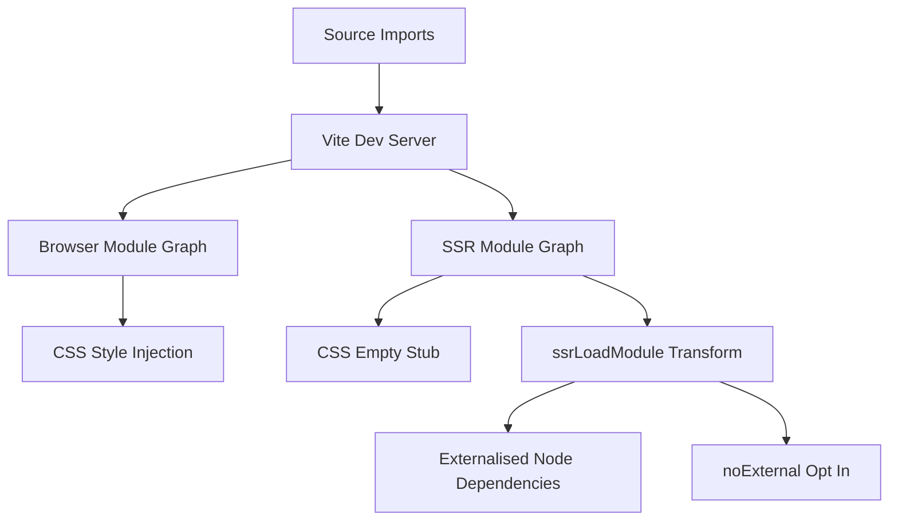

# Vite's SSR Pipeline: Two Module Graphs and Externalised Dependencies

## English

When you run Vite in server-side rendering mode, the dev server stops being one graph of modules and becomes two. The browser graph holds code that will run in the client; the SSR graph holds code that will run in Node. Vite keeps them separate because the same import specifier can resolve to different files depending on the environment — a `.css` import in the browser graph becomes a style injection module, while in the SSR graph it usually becomes an empty stub so that Node never tries to parse CSS. The `ssrLoadModule` API is what lets a framework's dev server pull a server entry through Vite's transform pipeline on demand, so your server code gets TypeScript stripping, JSX transforms, and alias resolution just like client code, without a separate build step.

The second key idea is externalisation. Node packages that ship CommonJS or native binaries (think a database driver or an image library) are painful to run through Vite's transform pipeline, and they often behave differently when bundled. So Vite marks most `node_modules` dependencies as external in SSR: instead of inlining them, it rewrites the import to a real Node `import()` or `require()` call so the package loads natively at runtime. Only packages you explicitly opt in via `ssr.noExternal` get processed by Vite. This is why a library that ships untranspiled modern syntax can break SSR until you add it to `noExternal` — you are telling Vite 'this one needs my transform pipeline'.

In production the picture flips again. The SSR build is a separate Rolldown pass configured with `build.ssr` (Rollup in Vite 7 and earlier), which targets Node rather than the browser. It does not hash filenames the way client builds do, because there is no long-term browser cache to defeat; the server simply imports the file. It also skips the preload helper and HTML handling, since there is no `<script>` tag to inject. The output is usually a single entry chunk plus whatever dynamic imports your server code uses.

A practical consequence: environment variables behave differently across the two graphs. Anything prefixed for client exposure is inlined into the browser bundle at build time, but server code reads `process.env` at runtime, so a value can change between deploys without a rebuild. Mixing the two — reading a secret in a module that also gets imported by the client graph — is one of the classic SSR mistakes, and Vite's environment separation is designed to make that boundary visible rather than silent.

Finally, SSR in Vite is deliberately unopinionated. Vite gives you `ssrLoadModule`, an SSR build target, and externalisation rules; it does not give you a request handler, a router, or a hydration strategy. Frameworks layer those on top. Understanding this split — two dev graphs, externalised dependencies, a separate Node build — explains most of the confusing 'works in dev, breaks in prod' SSR bugs you will encounter.

## 中文

當你以伺服器端渲染（SSR）模式運行 Vite 時，開發伺服器就不再是單一的模組圖，而是兩個。瀏覽器圖存放將在客戶端執行的程式碼；SSR 圖存放將在 Node 中執行的程式碼。Vite 之所以把它們分開，是因為同一個 import 指定符在不同環境下可能解析到不同檔案——在瀏覽器圖中，一個 `.css` import 會變成注入樣式的模組，而在 SSR 圖中它通常變成一個空殼，好讓 Node 永遠不會嘗試解析 CSS。`ssrLoadModule` 這個 API 正是讓框架的開發伺服器可以按需把伺服器入口拉進 Vite 的轉換管線，於是你的伺服器程式碼也能獲得 TypeScript 剝離、JSX 轉換與別名解析，與客戶端程式碼無異，而毋須另建一次。

第二個關鍵概念是外部化（externalisation）。以 CommonJS 形式發佈或帶原生二進位檔的 Node 套件（例如資料庫驅動或影像處理庫）很難穿過 Vite 的轉換管線，而且它們被打包後的行為往往不同。因此 Vite 在 SSR 中把大部分 `node_modules` 依賴標記為 external：不是把它們內聯，而是把 import 改寫成真正的 Node `import()` 或 `require()` 呼叫，讓套件在執行時以原生方式載入。只有你透過 `ssr.noExternal` 明確選擇加入的套件才會被 Vite 處理。這就是為何一個發佈未轉譯現代語法的套件會令 SSR 出錯，直到你把它加進 `noExternal`——你是在告訴 Vite「這一個需要經過我的轉換管線」。

在生產環境中，情況又再反轉。SSR 建置是另一個獨立的 Rolldown 流程，以 `build.ssr` 設定（Vite 7 及更早版本用 Rollup），目標是 Node 而非瀏覽器。它不會像客戶端建置那樣為檔名加上雜湊，因為沒有瀏覽器長期快取需要對抗；伺服器只是直接 import 該檔案。它也會略過 preload 輔助函式與 HTML 處理，因為根本沒有 `<script>` 標籤可注入。輸出通常是一個入口 chunk，加上你的伺服器程式碼所用的動態 import。

一個實際後果是：環境變數在兩個圖中的行為不同。任何加上前綴以供客戶端使用的變數會在建置時內聯進瀏覽器 bundle，但伺服器程式碼是在執行時讀取 `process.env`，所以同一個值可以在不重新建置的情況下於兩次部署之間改變。把兩者混用——在一個同時被客戶端圖 import 的模組中讀取機密——是經典的 SSR 錯誤之一，而 Vite 的環境分隔正是要讓這條界線顯而易見，而非默默無聲。

最後，Vite 的 SSR 刻意保持不設立場。Vite 給你 `ssrLoadModule`、一個 SSR 建置目標與外部化規則；它不會給你請求處理器、路由或水合策略。框架在這些之上再疊加。理解這個分界——兩個開發圖、外部化依賴、獨立的 Node 建置——就能解釋你日後遇到的大部分「開發時正常、上線就壞」的 SSR 疑難。

## Key Takeaway

Vite's SSR mode maintains a separate module graph and externalises Node dependencies, which is why server code needs different treatment from client code in both dev and build.

## Related Concepts
- Server-Side Rendering
- Dependency Externalisation

## Diagram

