# The Client Boundary and Secret Leakage: What import.meta.env Really Does

## English

Vite exposes environment variables to your code through `import.meta.env`, and by default only variables prefixed with `VITE_` are included. This prefix is not a cosmetic convention — it is a security boundary. At build time, Vite performs a textual substitution: every occurrence of `import.meta.env.VITE_API_URL` in code that reaches the browser bundle is replaced with a string literal containing the value. That means the value is baked into the shipped JavaScript, readable by anyone who opens DevTools. A database password placed in a `VITE_`-prefixed variable is not protected; it is published.

The mechanism is the same one behind `define`, the config option that lets you substitute arbitrary identifiers with constant values. `define` is a blunt textual replacement performed by the bundler, not a runtime lookup, so it only works on things that look like free identifiers and it can produce surprising results if you try to define something that shadows a local variable. Vite's `import.meta.env` handling is essentially a curated, safer layer on top of `define`, with built-in keys like `MODE`, `DEV`, `PROD`, `BASE_URL`, and `SSR` provided automatically.

Because the substitution happens at build time, the value cannot change after the build. If you deploy the same artifact to staging and production, both will carry whatever value was present when the bundle was built. This is a common source of confusion: people expect environment variables to behave like they do on a server, where restarting with a new `.env` changes behaviour. In a static frontend bundle, it does not — you must rebuild. The exception is SSR, where server-side code reads `process.env` at runtime and can genuinely vary per deploy.

There is also a subtlety about how Vite decides what is 'client code'. In a plain client build, everything is client code. In SSR or in the newer Environment API, the same source file might be transformed for multiple environments, and the substitution rules can differ per environment. A variable available in the client graph might be undefined in the server graph unless you configure it explicitly. This is intentional: it lets you avoid shipping a public API key into server code, or avoid exposing a server-only secret to the client graph by accident.

A useful mental model: treat `import.meta.env` as a build-time constant injection system with a naming convention that acts as a safety rail, not as a runtime configuration system. If a value must be secret, it belongs on a server, reached through an API or a proxy. If a value must change without a rebuild, it must be fetched at runtime. Everything else — public analytics IDs, feature flags baked at build time, the base URL — is a fair candidate for `VITE_` variables.

## 中文

Vite 透過 `import.meta.env` 把環境變數暴露給你的程式碼，而預設只有以 `VITE_` 為前綴的變數會被包含在內。這個前綴不是裝飾性的慣例，而是一條安全界線。在建置時，Vite 會進行文字替換：在到達瀏覽器 bundle 的程式碼中，每一處 `import.meta.env.VITE_API_URL` 都會被替換成包含該值的字串字面量。這意味著該值被烘焙進出貨的 JavaScript 中，任何打開開發者工具的人都能讀到。把資料庫密碼放進以 `VITE_` 為前綴的變數並不安全；它是被公開了。

這個機制與 `define` 背後的機制相同——`define` 是設定選項，讓你用常數值替換任意識別符。`define` 是打包器執行的粗暴文字替換，而非執行時查找，所以它只對看起來像自由識別符的東西有效，而如果你試圖定義一個會遮蔽本地變數的名稱，結果可能出人意表。Vite 的 `import.meta.env` 處理本質上是建構在 `define` 之上、經過整理且更安全的一層，並自動提供 `MODE`、`DEV`、`PROD`、`BASE_URL` 與 `SSR` 等內建鍵。

由於替換發生在建置時，該值在建置之後就無法改變。如果你把同一個產物部署到預備環境與生產環境，兩者都會帶著 bundle 建置時存在的值。這是常見的混淆來源：人們期望環境變數像在伺服器上一樣運作，即以新的 `.env` 重新啟動就會改變行為。在靜態前端 bundle 中並非如此——你必須重新建置。例外是 SSR，伺服器端程式碼在執行時讀取 `process.env`，確實可以每次部署都不同。

還有一個微妙之處：Vite 如何決定什麼是「客戶端程式碼」。在純客戶端建置中，一切都是客戶端程式碼。在 SSR 或較新的 Environment API 中，同一個原始檔案可能會為多個環境轉換，而替換規則可以因環境而異。在客戶端圖中可用的變數，在伺服器圖中可能未定義，除非你明確設定。這是刻意的：它讓你避免把公開 API 金鑰送進伺服器程式碼，或避免意外把伺服器專用機密暴露給客戶端圖。

一個有用的心智模型：把 `import.meta.env` 視為一套建置時常數注入系統，其命名慣例扮演安全護欄的角色，而不是一套執行時配置系統。如果某個值必須保密，它屬於伺服器，透過 API 或代理存取。如果某個值必須在不重新建置的情況下改變，它必須在執行時取得。其餘一切——公開的分析 ID、在建置時烘焙的功能旗標、基礎 URL——都是 `VITE_` 變數的合適候選。

## Key Takeaway

import.meta.env is build-time textual substitution guarded by a VITE_ prefix, so anything secret must live on a server, never in the client bundle.

## Related Concepts
- Build-Time Substitution
- Environment Variables

## Diagram

```mermaid
flowchart TD
    A[Source code] --> B[Find import meta env VITE key]
    B --> C[Read value at build time]
    C --> D[Textual substitution]
    D --> E[String literal baked in bundle]
    E --> F[Shipped JavaScript]
    F --> G[Readable in DevTools]
    C --> H[Same value for every deploy until rebuild]
```

