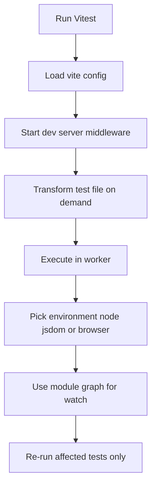

# Testing Inside Vite: Vitest, jsdom, and the Transform Pipeline Reuse

## English

Vitest is a test runner that reuses Vite's config and transform pipeline rather than building its own. That single design choice explains most of its behaviour. When you run tests, Vitest resolves your `vite.config.ts`, applies the same aliases, the same plugins, the same `define` substitutions, and the same module resolution rules that your app uses. A test that imports `@/components/Button.vue` resolves identically to the app, so you stop maintaining a parallel `jest.config` with a duplicate `moduleNameMapper` that drifts out of sync.

The runner exploits Vite's dev server architecture. Instead of bundling test files ahead of time, Vitest starts a Vite dev server in middleware mode, transforms each test file on demand, and executes it in a worker. Because modules are transformed lazily and cached, running a single test file is fast even in a large repository. Vitest also uses Vite's module graph to know which modules a test imported, so it can invalidate and re-run only affected tests in watch mode — the same dependency-tracking idea that powers HMR, repurposed for test selection.

The environment question is where testing gets interesting. Browser APIs like `document`, `window`, or `localStorage` do not exist in Node, so Vitest offers environment options: `node` for pure logic, `jsdom` or `happy-dom` for a simulated DOM, and a real browser mode using Playwright or WebdriverIO for tests that need actual layout and rendering. The simulated DOM is fast but incomplete — it does not do layout, so anything depending on element dimensions, scrolling, or real CSS will behave differently. Knowing which environment your test needs is often the difference between a reliable suite and a flaky one.

Mocking follows the same philosophy. Vitest provides `vi.mock` for module-level mocks and `vi.spyOn` for observing calls, and because it runs inside Vite's resolver, mocks respect your aliases and path mappings. You can also mock CSS and asset imports, which Vite treats as modules — importing a `.css` file in a test returns a stub rather than failing. This is a direct benefit of Vite's decision to model every file type as a module.

One caveat worth internalising: because Vitest shares Vite's transform pipeline, a misconfiguration in `vite.config.ts` will break your tests in exactly the same way it breaks your app, and conversely a plugin that only runs during build will not run during tests unless you configure it for the test environment. Tests are not a separate universe; they are another consumer of the same pipeline. That is the point — and also the thing to check first when tests behave unexpectedly.

## 中文

Vitest 是一個重用 Vite 設定與轉換管線、而非自行另建的測試執行器。這個單一設計選擇解釋了它的大部分行為。當你執行測試時，Vitest 會解析你的 `vite.config.ts`，套用相同的別名、相同的插件、相同的 `define` 替換，以及與你的應用程式相同的模組解析規則。一個 import `@/components/Button.vue` 的測試，解析方式與應用程式完全一致，於是你不再需要維護一份平行的 `jest.config`，裡面重複的 `moduleNameMapper` 還會逐漸偏離同步。

這個執行器利用了 Vite 開發伺服器的架構。Vitest 不會事先打包測試檔案，而是以 middleware 模式啟動一個 Vite 開發伺服器，按需轉換每個測試檔案，並在 worker 中執行它。由於模組是延遲轉換並快取的，即使在大型儲存庫中，執行單一測試檔案也很快。Vitest 也利用 Vite 的模組圖來得知某個測試 import 了哪些模組，因此在 watch 模式下只會失效並重跑受影響的測試——這正是驅動 HMR 的同一套依賴追蹤概念，被重新用於測試選擇。

環境問題是測試變得有趣的地方。像 `document`、`window` 或 `localStorage` 這類瀏覽器 API 在 Node 中並不存在，所以 Vitest 提供環境選項：`node` 用於純邏輯，`jsdom` 或 `happy-dom` 用於模擬 DOM，以及使用 Playwright 或 WebdriverIO 的真實瀏覽器模式，用於需要真正版面與渲染的測試。模擬 DOM 快但不完整——它不做版面計算，所以任何依賴元素尺寸、捲動或真實 CSS 的東西行為都會不同。知道你的測試需要哪個環境，往往就是可靠測試套件與不穩定套件之間的分別。

模擬（mocking）遵循同樣的哲學。Vitest 提供 `vi.mock` 做模組層級的模擬，`vi.spyOn` 觀察呼叫，而由於它運行於 Vite 的解析器之內，模擬會尊重你的別名與路徑映射。你也可以模擬 CSS 與資源 import，因為 Vite 把它們視為模組——在測試中 import 一個 `.css` 檔案會回傳一個空殼而非報錯。這是 Vite 把每種檔案類型都建模為模組這個決定的直接好處。

一個值得內化的注意事項：由於 Vitest 共用 Vite 的轉換管線，`vite.config.ts` 中的錯誤設定會以完全相同的方式弄壞你的測試與應用程式；反過來說，只在建置時運行的插件不會在測試時運行，除非你為測試環境設定它。測試不是另一個宇宙；它們是同一條管線的另一個消費者。這正是重點——也是測試行為異常時你該先檢查的地方。

## Key Takeaway

Vitest reuses Vite's config, resolver, and transform pipeline, so tests and app share one source of truth for aliases, plugins, and module handling.

## Related Concepts
- Vitest
- Module Resolution

## Diagram

