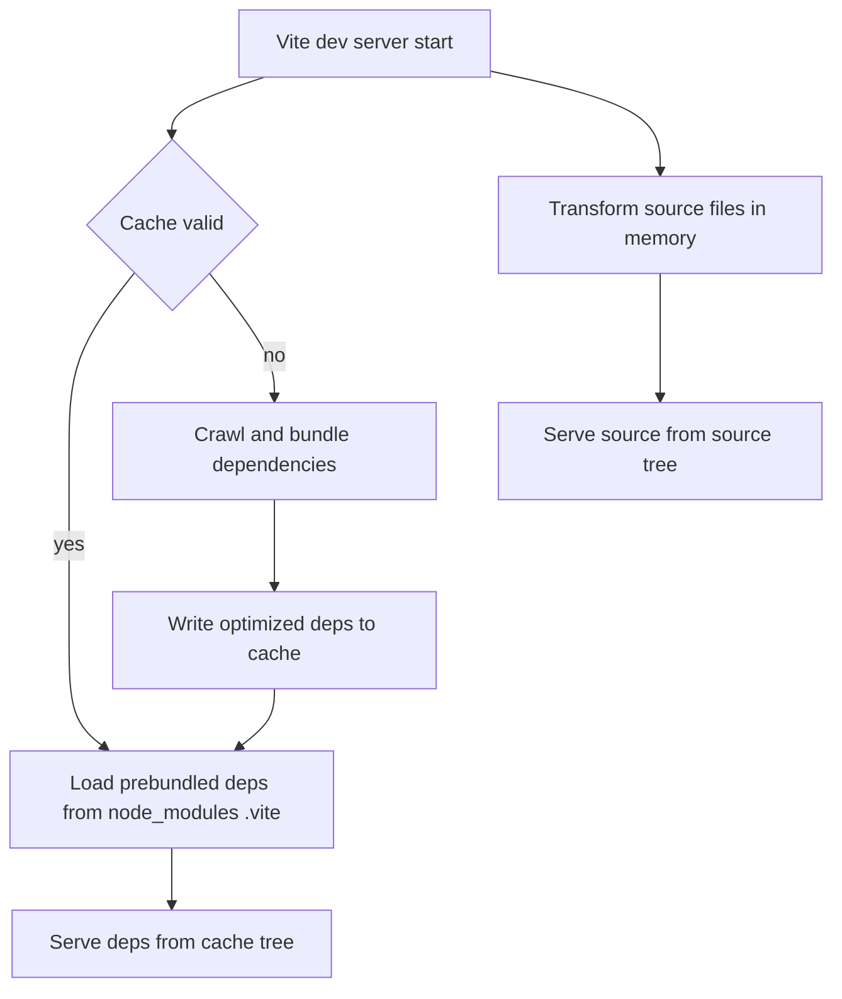

# Why Vite Splits Dependencies Into a Separate Cache: The Two-Tree Model

## English

When Vite pre-bundles your dependencies, it does not write the result into your project's node_modules or into your source tree. Instead it builds a second, parallel cache directory (by default node_modules/.vite) and serves optimized dependency files from there, while your own source files are transformed on the fly in memory. This creates what is effectively a two-tree model: the dependency tree, which changes only when your lockfile or config changes, and the source tree, which changes constantly as you type. The two trees are keyed by completely different signals. The dependency cache is invalidated by a hash of your lockfile, your Vite config, relevant config options like optimizeDeps.include, and the Vite version itself. The source tree is invalidated per-file by the module graph.

The practical consequence is that the expensive part of startup, crawling and bundling hundreds of packages, happens once and then survives restarts. If you close your laptop, reopen the project tomorrow, and nothing about your dependencies changed, Vite still finds a valid cache and skips the crawl entirely. This is why the second and subsequent starts of a Vite project feel dramatically faster than the first. The cache is not a convenience; it is the design that makes pre-bundling tolerable. Without it, every dev server start would pay the full cost of dependency discovery, and the 'instant start' promise would only hold for projects with almost no dependencies.

A useful analogy is a bakery. Your source files are the bread baked fresh every morning, because they change daily. Your dependencies are the flour, sugar, and yeast: bulk ingredients that arrive in large shipments and sit in a pantry. You do not re-order flour every time you bake a loaf; you order it when the shipment runs out or when you deliberately change suppliers (i.e. change your lockfile). The pantry is node_modules/.vite, and the shipment manifest is the hash Vite computes from your lockfile and config.

This model also explains a common source of confusion: editing a file inside node_modules to patch a bug, then wondering why the change does not appear. Because Vite serves dependencies from the pre-bundled cache, not from the raw package, a hand-edited file in node_modules may be ignored until the cache is invalidated. The supported answers are patch-package style workflows, a proper fork, or explicitly forcing a re-optimization. Knowing which tree a file belongs to tells you immediately whether your edit will take effect on reload.

Finally, the two-tree split has real implications for monorepos. A linked workspace package is source code you own, so Vite generally treats it as source rather than as an opaque dependency, which means it goes through the normal transform pipeline and gets proper HMR. But a package that is symlinked in from outside and contains pre-compiled output may be treated differently depending on configuration. When a monorepo behaves inconsistently, the first question to ask is: which tree does this file live in, and which invalidation signal governs it?

## 中文

當 Vite 預先打包你的依賴時，它不會把結果寫進專案的 node_modules，也不會寫進你的原始碼目錄。它會建立一個平行的快取目錄（預設是 node_modules/.vite），並從那裡提供已最佳化的依賴檔案；而你自己寫的原始碼則是在記憶體中即時轉換。這實質上形成了一個「雙樹模型」：依賴樹只在 lockfile 或設定變更時才改變，原始碼樹則隨著你打字而不斷改變。兩棵樹由完全不同的訊號來判定失效。依賴快取的失效依據，是 lockfile、Vite 設定、像 optimizeDeps.include 這類相關選項，以及 Vite 版本本身所算出的雜湊值；原始碼樹則是逐檔由模組圖判定。

實際後果是：啟動時最昂貴的部分——爬梳並打包數百個套件——只發生一次，之後就能跨重啟存活。如果你闔上筆電、明天再開這個專案，而依賴完全沒變，Vite 仍然會找到有效的快取，直接跳過整個爬梳流程。這就是為何同一個 Vite 專案第二次以後的啟動，感覺比第一次快得多。快取不是一種便利措施，而是讓預先打包得以被接受的設計核心。少了它，每次啟動開發伺服器都要付全額的依賴探索成本，「即時啟動」的承諾就只對幾乎沒有依賴的專案成立。

一個好用的類比是麵包店。你的原始碼是每天早上現烤的麵包，因為它每天都變；你的依賴則是麵粉、糖和酵母——大批進貨、堆在儲藏室裡的原料。你不會每烤一條麵包就重新訂一次麵粉，而是等這批貨用完、或你刻意換供應商（也就是改 lockfile）時才重訂。儲藏室就是 node_modules/.vite，進貨單就是 Vite 從 lockfile 與設定算出的雜湊值。

這個模型也解釋了一個常見的困惑：有人直接改 node_modules 裡的檔案來修 bug，然後納悶為何改動沒出現。因為 Vite 是從預先打包的快取提供依賴，而不是從原始套件讀取，所以手改的 node_modules 檔案在快取失效前可能被忽略。正式的做法是用 patch-package 之類的工作流程、自己 fork，或明確強制重新最佳化。只要知道某個檔案屬於哪一棵樹，你就能立刻判斷這次修改在重新載入後會不會生效。

最後，雙樹拆分對 monorepo 有實質影響。被 link 進來的工作區套件是屬於你自己的原始碼，所以 Vite 一般會把它當原始碼處理，走一般的轉換流程並享有正常的 HMR。但如果是從外部 symlink 進來、內含預先編譯產物的套件，處理方式可能依設定而不同。當 monorepo 行為不一致時，第一個該問的問題是：這個檔案住在哪一棵樹？由哪個失效訊號管轄？

## Key Takeaway

Vite keeps dependencies in a separate, hash-keyed cache tree from your source tree, so the expensive bundling work survives restarts and only source files pay the per-edit cost.

## Related Concepts
- Dependency pre-bundling
- Module graph invalidation

## Diagram

