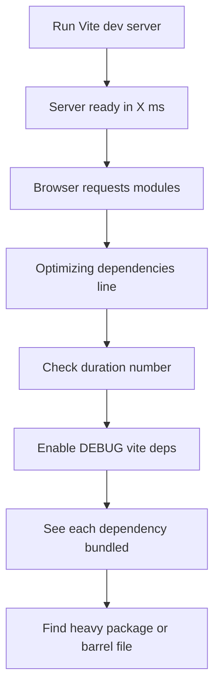

# Reading Vite's Startup Output: What the Coloured Lines Actually Tell You

## English

When you run a Vite dev server, the terminal prints a small block of text: the local URL, the network URL, sometimes a note about the port being in use, and often a line about optimizing dependencies. Most people skim past it. But that output is a diagnostic surface, and learning to read it turns vague 'it feels slow' complaints into specific, actionable facts. Each line corresponds to a phase of startup, and the timing and content of each line tells you where the time went.

The first thing to notice is the distinction between Vite's own startup message and the browser's first request. Vite can print 'ready in X ms' long before your app is usable, because Vite does not eagerly transform your whole source tree. It starts the server, then waits for the browser to request modules. So a fast 'ready' message does not mean your app loads fast; it means the server is listening. The real cost shows up as a flurry of requests once the browser connects, and that cost is dominated by dependency pre-bundling on a cold cache.

Second, watch for the dependency optimization line. On a cold cache, Vite prints something like 'optimizing dependencies' with a count and a duration. That duration is the single most useful number for diagnosing slow first loads. If it is large, the question becomes: which dependencies? Vite's debug output (enabled with a DEBUG environment variable, e.g. DEBUG=vite:deps) lists each dependency as it is discovered and bundled, so you can see whether one heavy package is responsible or whether the count itself is the problem. A large count often means a barrel file (an index file that re-exports everything) is pulling in hundreds of modules that you never actually use.

Third, pay attention to messages about the cache being reused or invalidated. Vite will tell you when it is re-optimizing because the lockfile or config changed, and it will tell you when it found a valid cache and skipped the work. If you see re-optimization on every start despite not changing dependencies, that is a signal: something in your setup is making the cache key unstable, perhaps a config file that computes a timestamp, or a plugin that mutates resolve options non-deterministically. Catching that early saves hours.

Finally, the network URL line is more than trivia. It is the address other devices on your LAN can use to reach the dev server, which matters for testing on a phone or a tablet. If that line is missing, the server is bound to localhost only, and you will waste time wondering why your phone cannot connect. Similarly, a port-in-use message tells you Vite has shifted to the next available port, which matters if you have hard-coded a backend proxy target pointing at the original port. Treat the startup block as a short status report from a machine that is telling you exactly what it did.

## 中文

當你執行 Vite 開發伺服器時，終端機會印出一小段文字：本機 URL、網路 URL、有時會有一行提示連線埠被佔用，還常常有一行關於最佳化依賴的訊息。大多數人會直接略過。但那段輸出其實是一個診斷介面，學會讀它，就能把模糊的「感覺很慢」變成具體、可據以行動的事實。每一行都對應啟動過程的某個階段，而每一行的時機與內容，都在告訴你時間花在哪裡。

首先要留意的是 Vite 自己的啟動訊息與瀏覽器第一次請求之間的差別。Vite 可以在你的應用真正可用之前很久就印出「ready in X ms」，因為它不會積極地一次轉換你整棵原始碼樹。它先把伺服器啟動起來，然後等瀏覽器來請求模組。所以「ready」很快，不代表你的應用載入很快；它只代表伺服器已在監聽。真正的成本會在瀏覽器連上後、一連串請求湧現時才顯現，而這個成本在冷快取時主要由依賴預先打包所支配。

第二，注意依賴最佳化那一行。在冷快取時，Vite 會印出類似「optimizing dependencies」並附上數量與耗時。那個耗時是診斷首次載入緩慢最有用的單一數字。如果它很大，下一個問題就是：哪些依賴？Vite 的除錯輸出（透過 DEBUG 環境變數開啟，例如 DEBUG=vite:deps）會在每個依賴被發現與打包時列出它，讓你能看出是某個笨重的套件造成的，還是數量本身就是問題。數量很大，通常意味著某個 barrel file（把所有東西再匯出的 index 檔）拉進了數百個你根本沒用到的模組。

第三，留意關於快取被重用或失效的訊息。當 lockfile 或設定變更而需要重新最佳化時，Vite 會告訴你；當它找到有效快取、跳過工作時，也會告訴你。如果你明明沒改依賴，卻每次啟動都看到重新最佳化，那就是一個訊號：你的設定裡有東西讓快取鍵不穩定，也許是某個設定檔會算出時間戳，或某個外掛以非決定性的方式改動瞭解析選項。及早抓到這點，可以省下好幾小時。

最後，網路 URL 那一行不只是冷知識。那是同一區域網路上其他裝置可以用來連到開發伺服器的位址，對用手機或平板測試很重要。如果那一行不見了，代表伺服器只繫結在 localhost，你會白白花時間納悶手機為何連不上。同樣地，連線埠被佔用的訊息告訴你 Vite 已改用下一個可用連線埠，如果你把後端代理目標寫死指向原本的連線埠，這點就很重要。把啟動區塊當成機器給你的簡短狀態報告——它正鉅細靡遺地告訴你它做了什麼。

## Key Takeaway

The dev server's startup text is a phase-by-phase status report; learning to read the dependency-optimization timing and cache messages turns vague slowness into a specific diagnosis.

## Related Concepts
- Dependency pre-bundling
- Debug logging with DEBUG

## Diagram

