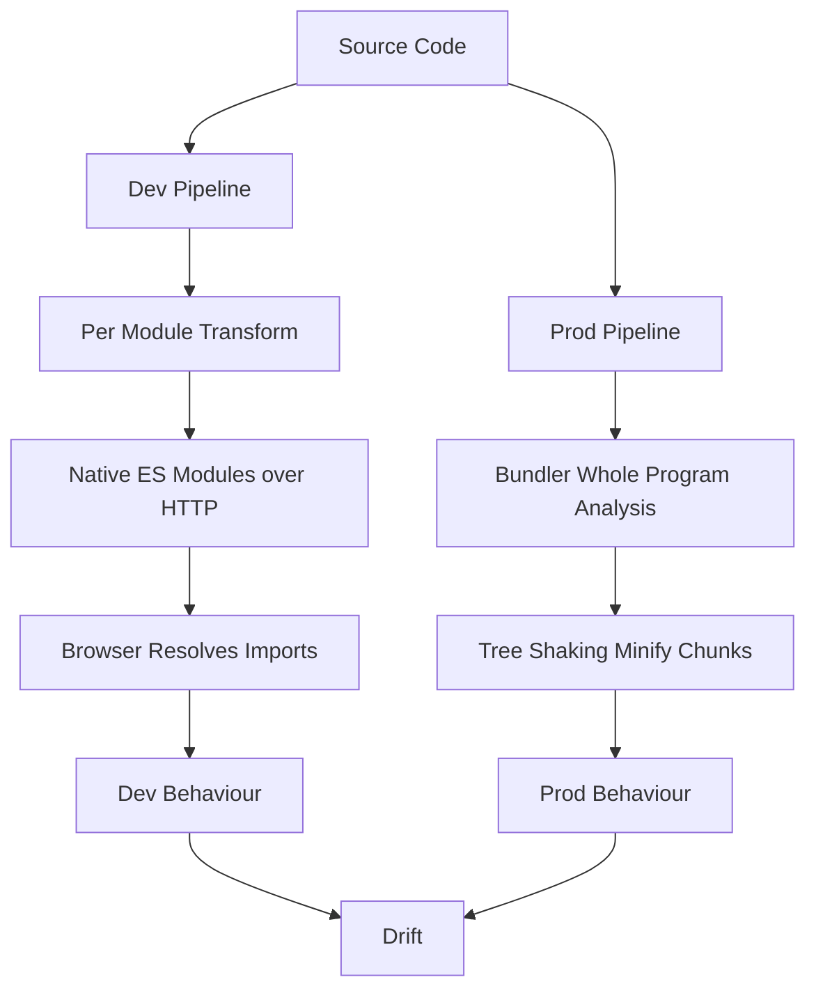

# Why Vite's Dev Output Is Not Your Deployed Output: A Mental Checklist for Drift

## English

A recurring surprise in Vite projects is that something works perfectly in development and breaks in production, or vice versa. The root cause is structural, not a bug: development and production are produced by two different pipelines. In development, Vite transforms each module individually, serves it as native ES modules over HTTP, and relies on the browser to resolve imports. In production, Vite hands your code to a bundler (Rollup historically, Rolldown in newer versions) that performs whole-program analysis: tree-shaking, scope hoisting, chunk splitting, minification, and constant folding. Each of these transformations can change behaviour in ways that only appear when the whole graph is visible.

The most common drift is tree-shaking removing something that had a side effect. A module that, on import, registers itself somewhere (a polyfill, a custom element definition, a global event listener) may be dropped in production if the bundler decides the import is unused. In development, the module is still fetched and executed because the browser follows the import literally. The fix is usually to make the side effect explicit, either by importing for effect and ensuring the bundler knows, or by configuring the package's sideEffects field correctly. This is a packaging concern, not a Vite-specific quirk, but Vite is where you notice it.

Another drift source is conditional code that depends on environment. Code guarded by import.meta.env.PROD or import.meta.env.DEV is statically replaced at build time, so the dead branch is removed entirely in production. That is usually desirable, but it means a code path you tested in dev may never run in prod, and a code path that only exists in prod may never have been exercised. Similarly, import.meta.env values are inlined as literals, so anything that depends on runtime configuration (a value injected by a server, a feature flag read at startup) must not be baked in this way.

CSS ordering is a subtler drift. In development, styles are injected as modules are loaded, so the order follows request order. In production, CSS is extracted into files and the order follows chunk boundaries and import graph structure. A rule that won a specificity tie in dev by being loaded later may lose in prod because a different chunk was emitted first. This is why visual regressions that only appear in the built app are often CSS-order bugs, not layout bugs.

A practical checklist: after any significant change, run a production build locally and click through the app, do not rely on dev alone. Pay special attention to anything that runs on import, anything behind an environment flag, and anything whose styling depends on load order. If a library misbehaves only in production, suspect tree-shaking and side effects first. Treating dev and prod as two different programs that happen to share source is the mental shift that prevents most of these surprises.

## 中文

Vite 專案裡反覆出現的意外，是某個東西在開發時完美運作、在生產環境卻壞掉，或反過來。根本原因是結構性的，不是 bug：開發與生產是由兩條不同的管線產生的。開發時，Vite 逐一模組轉換，以原生 ES 模組透過 HTTP 提供，並依賴瀏覽器去解析 import。生產時，Vite 把你的程式碼交給打包器（歷史上用 Rollup，較新版本用 Rolldown），由它做全程式分析：tree-shaking、scope hoisting、chunk 拆分、壓縮，以及常數摺疊。這些轉換每一個都可能以「只有看到整張圖時才會顯現」的方式改變行為。

最常見的偏差是 tree-shaking 移除了帶有副作用的東西。一個在 import 時會自我註冊的模組（polyfill、custom element 定義、全域事件監聽器），如果打包器判定該 import 未被使用，在生產環境就可能被丟掉。開發時，該模組仍會被下載並執行，因為瀏覽器是照字面跟著 import 走。修正方式通常是讓副作用變得明確：要嘛以「只為副作用而 import」的方式確保打包器知情，要嘛正確設定套件的 sideEffects 欄位。這是封裝層面的問題，不是 Vite 特有的怪癖，但 Vite 是你發現它的地方。

另一個偏差來源是依環境而定的條件程式碼。由 import.meta.env.PROD 或 import.meta.env.DEV 守衛的程式碼，會在建置時被靜態替換，所以死分支在生產環境會被整個移除。這通常是好事，但也意味著你在 dev 測過的某條路徑在 prod 永遠不會跑，而只存在於 prod 的路徑可能從未被實際執行過。同樣地，import.meta.env 的值是以字面量內嵌的，所以任何依賴執行期設定的東西（伺服器注入的值、啟動時讀取的功能旗標）都不該這樣被烤進去。

CSS 順序是更細微的偏差。開發時，樣式隨著模組載入而注入，所以順序跟著請求順序走。生產時，CSS 被抽取成檔案，順序跟著 chunk 邊界與 import 圖結構走。一條在 dev 因為較晚載入而在優先級平手時勝出的規則，在 prod 可能因為另一個 chunk 先被輸出而落敗。這就是為何只在建置版才出現的視覺退化，往往是 CSS 順序的 bug，而不是版面 bug。

一份實用清單：任何重大變更之後，在本機跑一次生產建置並實際點過整個應用，不要只靠 dev。特別留意任何在 import 時就執行的東西、任何藏在環境旗標後面的東西，以及任何樣式依賴載入順序的東西。如果某個函式庫只在生產環境出問題，先懷疑 tree-shaking 與副作用。把 dev 與 prod 當成兩個剛好共用原始碼的不同程式，就是能擋掉大部分這類意外的思維轉換。

## Key Takeaway

Development and production are two different programs produced by two different pipelines, so anything relying on import side effects, environment flags, or CSS load order must be verified against a real production build.

## Related Concepts
- Tree-shaking and side effects
- import.meta.env static replacement

## Diagram

