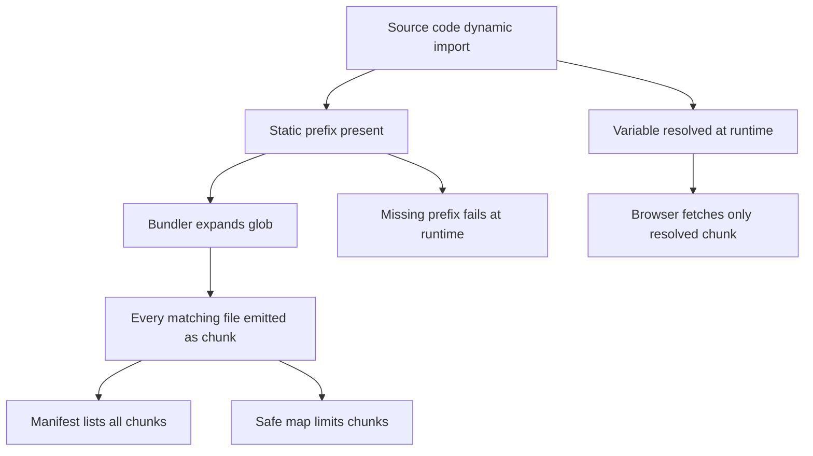

# Dynamic Import Variables and the Limits of a Static Bundler

## English

A plain dynamic import like `import('./pages/Home.js')` is easy for Vite: the string is a literal, so the module graph can record an edge and the build can emit a separate chunk. But the moment you write `import(`./pages/${name}.js`)` — a template literal with a variable inside — you have asked a static analyser to solve a problem it cannot solve in general. Vite's answer is a documented compromise: the import must contain at least some static text (a directory prefix or a file extension) so the bundler knows where to look, and then it expands the pattern into a glob over the filesystem. Every file matching `./pages/*.js` becomes a potential target, each one gets its own chunk in production, and at runtime the browser fetches only the one the variable actually resolved to.

The practical consequence is that the glob is greedy. If your `pages` folder holds forty files, the build produces forty chunks even if the app only ever navigates to three of them. Those chunks are not downloaded eagerly, so the user is not paying bandwidth for them — but they are emitted, hashed, listed in the manifest, and shipped to your server. A typo in the static prefix is worse: `import(`./Pages/${name}.js`)` with a capital P matches nothing, and the failure surfaces at runtime as a rejected promise rather than at build time as an error.

A second trap is that the variable is not analysed for values. Vite cannot know that `name` is always one of `home`, `about`, or `contact`, so it cannot warn you that `import(`./pages/${name}.js`)` will 404 when someone passes `settings`. The safe pattern is to keep a small explicit map — an object literal whose values are literal dynamic imports — and look the name up in it. That map is fully static, so the bundler sees exactly the three chunks you meant, and a missing key becomes a clean `undefined` you can handle instead of a network failure.

Finally, remember that this is a bundler constraint, not a Vite quirk. Rolldown (the Rust-based bundler that ships with Vite 8 — Vite 7 and earlier used Rollup), webpack, and esbuild all impose some version of the same rule, because tree-shaking and chunk emission both require knowing the set of modules before the code runs. Vite's documentation is unusually explicit about the allowed syntax, which is a kindness: the error messages in this area are often terse, so knowing the rule in advance saves an afternoon of confusion.

## 中文

一個普通的動態 import，例如 `import('./pages/Home.js')`，對 Vite 來說很簡單：字串是字面量，所以模組圖可以記錄一條邊，建置時也可以輸出一個獨立的 chunk。但當你寫成 `import(`./pages/${name}.js`)`——模板字串裡夾著變數——你就等於要求一個靜態分析器去解一道它原則上解不了的題。Vite 的答案是文檔裡明寫的折衷方案：import 裡必須至少包含一些靜態文字（目錄前綴或副檔名），好讓打包器知道去哪裡找；然後它會把這個模式展開成對檔案系統的 glob。所有符合 `./pages/*.js` 的檔案都成為潛在目標，每一個在生產建置裡都有自己的 chunk，而執行時瀏覽器只會下載變數實際解析到的那一個。

實際後果是這個 glob 很貪心。如果你的 `pages` 資料夾有四十個檔案，建置就會產出四十個 chunk，即使應用程式只會導航到其中三個。這些 chunk 不會被預先下載，所以使用者不會為它們付出頻寬——但它們會被輸出、被雜湊、被列進 manifest，然後送到你的伺服器上。更糟的是靜態前綴打錯字：`import(`./Pages/${name}.js`)` 把 P 寫成大寫，結果什麼都匹配不到，而這個錯誤要到執行時才以 rejected promise 的形式浮現，而不是在建置時報錯。

第二個陷阱是變數的值完全不被分析。Vite 不可能知道 `name` 永遠只會是 `home`、`about` 或 `contact`，所以它無法警告你：當有人傳入 `settings` 時，`import(`./pages/${name}.js`)` 會回 404。安全的做法是保留一個小小的顯式對照表——一個物件字面量，其值是字面量的動態 import——再用名稱去查表。這個表完全靜態，所以打包器看到的正好是你想要的那三個 chunk，而缺少某個 key 時會變成一個乾淨的 `undefined` 讓你自己處理，而不是一次網路失敗。

最後要記住，這是打包器的限制，不是 Vite 的怪癖。Rolldown（Vite 8 採用的 Rust 打包器；Vite 7 及之前用的是 Rollup）、webpack、esbuild 都施加某種版本的同一條規則，因為 tree-shaking 與 chunk 輸出都需要在程式執行之前就知道模組集合。Vite 的文檔對允許的語法寫得異常清楚，這是一種體貼：這一帶的錯誤訊息往往很簡短，事先知道規則可以省下一個下午的困惑。

## Key Takeaway

Variable dynamic imports work only when Vite can see a static prefix to glob against, and the glob is greedy — prefer an explicit map of literal imports when the set of targets is small and known.

## Related Concepts
- Static Analysis Limits
- Module Graph in Production

## Diagram

