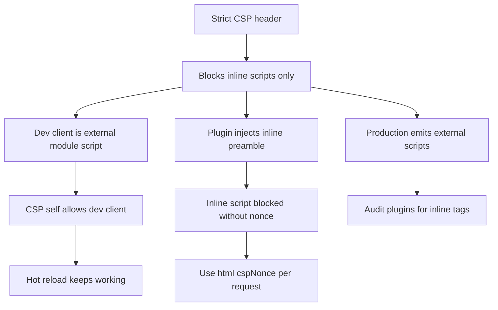

# Content Security Policy and Vite's Inline Scripts

## English

A Content Security Policy (CSP) is an HTTP header — or a `<meta>` tag — that tells the browser which sources of script, style, image, and so on it is willing to execute. A strict policy typically forbids `unsafe-inline`, which means any `<script>` whose body is written directly into the HTML rather than loaded from a URL will be blocked. Production builds are usually friendly here: Vite emits external `<script type="module" src="/assets/index-abc123.js">` tags by default, which a `script-src 'self'` policy accepts happily. Drop a strict CSP onto a Vite app without thinking and you will usually see a blank page and a console full of refusals.

The interesting case is development, and the first thing to get right is where the dev client actually lives. Vite's dev server injects the HMR and error-overlay client as an *external* module script — a `<script type="module" src="/@vite/client">` tag prepended to the document head — not as inline script text. Because it is served from the dev server's own origin, `script-src 'self'` allows it, and hot reloading keeps working under a strict policy. It is easy to assume otherwise because the tag is added to your `index.html` at request time, but "injected" and "inline" are different things: a script tag with a `src` attribute is external no matter who wrote it.

Where inline code does appear in development is in plugins. Framework integrations such as `@vitejs/plugin-react` inject a small inline preamble script that installs the React Refresh runtime before your modules load, and if that inline script is blocked the app still renders but you get the notorious "can't detect preamble" error and no fast refresh. Vite's own answer to this is the `html.cspNonce` option: set it to a placeholder value and Vite adds a `nonce` attribute to every `<script>` and `<style>` tag it generates, plus a `<meta property="csp-nonce">` tag so your server can read the value and put the matching `nonce-...` into the response header. The placeholder must be replaced with a fresh value per request by your server — a static nonce is not a nonce.

Production is generally friendlier, but two features can reintroduce inline code: the `build.assetsInlineLimit` option, which base64-encodes small assets into the bundle (fine, since that is still inside an external script), and any plugin that injects inline scripts or inline `<style>` blocks into the HTML. If you need a strict CSP, audit the final `dist/index.html` rather than assuming the default behaviour holds.

There is a further wrinkle: `import.meta.env` values that get substituted by `define` end up as literals inside your JavaScript, which is harmless for CSP but relevant if you are trying to keep secrets out of the bundle. And if you use a nonce-based policy, note that a nonce-based CSP and static hosting are in tension — if the same HTML is served from a cache, the cached nonce will not match the freshly generated one. None of this is insurmountable, but it is the kind of thing that is far cheaper to plan for at the start of a project than to retrofit after a security review.

## 中文

內容安全政策（CSP）是一個 HTTP 標頭——或一個 `<meta>` 標籤——告訴瀏覽器它願意執行哪些來源的 script、style、image 等等。嚴格的政策通常會禁止 `unsafe-inline`，意思是任何直接寫在 HTML 裡、而非從 URL 載入的 `<script>` 都會被封鎖。生產環境通常比較友善：Vite 預設輸出外部的 `<script type="module" src="/assets/index-abc123.js">` 標籤，`script-src 'self'` 政策會欣然接受。在沒有想清楚的情況下，把嚴格 CSP 套到 Vite 應用上，你會看到一片空白頁和滿是拒絕訊息的 console。

開發階段最值得弄清楚的是：dev client 到底住在哪裡。Vite 的開發伺服器是以*外部* module script 的形式注入 HMR 與錯誤覆蓋層 client 的——它在文件 head 前插入一個 `<script type="module" src="/@vite/client">` 標籤，而不是一段 inline script 文字。既然它是由開發伺服器自己的 origin 提供，`script-src 'self'` 就會放行，熱更新在嚴格政策下照樣運作。這點很容易被誤解成相反的情況，因為那個標籤確實是在請求時被加進你的 `index.html`；但「被注入」和「inline」是兩回事——帶有 `src` 屬性的 script 標籤，不論是誰寫的，都算外部資源。

開發階段真正出現 inline 程式碼的地方是外掛。像是 `@vitejs/plugin-react` 這類框架整合會注入一小段 inline preamble script，用來在你的模組載入之前安裝 React Refresh runtime；如果那段 inline script 被封鎖，應用仍然會渲染，但你就會看到有名的「can't detect preamble」錯誤，而且沒有 fast refresh。Vite 自己對應的做法是 `html.cspNonce` 選項：設定一個 placeholder 值，Vite 就會為它生成的每一個 `<script>` 和 `<style>` 標籤加上 `nonce` 屬性，並附上一個 `<meta property="csp-nonce">` 標籤，讓你的伺服器可以讀到該值，並把對應的 `nonce-...` 放進回應標頭。這個 placeholder 必須由伺服器每次請求換成新的值——固定的 nonce 就不是 nonce。

生產環境通常比較友善，但有兩個功能可能重新引入 inline 程式碼：`build.assetsInlineLimit` 選項，它會把小型資源以 base64 編碼進 bundle（這沒問題，因為它仍然在外部的 script 裡），以及任何往 HTML 注入 inline script 或 inline `<style>` 區塊的外掛。如果你需要嚴格 CSP，請稽核最終的 `dist/index.html`，而不是假設預設行為一定成立。

還有一個細節：被 `define` 替換掉的 `import.meta.env` 值最後會變成你 JavaScript 裡的字面量，這對 CSP 無害，但如果你想把機密擋在 bundle 之外就值得注意。而如果你採用 nonce 式政策，要注意 nonce 式 CSP 與靜態託管之間存在張力——如果同一份 HTML 是從快取提供的，快取中的 nonce 就對不上新產生的 nonce。這些都不是無法克服的，但這種事在專案開始時就規劃好，遠比在安全審查之後才補救便宜得多。

## Key Takeaway

Vite's dev client is an external module script (`/@vite/client`), so `script-src 'self'` does not block hot reloading — the inline scripts that do trip a strict CSP come from plugins, and `html.cspNonce` is Vite's built-in way to attach a per-request nonce to every tag it generates.

## Related Concepts
- Hot Module Replacement
- Nonce-based Content Security Policy

## Diagram

