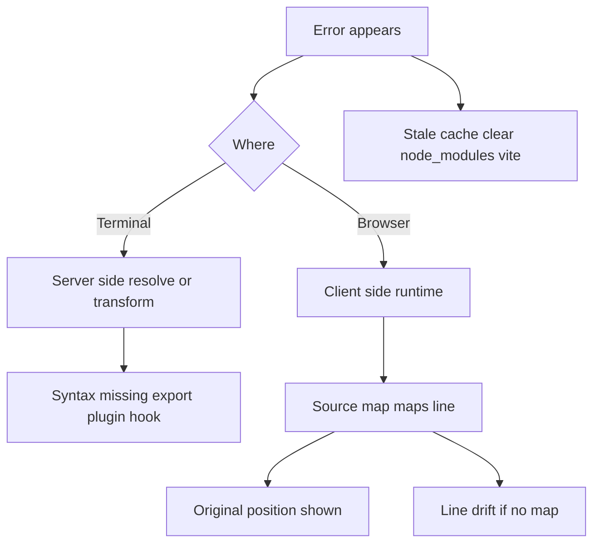

# Reading a Vite Error: Where the Stack Trace Actually Points

## English

When something goes wrong in a Vite project, the error you see is often not the error the browser threw. In development, Vite transforms each module before sending it, so the line numbers in a browser stack trace refer to the transformed file, not the one you wrote. Vite compensates by generating source maps for every transformed module and by shipping a small overlay that catches errors and displays them with the original positions. If you have disabled source maps — or if a plugin produces a transform without a map — the reported line will drift, sometimes by hundreds of lines, because the injected import rewrites and HMR preamble add code above your first statement.

A second class of confusion comes from the timing of the failure. Errors thrown while Vite is resolving or transforming a module happen on the server, in Node, and arrive in the terminal rather than the browser. These are usually syntax errors, missing exports, or a plugin throwing inside a hook, and the message often names the plugin rather than your file. Errors that happen after the module reaches the browser — a `TypeError` on `undefined`, a failed dynamic import — appear in the browser console and in the overlay. Knowing which side of the wire an error lives on is the single most useful debugging skill in Vite, because it tells you whether to look at the terminal or the devtools.

A third pattern is the stale-state error. Because Vite caches pre-bundled dependencies in `node_modules/.vite` and keeps a module graph in memory, a change that confuses the graph — renaming a file, editing a config, switching a branch that changes dependency versions — can produce errors that reference files that no longer exist. The classic remedy is to stop the server, delete the cache directory, and restart. This is not superstition; it is the correct response to a cache that is now describing a world that no longer exists.

Finally, pay attention to the difference between a build error and a dev error. A production build runs the same source through Rolldown — the Rust-based bundler that Vite 8 ships with, replacing the Rollup-based pipeline of Vite 7 and earlier — which is stricter about certain things: it will complain about unresolved imports that the dev server tolerated, and it will fail on circular dependencies that merely produced odd runtime behaviour in dev. If `vite dev` works and `vite build` fails, the message is usually accurate and points at a real problem that the dev server was papering over.

## 中文

當 Vite 專案出錯時，你看到的錯誤往往不是瀏覽器真正拋出的那個。在開發階段，Vite 會先把每個模組轉換再送出，所以瀏覽器堆疊追蹤裡的行號指向的是轉換後的檔案，而不是你寫的那個。Vite 靠為每個轉換後的模組產生 source map，以及附上一個小型的覆蓋層來攔截錯誤並以原始位置顯示，來補償這一點。如果你停用了 source map——或者某個外掛產生的轉換沒有對應的 map——回報的行號就會漂移，有時漂移幾百行，因為注入的 import 改寫與 HMR 前導碼在你的第一條語句上方加進了程式碼。

第二類混淆來自失敗發生的時機。在 Vite 解析或轉換模組時拋出的錯誤發生在伺服器端、在 Node 裡，會出現在終端機而不是瀏覽器。這些通常是語法錯誤、缺少匯出，或某個外掛在 hook 裡拋錯，訊息往往點名的是外掛而不是你的檔案。模組抵達瀏覽器之後才發生的錯誤——對 `undefined` 取屬性的 `TypeError`、失敗的動態 import——則出現在瀏覽器 console 與覆蓋層。知道一個錯誤落在連線的哪一側，是 Vite 除錯最有用的單一技能，因為它告訴你該去看終端機還是 devtools。

第三種模式是過期狀態造成的錯誤。因為 Vite 把預先打包的依賴快取在 `node_modules/.vite`，並在記憶體裡維護模組圖，某個讓圖混亂的變更——重新命名檔案、改設定、切到一個改變依賴版本的分支——可能產生引用已不存在檔案的錯誤。經典解法是停掉伺服器、刪掉快取目錄、重新啟動。這不是迷信；這是對一個正在描述已不存在之世界的快取的正確反應。

最後，注意建置錯誤與開發錯誤的差別。生產建置會把同一份原始碼交給 Rolldown——Vite 8 採用的 Rust 打包器，取代了 Vite 7 及之前的 Rollup 流程——它對某些事更嚴格：它會抱怨開發伺服器容忍的未解析 import，也會在開發階段只造成奇怪執行行為的循環依賴上直接失敗。如果 `vite dev` 能跑而 `vite build` 失敗，訊息通常是準確的，指向一個開發伺服器一直在遮掩的真實問題。

## Key Takeaway

Diagnose Vite errors first by asking whether they occurred server-side during transform or client-side at runtime, and remember that a stale dep cache can make the graph describe files that no longer exist.

## Related Concepts
- Source Maps in Vite
- Vite's Caching Layers

## Diagram

