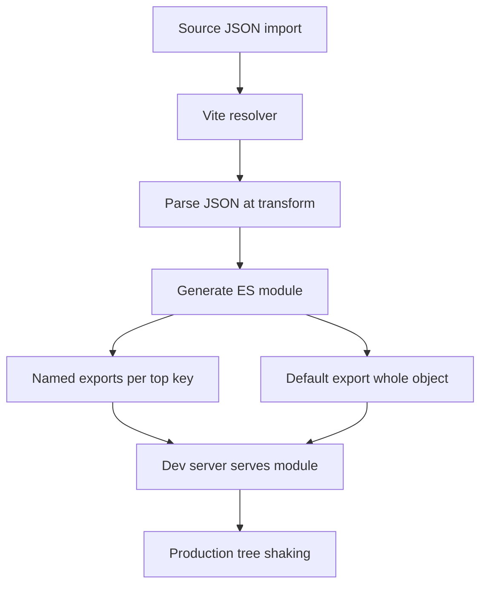

# JSON Imports and Named Exports: What Vite Does to a Data File

## English

When you write `import data from './config.json'`, you might assume the browser just reads the file and hands you an object. In a Vite dev server that is roughly true, because the JSON is served as a JavaScript module. But the interesting part is what happens to the shape of that import. Vite's JSON handling supports named imports, so `import { name } from './package-meta.json'` works even though JSON itself has no notion of exports — the plugin parses the JSON and generates a small ES module that re-exports each top-level key. This is a convenience with a sharp edge: if the JSON file is large, the generated module still contains the whole object in memory, and only the bundler's tree-shaking in production can drop the parts you did not use.

The second thing to know is that JSON imports are statically analysed. Vite must parse the file at transform time, which means the import is resolved the same way as any other module — through the resolver, honouring aliases and extensions. A dynamic path like `import('./data/' + name + '.json')` falls into the dynamic-import-variable territory, where Vite has to guess a glob and may pull in files you did not intend. The practical rule is simple: keep JSON imports literal and small, and treat a giant JSON file as a build-time data source rather than a runtime module.

There is also a subtlety about the `assert { type: 'json' }` (now `with { type: 'json' }`) import attribute syntax. Native browsers require it for JSON modules; Vite's transform strips or normalises this so the same source works in dev and in the bundle. If you are targeting a runtime that enforces the attribute strictly, check that the emitted code keeps it — this is one of those small places where dev and prod can drift.

Finally, consider what JSON imports mean for caching. In dev, the file is a module in the module graph, so editing it triggers an HMR update to any importer that accepted it. In production, the JSON is inlined into the chunk that imports it, so changing one number in a config file can change the hash of a whole chunk. If you have data that changes often but code that does not, loading it with `fetch` at runtime instead of importing it keeps your long-term caching intact.

A useful mental model: importing JSON is a compile-time decision to bake data into your JavaScript. That is great for small, stable constants and awkward for anything that looks like content.

## 中文

當你寫 `import data from './config.json'` 時，你可能以為瀏覽器只是讀取檔案然後交回一個物件。在 Vite 開發伺服器裡這大致成立，因為 JSON 是以 JavaScript 模組的形式提供。但真正有趣的是那個 import 的形狀會變成怎樣。Vite 的 JSON 處理支援具名匯入（named import），所以即使 JSON 本身沒有「匯出」的概念，`import { name } from './package-meta.json'` 仍然可用——外掛會解析 JSON，並產生一個小型 ES 模組，把每個頂層鍵重新匯出。這是方便的設計，但邊緣鋒利：如果 JSON 檔案很大，產生的模組仍然把整個物件留在記憶體中，只有生產建置時打包器的 tree-shaking 才能丟掉你沒用到的部分。

第二點要留意的是，JSON 匯入是靜態分析的。Vite 必須在轉換階段解析檔案，意思是這個 import 會像其他模組一樣經過解析器（resolver），遵循別名與副檔名規則。像 `import('./data/' + name + '.json')` 這種動態路徑就落入「動態匯入變數」的範疇，Vite 要猜一個 glob，可能把你不想要的檔案都拉進來。實務守則是：JSON 匯入保持字面值、保持細小；巨大的 JSON 檔案應視為建置期的資料來源，而不是執行期的模組。

還有一個細節關於 `assert { type: 'json' }`（現在是 `with { type: 'json' }`）這種匯入屬性（import attribute）語法。原生瀏覽器對 JSON 模組要求這個屬性；Vite 的轉換會把它剝掉或正規化，令同一份原始碼在開發與打包後都行得通。如果你目標的執行環境嚴格要求這個屬性，就要檢查輸出的程式碼有否保留它——這正是開發與生產可能出現偏差的細微位置之一。

最後，想想 JSON 匯入對快取的意義。開發時，檔案是模組圖（module graph）中的一個模組，改動它會觸發 HMR 更新給接受它的匯入者。生產時，JSON 被內聯到匯入它的 chunk 裡，所以改一個設定檔中的數字，可能改變整個 chunk 的雜湊值。如果你有經常變動的資料但程式碼不變，用執行期的 `fetch` 載入而非 import，就能保住長期快取。

一個有用的心智模型：匯入 JSON 是一個編譯期的決定，把資料烘焙進你的 JavaScript。這對細小穩定的常數很好，對任何像「內容」的東西就很尷尬。

## Key Takeaway

Importing JSON bakes data into your module at transform time, so keep it small and literal, and prefer runtime fetch for content that changes often.

## Related Concepts
- Static Asset Handling and the public Directory
- Dynamic Import Variables and the Limits of a Static Bundler

## Diagram

