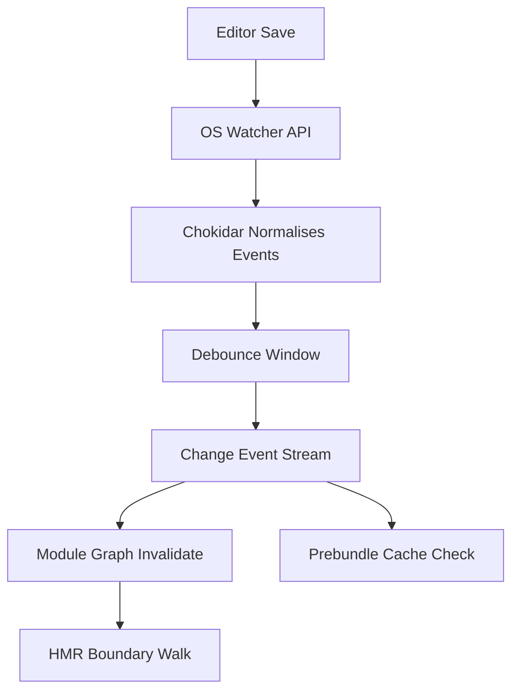

# The Dev Server's File Watcher: Chokidar, Debouncing, and Why One Save Can Fire Twice

## English

Vite's hot updates feel instantaneous, but behind them sits a file watcher — historically the Chokidar library, which wraps OS-level notification APIs like inotify on Linux, FSEvents on macOS, and ReadDirectoryChangesW on Windows. These APIs are not uniform: some report a single event for a save, some report a rename-then-create pair, and some editors write to a temporary file and then move it into place. Vite normalises these into a stream of change events that feed the module graph, which is how it decides which modules to invalidate and which HMR boundaries to walk.

Because editors save in different ways, Vite applies debouncing and a small delay before acting on changes. Without this, a single Ctrl+S in an editor that writes three times would trigger three rebuilds. You may have noticed that occasionally a save seems to fire the update twice, or that a change appears not to register until you touch the file again — both are artefacts of how the underlying watcher reports events and how the debounce window lines up with the editor's write pattern.

There is also the question of what gets watched. Watching every file under `node_modules` would exhaust file descriptors on large projects, so Vite ignores it by default and instead watches your source tree plus the files it knows about. If you depend on a linked package (via `npm link` or a workspace), changes inside that package may not be seen until you tell Vite to watch it. This is a common source of the frustrating 'my local library change is not reflected' problem, and the fix is usually to add the path to the server's watch options rather than to restart blindly.

The watcher also interacts with the dependency pre-bundling cache. When a lockfile changes, Vite knows the dependency tree may have shifted and re-runs optimisation. When only source files change, it just invalidates the affected modules. Separating these two signals is part of why Vite can stay responsive on a project with hundreds of dependencies.

A practical takeaway: when hot reload misbehaves, do not assume the HMR logic is broken. Check whether the file is actually being watched, whether the editor is writing atomically, and whether the change is inside an ignored directory. The watcher is the sensor; HMR is the nervous system; a bad sensor produces symptoms that look like a bad nervous system.

## 中文

Vite 的熱更新感覺是即時的，但背後其實有一個檔案監察器（file watcher）——歷史上用的是 Chokidar 這個函式庫，它包裝了作業系統層級的通知 API，例如 Linux 的 inotify、macOS 的 FSEvents、Windows 的 ReadDirectoryChangesW。這些 API 並不統一：有些對一次儲存只報告一個事件，有些報告「改名再建立」的一對事件，有些編輯器則先寫入暫存檔再搬過去。Vite 把這些正規化成一股變更事件流，餵給模組圖，從而決定要讓哪些模組失效、要走過哪些 HMR 邊界。

因為編輯器儲存方式各異，Vite 會在處理變更前做去抖（debounce）並加一點延遲。沒有這層，一個會寫三次的編輯器裡按一次 Ctrl+S 就會觸發三次重建。你可能偶爾見到一次儲存好像觸發了兩次更新，或者改動好像要再碰一下檔案才生效——兩者都是底層監察器如何報告事件、以及去抖窗口如何對上編輯器寫入模式的產物。

還有「監察什麼」的問題。監察 `node_modules` 下每個檔案會在大專案中耗盡檔案描述符，所以 Vite 預設忽略它，改為監察你的原始碼樹以及它已知的檔案。如果你依賴一個連結套件（透過 `npm link` 或 workspace），該套件內的改動可能不被看見，直到你叫 Vite 去監察它。這是「我本機改的函式庫沒反映」這個惱人問題的常見成因，解法通常是把那條路徑加入伺服器的 watch 選項，而不是盲目重啟。

監察器亦與依賴預打包快取互動。當 lockfile 改變，Vite 知道依賴樹可能移位，會重跑優化。當只有原始碼改變，它只讓受影響的模組失效。把這兩個訊號分開，是 Vite 在數百個依賴的專案上仍能保持靈敏的原因之一。

實務心得：當熱重載出問題，不要假設 HMR 邏輯壞了。先檢查檔案是否真的被監察、編輯器是否原子式寫入、改動是否在忽略的目錄內。監察器是感測器，HMR 是神經系統；感測器壞了，症狀看起來就像神經系統壞了。

## Key Takeaway

Hot reload problems are often file-watcher problems — check what is being watched and how your editor writes before blaming HMR.

## Related Concepts
- The Dev Server's WebSocket Channel: How Vite Talks to the Browser
- The Module Graph: How Vite Decides What to Invalidate

## Diagram

