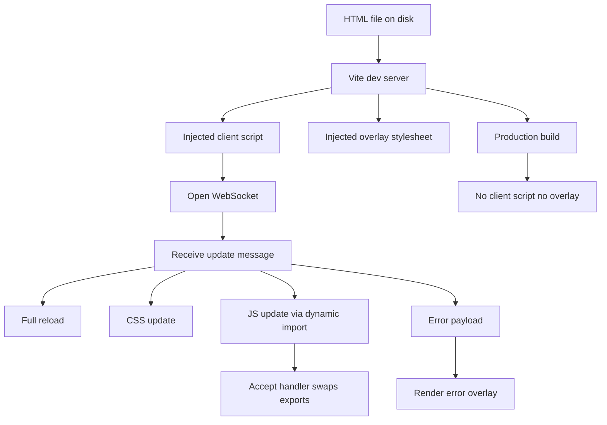

# The Client Script Injected Into Your HTML: What Vite Adds and Why

## English

Open your page in a browser during development and view the HTML source. It will not match the file on disk. Vite has injected a small `<script type="module">` pointing at a client entry, and often a stylesheet link for the error overlay. That injected script is the counterpart to the WebSocket channel: it opens the connection, listens for update messages, and performs the actual module swapping in the browser. Understanding what it does explains several behaviours that otherwise look like magic.

First, the client script is what makes HMR work at all. It receives messages describing which module changed and what kind of update it is (a full reload, a CSS-only update, or a JavaScript update with an accepted boundary). For a JavaScript update it uses the browser's native dynamic `import()` with a cache-busting query string to fetch the new version, then hands it to the module's accept handler. The old module instance is not replaced in place — the handler decides what to do with the new exports, which is why frameworks provide their own HMR plugins that know how to re-render a component.

Second, the client script is responsible for the error overlay you see when a transform fails. When the server cannot compile a file, it sends an error payload over the socket, and the client renders a full-screen overlay with the message and a stack. This is why a syntax error in one file can cover the whole page even though the rest of the app is fine — the overlay is a deliberate interruption, not a crash.

Third, the injection is conditional. In a production build there is no WebSocket, no overlay, and no client script; the HTML is emitted with only your real entry and the assets it references. That difference is one of the reasons dev and prod output can diverge, and it is why you should never rely on the injected script being present. If you serve your built files behind a strict Content Security Policy, the dev-time inline script would violate it — another reminder that the dev server is a development convenience, not a deployment target.

Finally, the client script also handles reconnection. If the dev server restarts — say, because you edited the config file — the socket drops and the client attempts to reconnect, then triggers a full page reload once it succeeds. That automatic reload after a config change is the client script doing its job, not a bug.

## 中文

開發時在瀏覽器打開頁面並檢視 HTML 原始碼，它不會跟磁碟上的檔案一致。Vite 注入了一段細小的 `<script type="module">` 指向一個客戶端入口，通常還有一條錯誤覆蓋層的樣式表連結。那段注入的腳本就是 WebSocket 通道的對應物：它開啟連線、監聽更新訊息，並在瀏覽器中執行真正的模組替換。理解它做了什麼，就能解釋幾個原本看似魔法的行為。

第一，客戶端腳本就是讓 HMR 得以運作的東西。它接收訊息，描述哪個模組改變了、是哪種更新（整頁重載、只更新 CSS、還是有接受邊界的 JavaScript 更新）。對於 JavaScript 更新，它用瀏覽器原生的動態 `import()` 加上破解快取的查詢字串去抓新版本，然後交給該模組的 accept 處理器。舊的模組實例不會被原地替換——處理器決定如何處理新的匯出，這就是為什麼各框架要提供自己的 HMR 外掛，因為它們才知道如何重新渲染一個元件。

第二，客戶端腳本負責你在轉換失敗時看到的錯誤覆蓋層。當伺服器無法編譯某個檔案，它會透過 socket 送出錯誤負載，客戶端就渲染一個全螢幕覆蓋層，附上訊息與堆疊。這就是為什麼一個檔案的語法錯誤可以蓋住整頁，即使應用其餘部分完好——覆蓋層是刻意的打斷，不是當機。

第三，注入是有條件的。生產建置中沒有 WebSocket、沒有覆蓋層、沒有客戶端腳本；輸出的 HTML 只有你真正的入口和它引用的資源。這個差異是開發與生產輸出可能出現偏差的原因之一，也是你不應依賴注入腳本存在的原因。如果你在嚴格的內容安全政策（CSP）後提供建置後的檔案，開發期的內聯腳本會違反它——再次提醒：開發伺服器是開發便利，不是部署目標。

最後，客戶端腳本也處理重連。如果開發伺服器重啟——例如你改了設定檔——socket 會斷開，客戶端會嘗試重連，成功後觸發整頁重載。設定變更後的自動重載是客戶端腳本在履行職責，不是臭蟲。

## Key Takeaway

The injected client script is the browser half of HMR — it owns the socket, the module swap, and the error overlay, and it exists only in development.

## Related Concepts
- The Dev Server's WebSocket Channel: How Vite Talks to the Browser
- Content Security Policy and Vite's Inline Scripts

## Diagram

