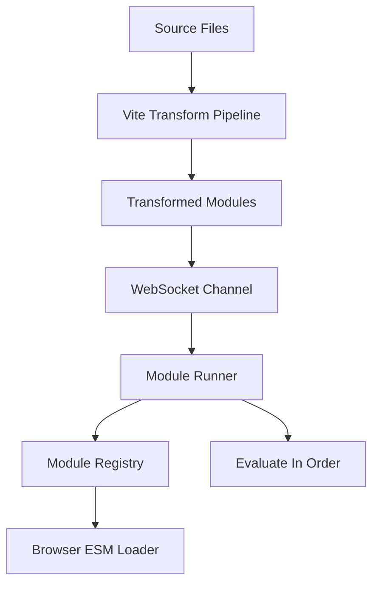

# Vite's Module Runner: How Transformed Code Actually Executes in the Browser

## English

When you write an import statement, the browser's native ESM loader is what fetches and links modules in development. But Vite cannot hand your raw source file straight to the browser — it must first rewrite bare specifiers like `import _ from 'lodash'` into a URL the browser can resolve, inject HMR bookkeeping, and transform TypeScript or JSX. The piece that performs this is often called the module runner: the small client script Vite injects into your HTML that receives transformed modules over the WebSocket channel and evaluates them in the right order. In older Vite versions this was a script called `/@vite/client` working together with the browser's native import mechanism; in newer versions the runner can execute modules itself, which is what makes non-browser environments (like SSR or tests) possible using the same transform output.

A useful analogy is a restaurant kitchen. The browser is the dining room and can only accept plated dishes. Vite's transform pipeline is the kitchen that turns raw ingredients (your `.ts`, `.vue`, `.jsx` files) into plated output. The module runner is the waiter who carries each plate to the right table and remembers which table already got which dish, so nothing is delivered twice and nothing is skipped. Without that waiter, the dining room would have to walk into the kitchen and cook for itself — which is exactly what happens in a traditional bundler, but not in Vite.

What does the runner actually track? It keeps a registry of module IDs (the resolved absolute paths Vite has assigned) mapped to their evaluated exports. When module A imports module B, the runner ensures B is fetched, transformed, and evaluated before A's body runs. Circular imports are handled by returning a partially-populated module object — the same semantics native ESM uses, so behaviour stays consistent with production. The runner also owns the HMR update cycle: when the file watcher reports a change, the server pushes an update message over the socket, the runner invalidates the affected module and re-executes it and its accepted parents.

Because the runner controls execution, it can do things the browser alone cannot. It can pause evaluation, report a proper stack trace pointing at your original source line (thanks to source maps), and support HMR boundaries that the browser's native loader has no concept of. It also means the same transformed module can run inside Node.js — which is how Vite's SSR pipeline and Vitest reuse the same transform output without a second build step. The runner is the seam that makes that reuse possible.

Practically, this explains a few everyday observations. If you see a stack trace with `__vite_ssr_import__` or `createHotContext` in it, you are looking at the runner's bookkeeping, not a bug in your code. If you disable JavaScript in the browser, Vite's dev server renders nothing — because the runner is JavaScript. And if you inspect the network tab, you will see each module fetched individually, each with a query string like `?t=1699...` appended by Vite to bust the browser cache on HMR updates. Understanding the runner turns those mysterious URLs into a coherent picture.

## 中文

當你寫下一個 import 語句時，在開發環境中真正負責抓取與連結模組的，是瀏覽器原生的 ESM 載入器。但 Vite 不能把你原始的原始碼直接交給瀏覽器——它必須先把 `import _ from 'lodash'` 這類裸識別符（bare specifier）改寫成瀏覽器能解析的 URL、注入 HMR 的記帳邏輯，並轉換 TypeScript 或 JSX。執行這件事的元件通常稱為 module runner（模組執行器）：它是 Vite 注入到你 HTML 裡的一小段客戶端腳本，透過 WebSocket 通道接收已轉換的模組，並依照正確順序求值。在較舊的 Vite 版本中，這是名為 `/@vite/client` 的腳本，配合瀏覽器原生 import 機制運作；在較新的版本中，執行器本身就能執行模組，這也是為什麼 SSR 或測試等非瀏覽器環境可以重複使用同一份轉換輸出。

可以用餐廳廚房來類比。瀏覽器是餐廳外場，只能接受擺好盤的菜。Vite 的轉換管線是廚房，把生食材（你的 `.ts`、`.vue`、`.jsx` 檔）變成擺盤完成的成品。module runner 則是服務生，負責把每一盤菜送到正確的桌號，並記住哪一桌已經上過哪道菜，既不重複上菜也不漏單。沒有這位服務生，外場就得自己走進廚房動手煮——這正是傳統打包器的做法，而 Vite 不是。

執行器實際追蹤什麼？它維護一份模組 ID（Vite 指派的已解析絕對路徑）到已求值 exports 的登記表。當模組 A 匯入模組 B，執行器會確保 B 先被抓取、轉換、求值完畢，A 的本體才開始執行。循環匯入則透過回傳一個只填了一半的模組物件來處理——這與原生 ESM 的語意相同，因此行為與生產環境保持一致。執行器同時掌管 HMR 更新週期：檔案監看器回報變更時，伺服器透過 socket 推送更新訊息，執行器讓受影響的模組失效，並重新執行它以及接受它更新的父模組。

因為執行器掌控了執行，它能做到瀏覽器單獨做不到的事。它可以暫停求值、回報正確指向你原始碼行號的堆疊追蹤（靠 source map），並支援瀏覽器原生載入器根本沒有概念的 HMR 邊界。這也意味著同一份轉換後的模組可以在 Node.js 裡執行——Vite 的 SSR 管線與 Vitest 就是這樣重複使用同一份轉換輸出，不必再跑一次建置。執行器正是讓這種重用得以成立的接縫。

實務上，這解釋了幾個日常現象。如果你在堆疊追蹤裡看到 `__vite_ssr_import__` 或 `createHotContext`，你看到的是執行器的記帳痕跡，不是你程式碼的 bug。如果你在瀏覽器停用 JavaScript，Vite 開發伺服器什麼都渲染不出來——因為執行器就是 JavaScript。而如果你打開網路面板，會看到每個模組被單獨抓取，每個都帶著像 `?t=1699...` 的查詢字串，那是 Vite 為了在 HMR 更新時突破瀏覽器快取而附加的。理解執行器，就能把這些神祕的 URL 串成一幅連貫的圖像。

## Key Takeaway

The module runner is the injected client script that evaluates transformed modules in dependency order, owns HMR invalidation, and is what makes Vite's transform output reusable in Node.js for SSR and tests.

## Related Concepts
- Hot Module Replacement
- Native ES Modules

## Diagram

