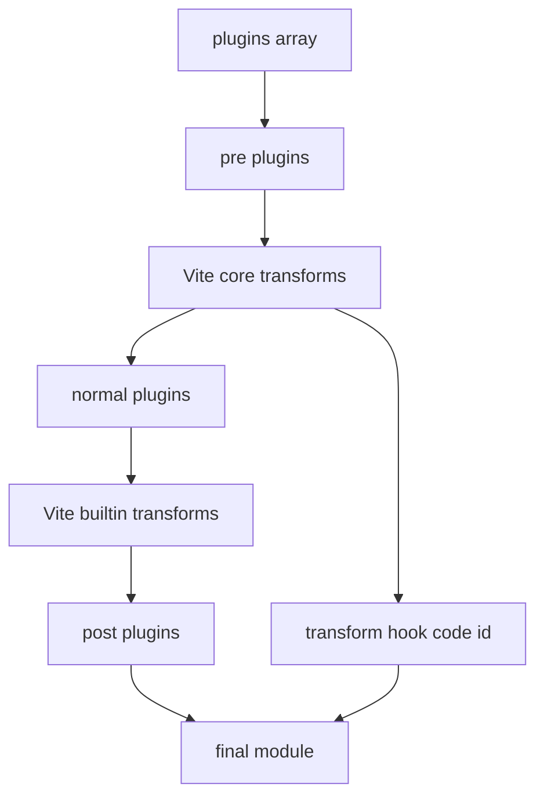

# The Transform Pipeline Order: Why Plugin Enforce and Order Matter

## English

A Vite plugin is not a single function — it is an object with hooks like `transform`, `resolveId`, `load`, and `configureServer`. When multiple plugins define the same hook, the order in which they run is not alphabetical or random; it is governed by a `enforce` field (`'pre'`, `'post'`, or omitted) plus the array order in your `plugins` list. Getting this wrong is one of the most common causes of "works in dev, breaks in build" bugs, because the dev server and the build pipeline can invoke the same plugins in slightly different contexts.

Think of the pipeline as an assembly line where each station adds a layer of paint. A `'pre'` plugin runs before Vite's core transforms — this is where you would put something that must see the raw file exactly as written, such as a custom macro preprocessor that replaces `__DEV__` tokens before TypeScript strips types. A normal plugin runs alongside Vite's built-in transforms, which is where most framework plugins (Vue, React, Svelte) sit. A `'post'` plugin runs after everything else — a good place for minification, banner injection, or analysis that needs to see the final shape of the module. If a `'pre'` plugin tried to consume already-transformed JSX, it would fail; if a `'post'` plugin tried to parse raw TypeScript, it would also fail.

The `transform` hook itself receives `(code, id)` and returns either `null` (meaning "I did not change anything, pass it on") or `{ code, map }`. This contract is what makes chaining possible: each plugin can transform the output of the previous one. A subtle but important detail is that the `map` returned by a plugin is composed with the incoming map, so source maps stay accurate through the whole chain — but only if plugins return proper maps. A plugin that returns a new `code` string without a `map` breaks the chain silently, and your stack traces start pointing at the wrong line.

`resolveId` and `load` are the earlier hooks in the pipeline. `resolveId` answers "what file does this import specifier refer to?" and is where aliases and virtual modules live. `load` answers "what are the bytes of that file?" and is where a plugin can synthesise content that does not exist on disk — for example, a plugin that generates a module from a GraphQL schema. Only if `load` returns `null` does Vite fall back to reading the file from the filesystem. Understanding this order — resolve, load, transform — is the mental model that makes plugin debugging tractable.

A practical debugging technique: Vite has a `--debug` flag (and the `DEBUG=vite:*` environment variable) that prints which plugins ran on which module. When a transform is misbehaving, this log tells you whether your plugin ran at all, and whether it ran before or after the one that broke. The plugin ordering rules are not arbitrary bureaucracy — they are the contract that lets dozens of independent plugins coexist without stepping on each other.

## 中文

一個 Vite plugin 不是單一函式——它是一個物件，帶有 `transform`、`resolveId`、`load`、`configureServer` 等鉤子（hook）。當多個 plugin 定義同一個鉤子時，執行順序既不是字母序也不是隨機的；它由 `enforce` 欄位（`'pre'`、`'post'` 或省略）加上你在 `plugins` 陣列中的排列順序共同決定。搞錯順序是「開發正常、建置壞掉」這類 bug 最常見的成因之一，因為開發伺服器與建置管線雖然呼叫同一批 plugin，但呼叫的上下文略有不同。

把管線想成一條組裝線，每一站都上一層漆。`'pre'` plugin 在 Vite 核心轉換之前執行——這裡適合放必須看到檔案原始樣貌的東西，例如自訂巨集預處理器，在 TypeScript 剝除型別之前先把 `__DEV__` 這類符號替換掉。一般 plugin 與 Vite 內建轉換並行執行，多數框架 plugin（Vue、React、Svelte）就坐在這一層。`'post'` plugin 在所有東西之後執行——適合放壓縮、注入 banner，或需要看到模組最終樣貌的分析工具。如果一個 `'pre'` plugin 想消費已經轉換過的 JSX，它會失敗；如果一個 `'post'` plugin 想解析原始 TypeScript，它同樣會失敗。

`transform` 鉤子本身接收 `(code, id)`，回傳 `null`（代表「我沒改動，繼續往下傳」）或 `{ code, map }`。這個契約正是鏈式轉換得以成立的原因：每個 plugin 都能轉換前一個 plugin 的輸出。一個微妙但重要的細節是：plugin 回傳的 `map` 會與傳入的 map 合成，因此只要每個 plugin 都回傳正確的 map，source map 在整條鏈上都保持準確。但若某個 plugin 回傳新的 `code` 卻不回傳 `map`，鏈條就會無聲斷裂，你的堆疊追蹤開始指向錯誤的行號。

`resolveId` 與 `load` 是管線中更早的鉤子。`resolveId` 回答「這個 import 識別符指向哪個檔案？」，路徑別名（alias）與虛擬模組就住在這裡。`load` 回答「那個檔案的位元組是什麼？」，plugin 可以在這裡合成磁碟上根本不存在的內容——例如從 GraphQL schema 生成模組的 plugin。只有當 `load` 回傳 `null`，Vite 才回退到從檔案系統讀取該檔。理解這個順序——resolve、load、transform——就是讓 plugin 除錯變得可行的思維模型。

一個實用的除錯技巧：Vite 有 `--debug` 旗標（以及 `DEBUG=vite:*` 環境變數），會印出哪些 plugin 對哪些模組執行過。當某個轉換行為異常時，這份日誌會告訴你你的 plugin 到底有沒有跑、以及它跑在壞掉的那個 plugin 之前還是之後。Plugin 的排序規則不是任意的官僚規定——它是讓數十個獨立 plugin 能共存而不互相踩腳的契約。

## Key Takeaway

Plugin hook order is determined by the enforce field and array position, and the resolve-load-transform sequence is the mental model that makes plugin debugging tractable.

## Related Concepts
- Vite Plugin Ecosystem
- Rolldown Build Pipeline

## Diagram

