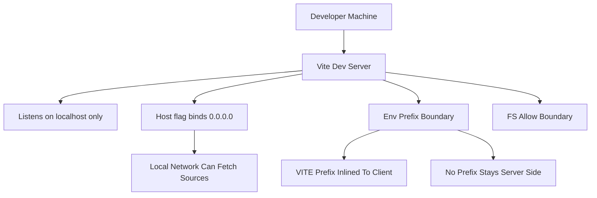

# Security Boundaries in Vite: The Dev Server Is a Local Tool, Not a Public Server

## English

Vite's dev server is designed for one developer on one machine. It serves files from your project root, exposes the whole module graph over HTTP, and by default listens only on localhost. But two things consistently trip people up: binding to `0.0.0.0` (via `--host` or `server.host`) exposes the server to the local network, and older Vite versions had a permissive default that allowed cross-origin requests to the dev server. If you are on a coffee shop Wi-Fi with `--host` enabled, anyone on that network can fetch your source files, your `.env` values that Vite has inlined, and any module your app imports.

The `.env` handling is where the sharpest edge lives. Vite exposes environment variables to client code only if they are prefixed with `VITE_` (configurable via `envPrefix`). Anything without the prefix stays server-side and never reaches the browser. This prefix is a security boundary, not a naming convention: if you rename a secret to start with `VITE_`, you have just published it to every visitor of your app, because Vite inlines those values into the transformed module at build time. The same applies to `define` entries — they are textual substitutions, so `define: { 'process.env.API_KEY': JSON.stringify(secret) }` embeds the secret in your bundle.

A second boundary is the dev server's file-serving scope. By default, Vite restricts filesystem access to the project root and to `node_modules`, and rejects requests that try to escape via `..` paths. The `server.fs.allow` option lets you widen this allowlist — useful in monorepos where packages live outside the root — but every entry you add is a directory whose contents become fetchable over HTTP. Add the narrowest path that works, not the whole workspace. Similarly, `server.fs.deny` (with sensible defaults covering `.env`, `.git`, and certificate files) is the blocklist that stops accidental exposure; do not clear it without understanding what it protects.

A third and often-overlooked boundary is the proxy. When you configure `server.proxy` to forward `/api` to a backend, Vite strips the dev server from the path — but if the backend trusts requests based on origin or cookies, the proxy can quietly forward credentials your browser attached to the dev server. This is fine on localhost; it is not fine when the dev server is exposed. For production, none of this matters because the dev server is not deployed — but the build output inherits whatever `VITE_`-prefixed values were inlined, so the security review should happen before `vite build`, not after.

A practical checklist: run the dev server on localhost unless you specifically need network access; audit every `VITE_`-prefixed variable as if it were public; keep `server.fs.allow` minimal; and never put a secret in `define`. The mental shift is to treat the dev server as a development tool with a trust boundary around it, not as a web server that happens to be running locally.

## 中文

Vite 的開發伺服器是為「一個開發者、一臺機器」設計的。它從你的專案根目錄提供檔案、透過 HTTP 暴露整個模組圖，且預設只監聽 localhost。但有兩件事經常讓人栽跟頭：繫結到 `0.0.0.0`（透過 `--host` 或 `server.host`）會把伺服器暴露到區域網路；而較舊的 Vite 版本在跨來源請求上有較寬鬆的預設值。如果你在咖啡廳 Wi-Fi 上開了 `--host`，同網路的任何人都能抓取你的原始碼、Vite 已內聯的 `.env` 值，以及你應用程式匯入的任何模組。

`.env` 的處理是最鋒利的邊緣。Vite 只有在變數以 `VITE_` 為字首（可用 `envPrefix` 設定）時，才會把環境變數暴露給客戶端程式碼。沒有字首的變數留在伺服器端，永遠不會到達瀏覽器。這個字首是安全邊界，不是命名慣例：如果你把某個機密改名成以 `VITE_` 開頭，你就等於把它發布給應用程式的每一位訪客，因為 Vite 在轉換模組時會把這些值內聯進去。`define` 的條目同理——它們是文字替換，所以 `define: { 'process.env.API_KEY': JSON.stringify(secret) }` 會把機密嵌進你的 bundle。

第二道邊界是開發伺服器的檔案供應範圍。預設情況下，Vite 把檔案系統存取限制在專案根目錄與 `node_modules`，並拒絕試圖用 `..` 路徑逃逸的請求。`server.fs.allow` 選項讓你擴大這份允許清單——在套件位於根目錄之外的 monorepo 中很有用——但你加的每一個條目，都是一個其內容可被 HTTP 抓取的目錄。加入能運作的最窄路徑，而不是整個工作區。同樣地，`server.fs.deny`（有涵蓋 `.env`、`.git` 與憑證檔案的合理預設值）是阻止意外暴露的封鎖清單；不要在沒搞懂它保護什麼的情況下清空它。

第三道常被忽略的邊界是代理。當你設定 `server.proxy` 把 `/api` 轉發到後端時，Vite 會把開發伺服器從路徑中剝除——但如果後端依來源或 cookie 信任請求，代理就可能悄悄轉發瀏覽器附加到開發伺服器上的憑證。這在 localhost 上沒問題；開發伺服器一旦暴露就有問題。對生產環境而言這些都不重要，因為開發伺服器不會被部署——但建置輸出會繼承所有已內聯的 `VITE_` 字首值，所以安全審查應該在 `vite build` 之前進行，而不是之後。

一份實用檢查清單：除非你確實需要網路存取，否則在 localhost 上跑開發伺服器；把每個 `VITE_` 字首變數都當成公開資訊來審查；讓 `server.fs.allow` 保持最小；永遠不要把機密放進 `define`。心態上的轉變是：把開發伺服器視為一個周圍有信任邊界的開發工具，而不是一臺剛好在本地執行的網頁伺服器。

## Key Takeaway

The VITE_ prefix, server.fs.allow, and the --host flag are security boundaries, not conveniences — audit them before exposing the dev server or running vite build.

## Related Concepts
- Environment Variables
- Dev Server Middleware Stack

## Diagram

