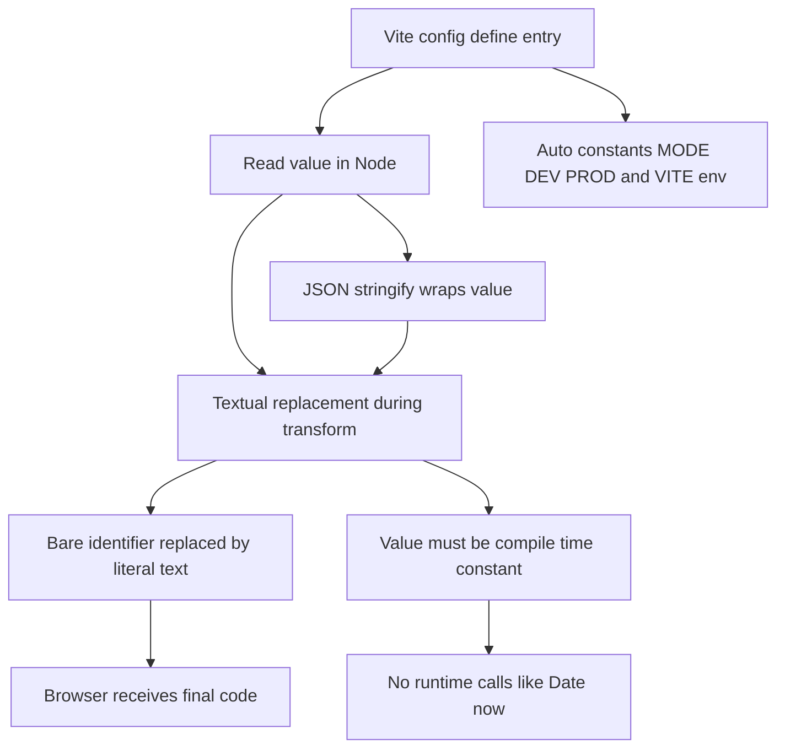

# Vite's Define and Constant Replacement: How a String Swap Becomes a Browser-Safe Value

## English

When you write `define: { __APP_VERSION__: JSON.stringify('1.2.3') }` in your Vite config, you are not creating a variable. You are telling Vite: every time you see the bare identifier `__APP_VERSION__` in my source, replace it with the literal text `"1.2.3"` before the browser ever sees it. This is a plain textual substitution performed during the transform stage, much like a very careful find-and-replace. The reason you must wrap the value in `JSON.stringify` is subtle but important: the config value is spliced into your code as source text, so a raw string like `'1.2.3'` would be inserted without quotes and produce a syntax error. Passing it through `JSON.stringify` gives you the quoted form that is valid JavaScript. The same trick works for numbers, booleans, `null`, and even small object literals.

Because this is a textual replacement rather than a runtime lookup, the substituted value must be a compile-time constant. You cannot put a `Date.now()` call in `define` and expect it to run in the browser; it would run in Node when Vite reads the config, and every user would get the same frozen timestamp. This is the same mental model as C preprocessor macros or Rust's `const` expressions: the value is baked in. It also means the replacement is literal and textual, so if your identifier appears inside a string or a comment, Vite tries to be careful but the safest habit is to use names that cannot collide, like `__BUILD_TIME__` or `import.meta.env.VITE_API_URL`.

Vite automatically defines several constants for you without any config. The most famous is `import.meta.env.MODE`, which is `'development'` in dev and `'production'` in a build, plus `import.meta.env.DEV` and `import.meta.env.PROD`, which are booleans. It also exposes any `.env` variable prefixed with `VITE_` as `import.meta.env.VITE_SOMETHING`. All of these are replaced at transform time, so `if (import.meta.env.DEV) { ... }` does not call a function; it becomes `if (true) { ... }` or `if (false) { ... }`, and the minifier in the production build can then dead-code-eliminate the branch entirely. That is why a `console.log` guarded by `import.meta.env.DEV` disappears from your shipped bundle.

A common gotcha is that `define` replacements happen before other plugins run, and they operate on the token stream of the module. If you write `import.meta.env.VITE_X` and forget the `VITE_` prefix in your `.env` file, Vite will substitute `undefined` silently instead of throwing, and you will spend an afternoon debugging why your API URL is `undefined`. Similarly, if you try to destructure `const { VITE_X } = import.meta.env`, the replacement will not work, because `import.meta.env` as an object is not a runtime object in the browser; it is a placeholder that only survives when accessed with the full dotted path. Treat `import.meta.env` as a set of named constants, not a dictionary.

Finally, remember that `define` is not a security boundary. Anything you put there ends up in the client bundle in plain text, visible to anyone who opens DevTools. It is perfect for feature flags, build timestamps, and public configuration like a CDN base URL. It is catastrophic for API keys, database passwords, or anything else you would not paste into a public GitHub gist. If you need a secret on the client, the correct answer is almost always a backend proxy, not a clever `define` trick.

## 中文

當你在 Vite 設定檔裡寫 `define: { __APP_VERSION__: JSON.stringify('1.2.3') }`，你其實不是在建立一個變數。你是在告訴 Vite：每次在我的原始碼裡看到單獨出現的識別字 `__APP_VERSION__`，就在瀏覽器看到之前，把它換成字面文字 `"1.2.3"`。這是在轉換階段做的純文字替換，很像非常小心的「尋找並取代」。你必須用 `JSON.stringify` 包住值的原因很微妙但重要：設定值是以原始碼文字的形式被插入你的程式碼，所以像 `'1.2.3'` 這樣未加引號的原始字串會被直接塞進去，產生語法錯誤。經過 `JSON.stringify` 之後，你拿到的是帶引號、合法的 JavaScript 形式。同樣的技巧適用於數字、布林值、`null`，甚至小型物件字面量。

因為這是文字替換而不是執行期查詢，被替換的值必須是編譯期常數。你不能在 `define` 裡放 `Date.now()` 然後期待它在瀏覽器裡執行；它會在 Vite 讀取設定時於 Node 裡執行，所有使用者拿到的是同一個凍結的時間戳。這跟 C 的前置處理器巨集或 Rust 的 `const` 運算式是同一種心智模型：值是被烘焙進去的。這也代表替換是字面且文字的，所以如果你的識別字出現在字串或註解裡，Vite 會盡量小心，但最安全的習慣還是使用不會碰撞的名稱，例如 `__BUILD_TIME__` 或 `import.meta.env.VITE_API_URL`。

Vite 會自動替你定義好幾個常數，不需要任何設定。最有名的是 `import.meta.env.MODE`，在開發時是 `'development'`，在建置時是 `'production'`，另外還有 `import.meta.env.DEV` 與 `import.meta.env.PROD` 這兩個布林值。它也會把任何以 `VITE_` 為字首的 `.env` 變數以 `import.meta.env.VITE_SOMETHING` 的形式暴露出來。這些全部在轉換階段就被替換，所以 `if (import.meta.env.DEV) { ... }` 並不是呼叫函式；它會變成 `if (true) { ... }` 或 `if (false) { ... }`，然後生產建置的壓縮器可以把整個分支當作死碼消除。這就是為什麼被 `import.meta.env.DEV` 守護的 `console.log` 會從你出貨的 bundle 裡消失。

常見的陷阱是：`define` 的替換發生在其他外掛執行之前，而且是作用在模組的 token 串流上。如果你寫了 `import.meta.env.VITE_X`，卻在 `.env` 檔裡忘了加 `VITE_` 字首，Vite 會默默替換成 `undefined`，而不是丟出錯誤，你會花一個下午除錯為什麼你的 API URL 是 `undefined`。同樣地，如果你嘗試解構 `const { VITE_X } = import.meta.env`，替換不會生效，因為在瀏覽器裡 `import.meta.env` 並不是執行期物件；它只是個佔位符，只有用完整的點號路徑存取時才會存活。把 `import.meta.env` 當成一組具名常數，而不是一個字典。

最後，請記住 `define` 不是安全邊界。你放進去的任何東西都會以純文字形式出現在客戶端 bundle 裡，任何開啟 DevTools 的人都看得到。它非常適合功能旗標、建置時間戳，以及像 CDN base URL 這種公開設定。它對 API 金鑰、資料庫密碼，或任何你不會貼到公開 GitHub gist 的東西來說則是災難。如果你需要在客戶端放秘密，正確答案幾乎永遠是後端代理，而不是某個聰明的 `define` 技巧。

## Key Takeaway

Vite's define and import.meta.env are compile-time text substitutions, not runtime variables, so they can be dead-code-eliminated but can never hold secrets.

## Related Concepts
- Dead code elimination
- Environment variables

## Diagram

