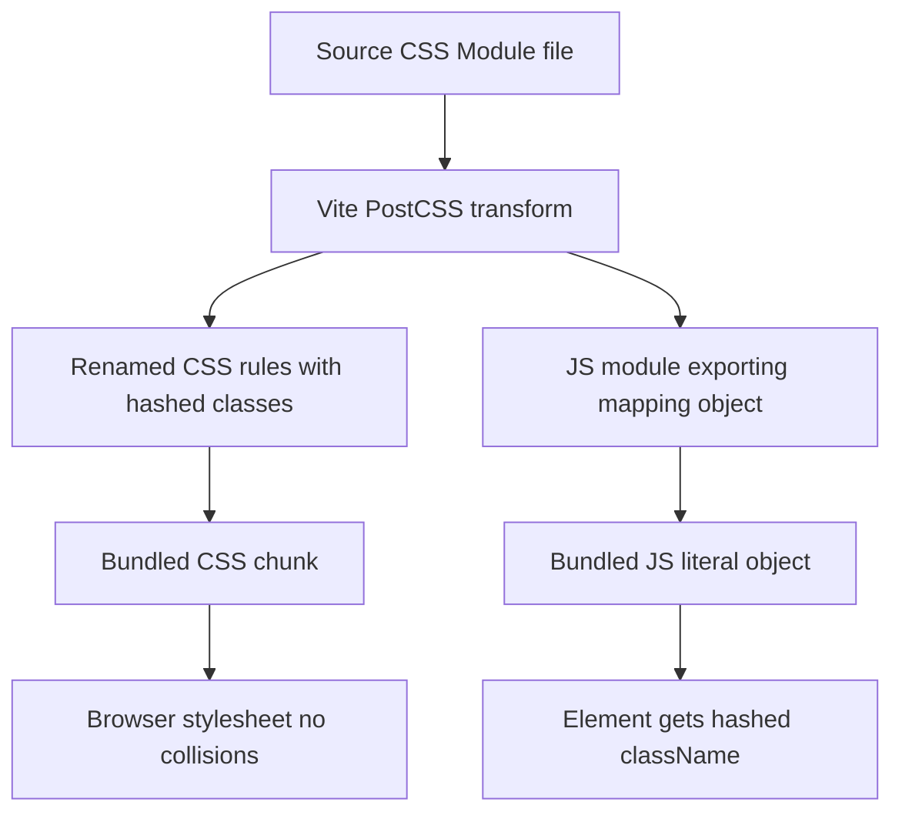

# The CSS Modules Contract: How Hashing Your Class Names Prevents Style Leaks

## English

Plain CSS is a global namespace. If two components both define `.button { padding: 8px; }`, whichever stylesheet loads last wins, and you have a bug that depends on import order. CSS Modules solve this by rewriting every class name at build time into a unique, hashed identifier. When you write `import styles from './Button.module.css'` and then use `className={styles.primary}`, the `styles` object is a plain JavaScript object whose keys are the original class names and whose values are the generated ones, something like `{ primary: '_primary_1a2b3_7' }`. The CSS file that gets emitted contains `. _primary_1a2b3_7 { ... }`, and the HTML element receives that same string. No other file can accidentally collide, because the hash is derived from the file path and content.

The magic is that this is not a runtime library. There is no `classnames` call or `style-loader` doing lookups in the browser. Vite (using PostCSS under the hood) transforms the CSS file into two artifacts at build time: a CSS chunk containing the renamed rules, and a JavaScript module that exports the mapping object. The mapping is a literal object in the emitted JS, so it can be tree-shaken, minified, and cached like any other code. This is why CSS Modules are considered zero-runtime: the work happens once, at build, and the browser just sees a normal stylesheet and a normal object literal.

The default generated name in Vite is a combination of the file name, a hash of the file path, and the original class name, separated by underscores. You can control this with the `generateScopedName` option in `css.modules` in your Vite config, or by naming the file with a `.module.css` suffix and letting Vite pick up the convention automatically. The hash is based on the file's path relative to the project root, not its content, so renaming a file changes all its class names but editing a rule inside it does not. That is a deliberate choice: it keeps class names stable across rebuilds when only styles change, which helps with caching and with visual diffing tools.

There is a subtle interaction with composition. CSS Modules support `composes: primary from './base.module.css'`, which lets one class inherit the rules of another across files. Vite handles this by following the composition graph at build time and emitting the combined rules into the importing file's CSS chunk. This is powerful but has a caveat: composed classes must be resolvable statically, so you cannot compose from a URL or a dynamic path. If you find yourself needing that, the right tool is probably a CSS custom property or a utility class, not `composes`.

A frequent source of confusion is that CSS Modules only rename class selectors, not element selectors, IDs, or custom properties. Writing `#root { ... }` inside a `.module.css` file still produces a global `#root` rule, and two such files will fight. Similarly, `:global(.some-class)` is an escape hatch that lets you opt a selector out of the renaming, which is useful for integrating with third-party widgets but easy to overuse. The mental model that keeps you safe: inside a `.module.css` file, treat every class name as local by default, and use `:global` explicitly and sparingly when you genuinely need to reach outside the module boundary.

## 中文

純 CSS 是全域命名空間。如果兩個元件都定義 `.button { padding: 8px; }`，最後載入的樣式表會勝出，而你得到一個取決於 import 順序的 bug。CSS Modules 的解法是在建置時把每個 class 名稱改寫成唯一、經過雜湊的識別字。當你寫 `import styles from './Button.module.css'`，然後使用 `className={styles.primary}`，`styles` 就是一個普通的 JavaScript 物件，鍵是原始的 class 名稱，值是產生的名稱，大概像 `{ primary: '_primary_1a2b3_7' }`。被輸出的 CSS 檔包含 `._primary_1a2b3_7 { ... }`，而 HTML 元素收到同一個字串。其他檔案不可能意外碰撞，因為雜湊是從檔案路徑與內容推導出來的。

神奇的地方在於這不是執行期函式庫。瀏覽器裡沒有 `classnames` 呼叫，也沒有 `style-loader` 在做查找。Vite（底層用 PostCSS）在建置時把 CSS 檔轉換成兩個產物：一個包含改名後規則的 CSS chunk，以及一個匯出對照物件的 JavaScript 模組。對照表在輸出的 JS 裡是字面物件，所以它可以被 tree-shake、壓縮，並像其他程式碼一樣被快取。這就是為什麼 CSS Modules 被視為零執行期：工作在建置時做一次，瀏覽器只看到普通的樣式表與普通的物件字面量。

Vite 預設產生的名稱是檔名、檔案路徑的雜湊，以及原始 class 名稱的組合，用底線分隔。你可以在 Vite 設定的 `css.modules` 裡用 `generateScopedName` 選項控制它，或用 `.module.css` 副檔名命名檔案，讓 Vite 自動套用慣例。雜湊是基於檔案相對於專案根目錄的路徑，而不是內容，所以重新命名檔案會改變它所有 class 名稱，但編輯檔案內的某條規則不會。這是刻意的選擇：當只有樣式改變時，class 名稱在重建之間保持穩定，這有助於快取與視覺差異工具。

與組合（composition）之間有一個微妙的互動。CSS Modules 支援 `composes: primary from './base.module.css'`，讓某個 class 繼承另一個檔案中 class 的規則。Vite 在建置時追蹤組合圖，並把合併後的規則輸出到匯入檔案的 CSS chunk 裡。這很強大但有個注意事項：被組合的 class 必須能靜態解析，所以你不能從 URL 或動態路徑組合。如果你發現自己需要那樣做，正確的工具大概是 CSS 自訂屬性（custom property）或工具類別（utility class），而不是 `composes`。

常見的困惑來源是 CSS Modules 只重新命名 class 選擇器，不是元素選擇器、ID 或自訂屬性。在 `.module.css` 檔裡寫 `#root { ... }` 仍然會產生全域的 `#root` 規則，兩個這樣的檔案會互相打架。同樣地，`:global(.some-class)` 是逃生口，讓你選擇某個選擇器不參與改名，這在與第三方小工具整合時很有用，但很容易過度使用。讓你保持安全的心智模型是：在 `.module.css` 檔裡，把每個 class 名稱預設視為區域的，只有在你真的需要跨越模組邊界時，才明確且節制地使用 `:global`。

## Key Takeaway

CSS Modules are a build-time rename that turns a global stylesheet into a per-file namespace, with zero runtime cost and a stable hash for caching.

## Related Concepts
- PostCSS
- CSS custom properties

## Diagram

