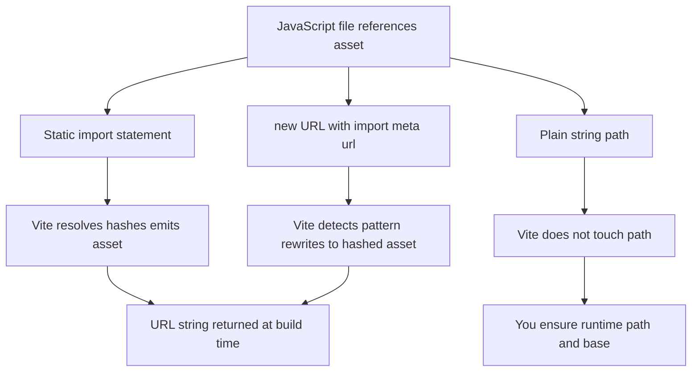

# The Asset URL Contract: Why import.meta.url and new URL() Behave Differently in Vite

## English

There are three different ways to reference a file from JavaScript, and Vite treats each one differently. The first is a static import: `import logo from './logo.svg'`. Vite resolves this at build time, hashes the file, emits it as an asset, and gives you a URL string. The second is a `new URL('./logo.svg', import.meta.url)` expression. Vite recognises this pattern specifically and rewrites it at build time to point at the emitted, hashed asset. The third is a plain string path like `fetch('/assets/logo.svg')`. Vite does not touch this; it is your responsibility to make sure the path is correct at runtime, including under a non-root `base`.

The `new URL(..., import.meta.url)` pattern is special because it is the standard web idiom for resolving a URL relative to the current module. In a browser, `import.meta.url` is the URL of the current module file, so `new URL('./logo.svg', import.meta.url)` returns an absolute URL pointing next to that module. Vite mimics this at build time: it sees the pattern, resolves the relative path, emits the asset with a content hash, and rewrites the expression to `new URL('/assets/logo-abc123.svg', import.meta.url)`. The runtime expression still works because the rewritten path is absolute (or base-aware), and the browser resolves it correctly. This is why the pattern is preferred over string concatenation for assets that need to be referenced from JavaScript.

Static imports are the simplest and most optimised path. They participate in tree-shaking, they get hashed, and they produce a string that you can pass to ``. The downside is that the import must be statically analysable: you cannot do `import(`./logo-${name}.svg`)` and expect it to work, because Vite cannot know which files exist at build time. Dynamic imports with variables are a well-known limitation of any static bundler, and Vite is no exception. The workaround is `import.meta.glob`, which lets you declare a pattern and get back a map of paths to dynamic import functions, but that is a different tool with its own trade-offs.

Plain string paths are the escape hatch, and they are the most common source of bugs when deploying under a subfolder. If your `base` is `/my-app/`, then a hardcoded `/assets/logo.svg` will 404 because the file is actually served at `/my-app/assets/logo.svg`. Vite does not rewrite strings in your JavaScript, because it cannot tell which strings are URLs and which are just text. The correct approach is either to import the asset so Vite can hash and prefix it, or to use `import.meta.env.BASE_URL` to build the path at runtime: `${import.meta.env.BASE_URL}assets/logo.svg`. The latter is a compile-time constant, so it gets substituted and the resulting string is correct in both dev and prod.

A subtlety worth knowing: `public/` files are copied verbatim and are not hashed. Referencing them from JavaScript with a plain string like `/logo.svg` works in dev because Vite serves the `public` directory at the root, but in production the same string must respect `base`. The rule of thumb is: import assets you use in components, put files in `public` only when you need a stable, unhashed URL (like `favicon.ico` or a `robots.txt`), and never mix the two mental models in the same codebase without documenting which is which. When in doubt, import the asset; the bundler will do the right thing.

## 中文

從 JavaScript 引用檔案有三種不同方式，而 Vite 對每一種的處理都不一樣。第一種是靜態 import：`import logo from './logo.svg'`。Vite 在建置時解析它、對檔案做雜湊、把它輸出成資源，並給你一個 URL 字串。第二種是 `new URL('./logo.svg', import.meta.url)` 運算式。Vite 特別辨識這個模式，並在建置時改寫它，指向被輸出、經過雜湊的資源。第三種是像 `fetch('/assets/logo.svg')` 這樣的純字串路徑。Vite 不會動它；確保該路徑在執行期正確（包括在非根目錄的 `base` 之下）是你的責任。

`new URL(..., import.meta.url)` 模式之所以特別，是因為它是相對於目前模組解析 URL 的標準網路慣用語。在瀏覽器裡，`import.meta.url` 是目前模組檔案的 URL，所以 `new URL('./logo.svg', import.meta.url)` 會回傳一個指向該模組旁邊的絕對 URL。Vite 在建置時模仿這個行為：它看到模式、解析相對路徑、以內容雜湊輸出資源，並把運算式改寫成 `new URL('/assets/logo-abc123.svg', import.meta.url)`。執行期運算式仍然有效，因為改寫後的路徑是絕對的（或考慮 base 的），瀏覽器會正確解析它。這就是為什麼對於需要從 JavaScript 引用的資源，這個模式比字串串接更受青睞。

靜態 import 是最簡單也最優化的路徑。它們參與 tree-shaking、會被雜湊，並產生一個你可以傳給 `` 的字串。缺點是 import 必須能被靜態分析：你不能寫 `import(`./logo-${name}.svg`)` 然後期待它運作，因為 Vite 在建置時無法知道哪些檔案存在。帶變數的動態 import 是任何靜態打包器的已知限制，Vite 也不例外。變通方法是 `import.meta.glob`，它讓你宣告一個模式並拿回一個從路徑到動態 import 函式的對照表，但那是另一種工具，有它自己的取捨。

純字串路徑是逃生口，也是部署在子資料夾下時最常見的 bug 來源。如果你的 `base` 是 `/my-app/`，那麼硬編碼的 `/assets/logo.svg` 會 404，因為檔案實際上是在 `/my-app/assets/logo.svg` 提供。Vite 不會改寫你 JavaScript 裡的字串，因為它無法分辨哪些字串是 URL、哪些只是文字。正確做法是要嘛 import 資源讓 Vite 做雜湊與前綴，要嘛在執行期用 `import.meta.env.BASE_URL` 組路徑：`${import.meta.env.BASE_URL}assets/logo.svg`。後者是編譯期常數，所以會被替換，產生的字串在開發與生產都正確。

一個值得知道的微妙之處：`public/` 裡的檔案會原樣複製，不會被雜湊。從 JavaScript 用像 `/logo.svg` 的純字串引用它們，在開發時可行，因為 Vite 在根目錄提供 `public` 目錄，但在生產環境同樣的字串必須尊重 `base`。經驗法則是：元件裡用到的資源就 import，只有在需要穩定、未雜湊 URL 時（例如 `favicon.ico` 或 `robots.txt`）才把檔案放進 `public`，而且不要在沒有記錄哪個是哪個的情況下，在同一個程式庫裡混用兩種心智模型。有疑問時就 import 資源；打包器會做對的事。

## Key Takeaway

Vite hashes and rewrites imported assets and new URL(..., import.meta.url) expressions, but leaves plain string paths untouched, so hardcoded URLs break under a non-root base.

## Related Concepts
- Base path
- Static asset handling

## Diagram

