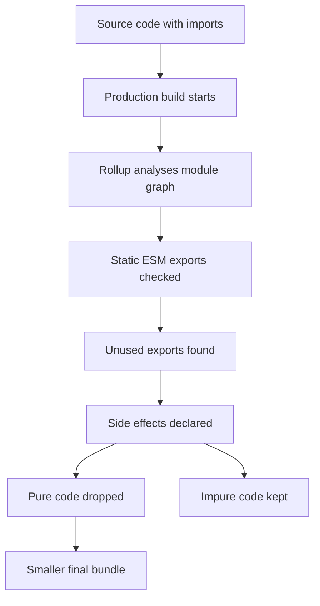

# Tree Shaking in Vite: How Dead Code Gets Removed and Why It Sometimes Doesn't

## English

Tree shaking is the process of removing code that is never used from your final bundle. The name comes from the idea of shaking a tree so that dead leaves fall off. In Vite, tree shaking happens during the production build, because that is the phase where Rollup (or Rolldown in newer versions) analyses the module graph and decides which exports are actually referenced. During development nothing is tree-shaken, since each module is served separately and the browser only loads what it imports anyway.

The mechanism depends on ES module syntax. Static `import` and `export` statements are analysed at build time, so the bundler can prove that an exported binding is never read and drop it. CommonJS `require()` calls cannot be analysed the same way, which is why packages that ship only CommonJS often resist tree shaking. This is one concrete reason the ecosystem moved toward ESM-first packages.

Tree shaking is also conservative by design. If a module has side effects — for example, it patches a global object or registers a custom element at import time — the bundler must keep it even if no export is used. Package authors declare this with the `sideEffects` field in package.json. Setting `"sideEffects": false` tells the bundler that every file is pure and can be dropped if unused; listing specific files marks only those as impure. Getting this wrong in either direction causes either bloated bundles or mysteriously missing behaviour.

A common surprise is that importing a single function from a large library still pulls in the whole library. That happens when the library's entry point re-exports everything from an internal index file that itself has side effects, or when the library is CommonJS. The fix is usually to import from a deep path (if the package supports it) or to choose a package that ships proper ESM with correct `sideEffects` metadata. Vite's build output can be inspected with a bundle visualiser to see exactly which modules survived.

Finally, tree shaking interacts with minification. Removing an unused export is only useful if the remaining code is also compressed; Vite's default production build runs a minifier after bundling. Dead code elimination at the minifier level (removing unreachable branches, constant-folding conditions) is a related but separate pass. Understanding both helps you read a bundle report and know whether the problem is in your imports or in the library's packaging.

## 中文

Tree shaking（搖樹最佳化）是指把最終打包結果中永遠不會被用到的程式碼移除。這個名字來自搖一棵樹，讓枯葉掉下來的意象。在 Vite 裡，tree shaking 發生在生產建置階段，因為那是 Rollup（或較新版本的 Rolldown）分析模組圖、判斷哪些 export 真的被引用到的階段。開發模式下完全不做 tree shaking，因為每個模組都是獨立提供，瀏覽器本來就只會載入它 import 的東西。

這個機制依賴 ES module 語法。靜態的 `import` 與 `export` 語句會在建置期被分析，所以打包器可以證明某個匯出的繫結從未被讀取，進而丟棄它。CommonJS 的 `require()` 呼叫無法用同樣方式分析，這就是為什麼只提供 CommonJS 的套件往往抗拒 tree shaking。這也是生態系逐漸轉向 ESM-first 套件的一個具體原因。

Tree shaking 在設計上也是保守的。如果某個模組有副作用——例如它在 import 時就修改了全域物件，或註冊了 custom element——即使沒有任何 export 被使用，打包器也必須保留它。套件作者會在 package.json 的 `sideEffects` 欄位宣告這件事。設成 `"sideEffects": false` 等於告訴打包器每個檔案都是純的、沒用到就可以丟；列出特定檔案則只把那些標記為不純。這個欄位設錯方向，不是造成打包體積膨脹，就是造成某些行為神秘消失。

常見的意外是：從一個大型函式庫只 import 一個函式，結果整個函式庫還是被拉進來。這通常發生在函式庫的進入點把內部 index 檔的所有東西重新匯出，而那個 index 檔本身有副作用；或者函式庫本身是 CommonJS。解法通常是改從深層路徑 import（如果套件支援），或改用有正確 ESM 與 `sideEffects` 中繼資料的套件。Vite 的建置產物可以用 bundle 視覺化工具檢視，看清楚到底哪些模組存活下來。

最後，tree shaking 與壓縮（minification）會互相影響。移除未使用的 export 只有在剩下的程式碼也被壓縮時才有意義；Vite 預設的生產建置會在打包後執行壓縮器。壓縮器層級的死碼消除（移除不可達分支、常數折疊條件）是相關但獨立的一道工序。兩者都理解，你才有辦法讀懂 bundle 報告，判斷問題出在自己的 import 寫法，還是套件的打包方式。

## Key Takeaway

Tree shaking only works on statically analysable ESM and is blocked by side effects, so correct package.json sideEffects metadata and ESM-first libraries matter more than any build flag.

## Related Concepts
- ES module syntax
- sideEffects field

## Diagram

