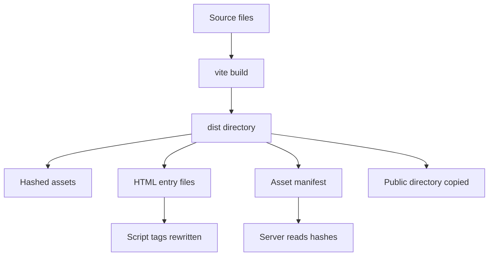

# The Build Output Contract: What Vite Guarantees About the Files It Emits

## English

When you run `vite build`, Vite writes a directory (by default `dist`) and that directory becomes a contract between your source code and whatever serves it. Understanding what is guaranteed to be inside helps you debug deployment problems without guessing. The most visible guarantee is content hashing: files that came from your source get a hash in their name derived from their contents, so a changed file always gets a new URL and a CDN can cache the old one forever.

The second guarantee is the entry graph. Vite starts from `index.html` (or whatever HTML files you configure), treats the `<script type="module">` tags as entry points, and emits a JavaScript file per entry plus shared chunks for code used by more than one entry. It also rewrites the HTML so the script tags point at the hashed output. This means the HTML file itself is not hashed — it is the one thing that must be re-fetched to discover new hashes, which is why HTML is usually served with a short cache lifetime while assets get a long one.

Third, Vite emits an asset manifest when you enable it in the config. The manifest is a JSON file mapping each source file to its output file and its imported CSS. Backends and server-rendering frameworks read this manifest to know which script tag to render. Without it, a server has no reliable way to know the hashed filename of a client entry, because hashes change on every content change.

Fourth, Vite preserves the public directory verbatim. Anything in `public/` is copied to the output root with its name unchanged, which is useful for files that must keep a stable URL (favicons, robots.txt, third-party verification files) but dangerous for anything you want cache-busted. The distinction between `public/` and imported assets is really a distinction about who owns the URL.

Finally, the output is not guaranteed to be byte-identical across machines or versions. Minifier versions, plugin versions, and even the order of files on disk can shift hashes. That is fine for caching, because a new hash just means a new URL, but it means you should not commit `dist` and expect clean diffs. Treat the output directory as a build artefact, not source.

## 中文

當你執行 `vite build`，Vite 會寫出一個目錄（預設是 `dist`），而這個目錄就成為你的原始碼與「負責提供檔案的伺服器」之間的契約。搞清楚裡面保證會有什麼，可以讓你在除錯部署問題時不用靠猜。最明顯的保證是內容雜湊（content hashing）：來自原始碼的檔案，檔名會帶上一段由內容衍生的雜湊，所以檔案一改就一定得到新網址，CDN 則可以把舊的那份永遠快取住。

第二個保證是進入點圖。Vite 從 `index.html`（或你設定的任何 HTML 檔）出發，把 `<script type="module">` 標籤當成進入點，為每個進入點輸出一支 JavaScript 檔，再加上供多個進入點共用的 chunk。它也會改寫 HTML，讓 script 標籤指向雜湊後的產物。這表示 HTML 檔本身不會被雜湊——它是唯一必須重新抓取、才能發現新雜湊的檔案，這也是為什麼 HTML 通常設短快取，而資源檔設長快取。

第三，若在設定中開啟，Vite 會輸出 asset manifest。manifest 是一個 JSON 檔，把每個原始檔對應到它的輸出檔以及它 import 的 CSS。後端與 server-rendering 框架會讀這份 manifest，才知道該渲染哪個 script 標籤。沒有它，伺服器就沒有可靠方式得知某個 client 進入點的雜湊檔名，因為內容一改雜湊就變。

第四，Vite 會原封不動保留 public 目錄。`public/` 裡的任何東西都會以原名複製到輸出根目錄，這對必須維持穩定網址的檔案很有用（favicon、robots.txt、第三方驗證檔），但對任何你想做快取破壞的檔案就很危險。`public/` 與被 import 的資源之間的差別，本質上就是「誰擁有這個網址」的差別。

最後，輸出並不保證跨機器或跨版本位元組完全相同。壓縮器版本、外掛版本、甚至磁碟上檔案的順序都可能讓雜湊改變。對快取來說這無所謂，因為新雜湊只是新網址；但這表示你不該把 `dist` 提交進版控還期待 diff 乾淨。把輸出目錄當成建置產物，而不是原始碼。

## Key Takeaway

The dist directory is a contract: hashed assets for caching, unhashed HTML as the discovery point, an optional manifest for servers, and a verbatim public directory for stable URLs.

## Related Concepts
- Content hashing
- Asset manifest

## Diagram

