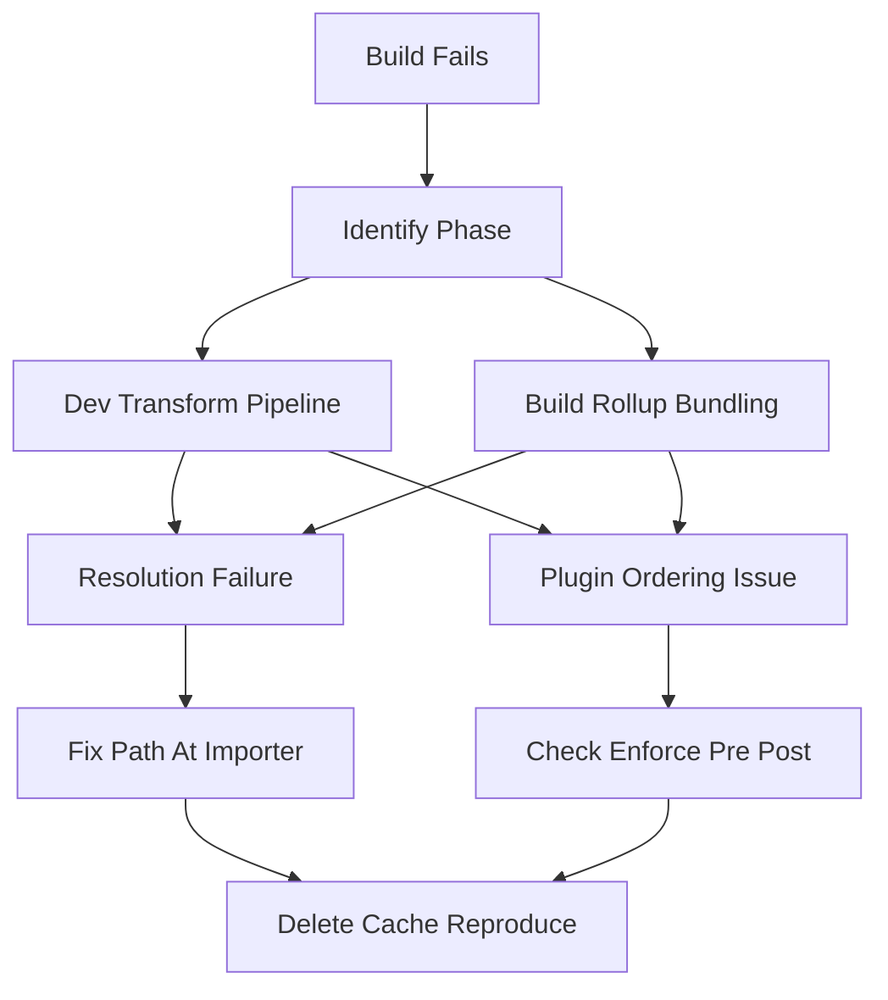

# Debugging a Broken Build: Reading Vite's Errors and Reproducing Them

## English

Most of the time Vite just works, which makes the failures feel mysterious when they happen. The good news is that Vite's error messages are structured: they usually tell you which plugin produced the error, which file and line, and often which transform stage failed. Learning to read that structure turns a scary stack trace into a checklist.

Start by identifying the phase. Errors during `vite dev` come from the transform pipeline: a plugin could not parse a file, an import could not be resolved, or a syntax feature is unsupported for the configured target. Errors during `vite build` come from Rollup's bundling phase: a module was imported but not found, a circular dependency produced an undefined binding, or a plugin's `renderChunk` hook threw. The same source file can pass in dev and fail in build, and knowing which phase you are in narrows the suspects enormously.

The most common category is resolution failure — an import path that Vite cannot map to a file. This happens with case-sensitivity mismatches (works on macOS, fails on Linux CI), missing extensions when `resolve.extensions` does not include them, or packages that rely on Node's resolution rules rather than ESM. Vite's error usually names the importer, which is the key clue: fix the path at the importer, not at the target.

The second common category is a plugin ordering problem. Plugins run in a defined order, and a plugin that transforms `.ts` files must run before a plugin that expects JavaScript. If a plugin declares `enforce: 'pre'` or `enforce: 'post'`, that changes where it sits in the chain. When an error says a file was not transformed as expected, the question is often "which plugin ran first" rather than "which plugin is broken".

To reproduce a build failure reliably, delete the cache directory (`node_modules/.vite`) and rebuild from a clean state, because stale pre-bundled dependencies can mask or cause errors. Then reduce the input: comment out imports until the error disappears, and the last thing you removed is the culprit. If the error only appears in CI, compare Node versions and lockfiles — Vite's behaviour can shift with the Node version and with dependency resolution differences. A reproducible minimal case is worth more than any amount of staring at the original stack trace.

## 中文

大多數時候 Vite 就是能用，所以一旦出錯就顯得神秘。好訊息是 Vite 的錯誤訊息是有結構的：它通常會告訴你是哪個外掛產生的錯誤、哪個檔案哪一行，而且往往會指出是哪個轉換階段失敗。學會讀這個結構，就能把嚇人的堆疊追蹤變成一張檢查清單。

先判斷是哪個階段。`vite dev` 期間的錯誤來自轉換管線：某個外掛解析不了檔案、某個 import 無法解析，或某個語法特性在設定的 target 下不支援。`vite build` 期間的錯誤來自 Rollup 的打包階段：某個模組被 import 但找不到、迴圈依賴造成未定義的繫結，或某個外掛的 `renderChunk` hook 拋錯。同一個原始檔可以在 dev 透過、在 build 失敗，知道自己在哪個階段就能大幅縮小嫌疑範圍。

最常見的一類是解析失敗——某個 import 路徑 Vite 對應不到檔案。這會發生在大小寫不一致（macOS 上沒問題、Linux CI 上失敗）、`resolve.extensions` 沒包含某個副檔名，或套件依賴 Node 的解析規則而非 ESM。Vite 的錯誤通常會指出 importer，那就是關鍵線索：要修的是 importer 那邊的路徑，不是目標檔案。

第二常見的一類是外掛順序問題。外掛會依既定順序執行，負責轉換 `.ts` 的外掛必須排在期待 JavaScript 的外掛之前。如果某個外掛宣告 `enforce: 'pre'` 或 `enforce: 'post'`，就會改變它在鏈上的位置。當錯誤說某個檔案沒有如預期被轉換，問題往往是「哪個外掛先跑」，而不是「哪個外掛壞了」。

要可靠地重現建置失敗，先刪掉快取目錄（`node_modules/.vite`）並從乾淨狀態重建，因為過期的預打包依賴可能掩蓋或引發錯誤。然後縮小輸入：把 import 一一註解掉，直到錯誤消失，最後移除的那一項就是兇手。如果錯誤只在 CI 出現，比較 Node 版本與 lockfile——Vite 的行為會隨 Node 版本與依賴解析差異而改變。一個可重現的最小案例，比盯著原始堆疊追蹤看半天有價值得多。

## Key Takeaway

Identify the phase first (dev transform vs build bundling), then reduce the input to a minimal reproduction — most Vite errors are resolution or plugin-order problems, not Vite itself.

## Related Concepts
- Plugin ordering
- Module resolution

## Diagram

